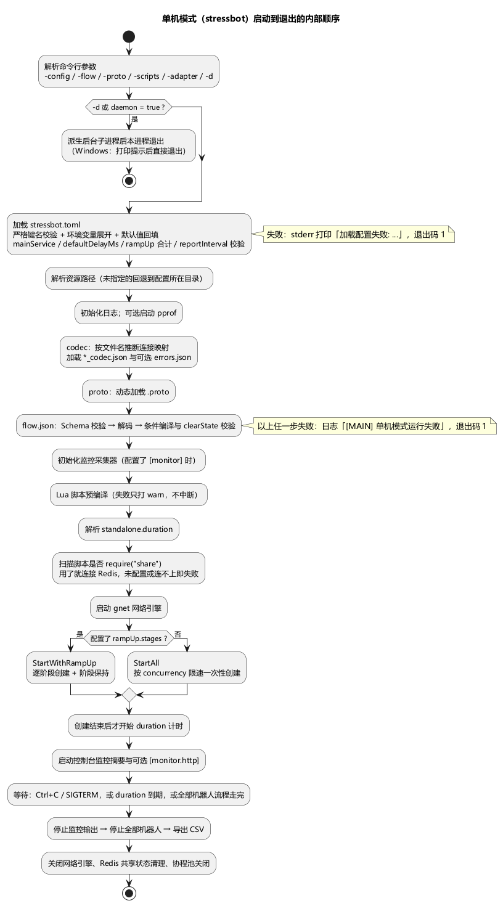
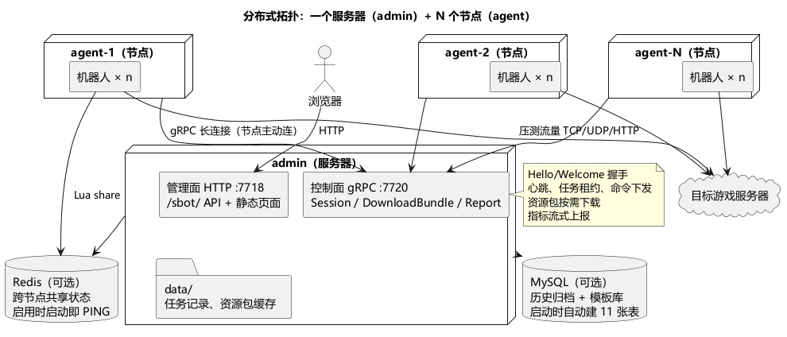

# 第 2 章 架构总览：两种形态、三个二进制

> **目标**：建立全局图景——工具由什么组成、我该用哪种形态、要准备几台机器和哪些依赖。之后每一章都能在这张地图上定位。
>
> **前置**：读过[第 1 章](ch01-quick-start.md)（知道 stressbot 能跑起来）。

## 2.1 两种形态怎么选

| | 单机（standalone） | 分布式（服务器 admin + 节点 agent） |
|---|---|---|
| 进程 | 1 个 `stressbot` | 1 个 `admin` + N 个 `agent` |
| 适合 | 协议调试、流程开发、单台施压机能扛住的规模 | 多台施压机、大规模压测、需要集中管理与历史归档 |
| 外部依赖 | 无（Lua 脚本用共享状态时才要 Redis） | 无硬性依赖；要历史归档/模板库就配 MySQL，脚本用共享状态就配 Redis |
| 操作方式 | 命令行 + 配置文件 | 浏览器管理面（日常）+ 配置文件（部署） |
| 规模上限 | 一台机器的 CPU/内存/带宽 | 加节点机器就加容量（每个节点有 `maxBots` 上限，默认 5000） |

经验值：单台施压机撑不住目标并发（CPU 打满、端口/带宽耗尽）时上分布式。协议与流程开发阶段永远用单机——迭代快、日志都在本地。两种形态跑的是同一套数据面代码（资源加载、机器人、网络层完全共用），单机调通的配置原样拿到分布式用。

## 2.2 三个二进制各自的职责

| 二进制 | 入口 / 默认配置 | 职责 | 监听端口 |
|---|---|---|---|
| `stressbot` | `cmd/stressbot`，`-config conf/stressbot.toml` | 单机模式：加载配置 → 跑机器人 → 本地打印监控、退出时导出 CSV，一个进程全干 | 无必开端口。`[pprof]` 段启用时监听 pprof（默认 6060）；`[monitor.http]` 段启用时监听监控 HTTP（样例配置 6061） |
| `admin` | `cmd/admin`，`-config conf/admin.toml` | 服务器：浏览器管理面（HTTP）、对节点的 gRPC 控制面、任务调度、指标聚合、MySQL 历史归档，并托管前端静态页面 | 管理面默认 `127.0.0.1:7718`（`/sbot/` API 与静态页面）；控制面 gRPC 默认 `127.0.0.1:7720`；可选 pprof |
| `agent` | `cmd/agent`，`-config conf/agent.toml` | 节点机器：主动连上服务器，接收并执行任务，上报指标。**不开放管理界面** | 无必开端口。`[pprof]` 段启用时监听 pprof（样例配置 `conf/agent.toml` 开了 6060），同一端口还挂着 `/metrics` 指标快照（JSON）和 `/debug/*` 调优端点 |

三个二进制都支持 `-config` 和 `-d`（守护进程，Windows 上会提示后直接退出），只有 `stressbot` 多出 `-flow`/`-proto`/`-scripts`/`-adapter` 四个资源路径参数。管理面和控制面默认只监听 `127.0.0.1`，节点在别的机器上时要把 `[controlPlane] listenHost` 改成内网地址，浏览器要远程访问时同理改 `[server] listenHost`。

> 监控 HTTP 端口与 pprof 端口共用同一套路由：开了 `[monitor.http]` 的单机进程，6061 上同样能访问 `/debug/pprof/`；同一进程若也开了 pprof，6060 上也能访问 `/metrics`。单机的 `/metrics` 只在同时满足两件事时才注册：配置了 `[monitor.http]`，并且压测已经开始、监控已启动。不要把这两个端口暴露到公网。

## 2.3 单机模式流水线

第 1 章运行时的内部顺序：

文字版：

1. 解析命令行参数；`-d` 或 `daemon = true` 时转后台；
2. 加载 `stressbot.toml`：严格键名校验、环境变量展开、默认值回填，并校验 `mainService`、`defaultDelayMs`、渐进加压合计、`reportInterval`；
3. 初始化日志，启用了 `[pprof]` 就启动 pprof；
4. 加载资源：声明式 codec（`*_codec.json` + 可选 `errors.json`）→ `.proto` 动态加载 → `flow.json`（Schema 校验 + 条件编译 + clearState 保留键校验）；
5. 初始化监控采集器 → 预编译 Lua 脚本 → 解析 `duration` → 检查脚本是否用了 `share`，用了就连接 Redis；
6. 启动 gnet 网络引擎；
7. 创建机器人：一次性按 `concurrency` 限速创建，或按 `rampUp` 阶段渐进创建；
8. **创建全部结束后**才开始 `duration` 计时、才开始打印控制台监控摘要；
9. 等到 Ctrl+C / SIGTERM、`duration` 到期、或全部机器人流程走完三者之一 → 停止全部机器人 → 导出 CSV → 关闭网络引擎与 Redis 共享状态。

失败处理：第 2、4、5 步里的配置和资源错误都是加载期硬报错，进程以退出码 1 结束（对照表见第 1 章 1.7 节）。有两处例外只打 warn 不中断：缺少 `errors.json`（错误码没有中文描述）和 Lua 脚本预编译失败。

## 2.4 分布式拓扑

要点：

- **节点主动连服务器**（`conf/agent.toml` 的 `[agent] adminAddress`，格式 `host:port`，指向服务器的控制面端口），不是服务器去连节点——施压机只需要出站网络。连接建立时先做 Hello/Welcome 握手，之后在同一条 gRPC 双向流上收发心跳、租约和任务命令。
- **断线重连**：节点断线后按指数退避自动重连，首次等 `[agent.reconnect] initialInterval`（默认 5s），之后逐次增大并带随机抖动，间隔以 `maxInterval`（默认 30s）为上限基准；`reconnectMaxRetries = -1`（或 0）表示无限重试。
- **健康判定**（服务器 `[controlPlane]` 段，默认值）：期望心跳间隔 `heartbeatInterval = 10s`、超过 `unhealthyAfter = 30s` 未心跳标记不健康、任务租约 `leaseDuration = 45s`、超过 `offlineAfter = 60s` 判离线并移出注册表。加载期强制 `heartbeatInterval < unhealthyAfter < offlineAfter` 且 `heartbeatInterval < leaseDuration < offlineAfter`。节点进程重启会被识别（启动时间戳变化）。
- **租约**：节点与服务器失联超过租约时长才取消当前任务；期间节点持续重连，恢复后任务继续。服务器重启后，原来的活跃任务会被置为 `failed`。
- **资源下发**：proto/Lua/codec/flow 等文件在管理面上传，任务启动时打包，节点经控制面下载到本地工作目录（`[agent] taskWorkDir`，留空用系统临时目录），不需要在节点机器上手工摆文件（第 16 章）。
- **同一时刻只有一个活跃任务**（单例约束），任务状态机为 `pending → starting → running → stopping → stopped / failed`。
- **服务器本地数据**：任务记录与资源包缓存保存在服务器工作目录下的 `data/`；MySQL 只承担历史归档和流程/动作/监听模板库。
- **前端页面**：服务器的 `[server] staticDir`（默认 `cmd/web/dist`）指向前端构建产物。前端按 `/stressbot/` 路径构建，具体如何对外提供页面（推荐 nginx 反代）见[第 13 章](ch13-deploy.md)。

## 2.5 依赖决策清单

| 依赖 | 什么时候需要 | 不需要时 |
|---|---|---|
| MySQL | 分布式形态下要历史归档、历史对比、流程/动作/监听模板库时。`admin.toml` 的 `[mysql] host` 非空即启用：服务器启动第一步就连库并自动建 11 张表（无迁移脚本），连不上直接启动失败 | `host` 留空：服务器照常启动，日志提示 `[ADMIN] MySQL 未配置：历史归档模块未启用...`，历史相关接口返回"未启用"。单机形态完全不用 |
| Redis | Lua 脚本用了 `share` 模块（跨机器人/跨节点共享数据、分布式锁、队列）。单机启动时递归扫描脚本目录自动判定；分布式在任务启动时检查，服务器没配 Redis 会拒绝启动用了 share 的任务。服务器配了 Redis 时启动即 PING 验证，连不上启动失败 | 不用 share 就不需要 |
| 目标服务器 | 端到端压测 | 教学示例只做本地动作时不需要 |

## 2.6 验收

回答这三个问题，说明本章达标：

1. 5 万连接、3 台施压机——用哪种形态？准备几台机器、装什么？
   （分布式；3 台跑 `agent`，另 1 台跑 `admin`（不压测、配置可以小一些）；要看历史报表就准备一个 MySQL，脚本用了 `share` 再准备 Redis。每个节点 `maxBots` 默认 5000，5 万连接需要按机器能力调大）
2. 只想在本地调试一个新游戏的协议和流程——用哪种形态？为什么？
   （单机：零依赖、迭代快、日志都在本地）
3. agent 进程要不要对公网开端口？
   （不要：它只主动出站连 admin 的 7720；本机 pprof 6060 仅供排障，勿暴露公网）

## 延伸阅读

- 内部实现细节：[docs/architecture.md](../docs/architecture.md)、[docs/distributed-architecture.md](../docs/distributed-architecture.md)
- 部署成常驻服务：[第 13 章 部署实操](ch13-deploy.md)
- 下一章：[第 3 章 核心概念](ch03-core-concepts.md)
