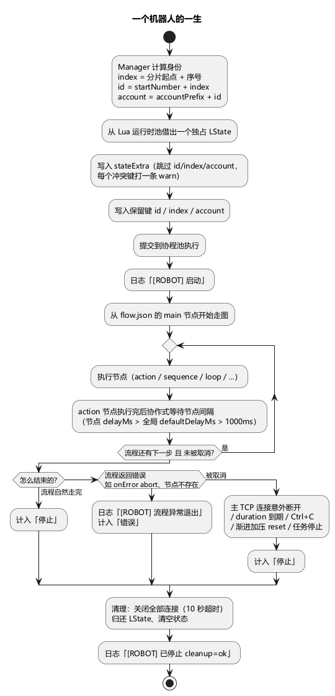
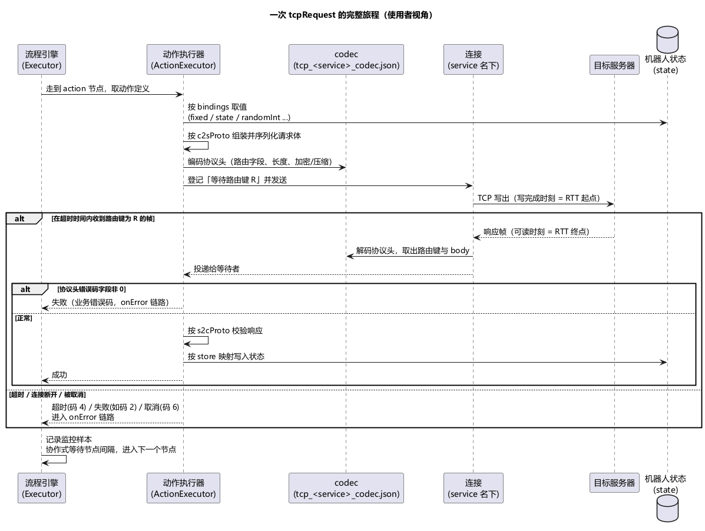

# 第 3 章 核心概念：一个机器人的一生

> **目标**：建立五个心智模型——**流程、动作、连接、状态、监听**。之后所有章节不再重复解释这五个词。
>
> **前置**：[第 2 章](ch02-architecture.md)（知道单机/分布式两种形态）。

## 3.1 机器人是什么

**机器人（Robot）= 一个模拟的客户端实例**。它有自己的：

- 一份**状态**（键值记忆，含框架注入的编号）；
- 一套**连接**（到目标服务器的命名 TCP/UDP 连接，HTTP 请求另走独立的 HTTP 客户端）；
- 一条**主流程**（从 flow.json 的 `main` 节点开始走图）；
- 一个独占的 **Lua 运行时**（创建机器人时就从运行时池借出，流程里有没有 Lua 动作都会占用一个）。

压测规模说"1 万机器人"，就是同时跑 1 万个这样的实例。`Manager` 负责批量创建：`totalBots = 100` 就创建 100 个；配置了 `rampUp.stages` 就按阶段渐进创建（第 12 章）。配置里的 `concurrency` 容易望文生义——它只是**创建期的批量限速**（每创建 N 个暂停 1 秒，最后一批之后不再暂停），不是运行期并发上限；机器人全部起来之后，并发数就是机器人总数。

## 3.2 一个机器人的出生与死亡

**出生**（日志 `[ROBOT] 启动`）：

1. 算出身份：`index`（任务内全局序号，从 0 起）、`id = startNumber + index`、`account = accountPrefix + id`。分布式形态下每个节点分到一段连续的 `index`，整个任务里身份不重复；
2. 注入初始状态：`stateExtra` 配置的键值对先写入；
3. 写入框架保留键 `id`、`index`、`account`。**stateExtra 里写这三个键会被忽略**，每个机器人各打一条 warn `[ROBOT] stateExtra 键与框架保留键冲突，已忽略`——否则整批机器人共用一个身份；
4. 从 `main` 节点开始执行流程。

**死亡**，四种方式：

1. **流程走完**（`main` 的执行链自然结束）——第 1 章示例就是这样结束的；
2. **流程出错退出**：例如动作失败且 `onError.strategy` 为 `abort`、引用了不存在的节点。日志 `[ROBOT] 流程异常退出`，监控 `robots:` 行里计入"错误"；
3. **主连接意外断开**：以 `mainService` 服务名建立的 **TCP** 连接被服务端关闭或网络异常断开时，机器人停止（warn 日志 `[ROBOT] 主连接意外断开，停止机器人`）。其他 TCP 连接、以及所有 UDP 连接断开只记一条 debug 日志，不停机器人；流程里主动 `tcpClose` 关掉的连接不算"意外断开"；
4. **被外部停止**：`duration` 到期（日志 `[MANAGER] 运行时长已到，自动停止`）、Ctrl+C、渐进加压的 reset 阶段、分布式任务被停止。

无论哪种方式，机器人都会清理：关闭自己的全部连接（最多等 10 秒）、归还 Lua 运行时、清空状态，然后打印 `[ROBOT] 已停止`，`cleanup` 字段为 `ok`（清理超时时为 `timeout`，并有 error 日志说明卡在哪一步）。

全部机器人结束后进程/任务结束（第 1 章见过：`[MAIN] 压测已结束，正在关闭...`）。

## 3.3 五个关键词

| 概念 | 一句话 | 定义在哪 |
|---|---|---|
| **流程（flow）** | 机器人行为的流程图：节点（9 种）+ 跳转关系，入口固定是 `main` | `flow/flow.json` 的 `nodes` 表 |
| **动作（action）** | 一步实际操作（14 种 pattern）：建连、发请求、等推送、写状态、跑 Lua… | flow.json 的 `actions` 表 |
| **连接（connection）** | 以**服务名**命名的一条 TCP/UDP 连接（如 `logic`、`arena`） | 连接类动作 + codec 文件名 |
| **状态（state）** | 该机器人独有的键值记忆 | 动作的 `store` / `setState` / 脚本 / stateExtra |
| **监听（listen）** | 预注册的推送接收器：推送先到也不丢，动作或脚本随后再取 | flow.json 的 `listens` 表（第 8 章） |

**服务名是贯穿的线索**：动作写 `service: "arena"`，TCP 连接就建在 `arena` 名下；codec 配置文件名 `tcp_arena_codec.json`（格式 `<proto>_<service>_codec.json`）按同一个名字找到该连接的协议描述，启动日志 `运行资源已加载` 里的 `connections` 就是 codec 文件的份数；`mainService = "arena"` 宣布哪条 TCP 连接是主连接。如果某个连接找不到对应的 codec 文件，建连时会报 `[ROBOT] TCP 连接无 codec 配置（resolver 未映射），拨号中止`。

## 3.4 单次请求-响应的完整旅程

以一个 `tcpRequest` 动作为例（使用者视角，实现细节见参考文档）：

1. **组装**：取动作定义，按 `bindings` 组装请求体（`fixed` 固定值 / `state` 从状态取 / `randomInt` 随机数…），按 `c2sProto` 声明的消息格式序列化；
2. **编码**：用该服务的 codec 打协议头（路由字段、长度，以及配置了的加密/压缩）；
3. **发送**：先登记"我在等路由键 R 的回包"，再经该 service 的连接发出；
4. **等响应**：按路由键（如 `"100:1"`）匹配回包。等待上限是动作的 `timeout`（秒）；不填时用运行级默认值——单机模式固定 60 秒，分布式形态由任务启动参数决定；
   - 等到 → 第 5 步；
   - 超时、连接断开、机器人被停止 → 记为超时 / 失败 / 取消样本，进入 onError 链路（第 9 章）；
5. **解析存储**：协议头里的错误码字段不为 0 时按业务错误处理；否则按 `s2cProto` 校验响应，再把字段按 `store` 映射写入状态；
6. **歇一下**：记录监控样本，然后按节点间隔协作式等待，再走下一个节点。

关于第 6 步的"节点间隔"：它只发生在 **action 节点执行完之后**（sequence/loop 等控制节点本身不等）。取值优先级是：节点自己的 `delayMs`（正数=自定义毫秒数，`-1`=不等）> 全局 `defaultDelayMs`（单机在 `[standalone.bot]` 配，分布式在任务启动参数里配；`-1` = 全局不等）> 引擎默认 **1000ms**。节点 `delayMs` 写 0 或不写表示用全局值。等待期间机器人仍会处理已到达的推送回调，不是死等。

两个值得现在就记住的点：

- **响应匹配靠路由键**（协议头里的 cmd/act 等字段按 codec 的 `routeKeyTemplate` 拼成），不是"下一条消息就是响应"。服务器主动推送、乱序回包都靠它区分；同一条连接上同一个路由键同时只能有一个在途请求；
- **每一步失败都有编号**：框架错误码 < 100，由工具自身产生（如 2 连接已关闭、4 等待响应超时、6 被取消）；业务错误码 ≥ 100，由服务器在协议头里返回。监控按码聚合（第 21 章精读）。

## 3.5 配置四件套与两种形态的对应

单机模式下，机器人的一切由四类资源 + 一个 TOML 决定：

| 资源 | 内容 | 单机怎么指定 | 分布式形态下在哪 |
|---|---|---|---|
| `flow/flow.json` | 流程（节点/动作/监听） | `-flow`，默认 `<配置目录>/flow/flow.json` | 顶栏「文件」加载基线 / 导入 JSON，或「流程」库保存；任务启动时随画布下发 |
| `proto/*.proto` | 消息结构定义 | `-proto`，默认 `<配置目录>/proto` | 顶栏「资源」抽屉的 Proto 页；任务启动时下发 |
| `scripts/*.lua` | 复杂行为脚本 | `-scripts`，默认 `<配置目录>/scripts` | 顶栏「资源」抽屉的 Lua 页，或动作编辑器里直接写；任务启动时下发 |
| `adapter/*_codec.json` + `errors.json` | 协议编解码 + 错误码描述 | `-adapter`，默认 `<配置目录>/adapter` | 顶栏「协议」编辑器；任务启动时下发 |
| `stressbot.toml` | 机器人数量、节奏、初始状态、日志、监控等运行参数 | `-config` | 机器人参数对应任务启动表单（第 18 章）；日志、监控、网络调优写在节点自己的 `agent.toml` |

也就是说：**你写的配置文件是同一条生产线，单机用文件喂，分布式用管理面喂**。前 12 章用单机形态把配置学透，第 15 章起换界面操作，内容完全复用。

## 3.6 验收

口头回答：

1. 一次 `tcpRequest` 从发到存经历哪几步？哪几步可能失败？（组装 → 编码 → 发送 → 等响应 → 解析存储 → 节点间隔。组装/编码一般只在配置错误时失败；发送与等响应可能超时、断连或被取消；解析存储可能遇到业务错误码或响应与 s2cProto 不符——失败主要集中在网络与等待）
2. `bot_1140000` 这个账号名怎么来的？`id`/`index`/`account` 能被 stateExtra 覆盖吗？（`accountPrefix` + (`startNumber` + `index`)；不能，保留键，写了会被忽略并告警）
3. 机器人什么时候停？（流程走完 / 流程出错 / 主 TCP 连接意外断开 / 到时、手动停止或 reset）
4. `concurrency = 20` 是什么意思？（创建期每创建 20 个歇 1 秒，不是运行期并发）

## 延伸阅读

- 网络层与机器人管理实现：[docs/network-layer.md](../docs/network-layer.md)
- 状态层实现：[docs/state-store.md](../docs/state-store.md)
- 下一章：[第 4 章 让工具认识你的协议](ch04-protocol.md)
