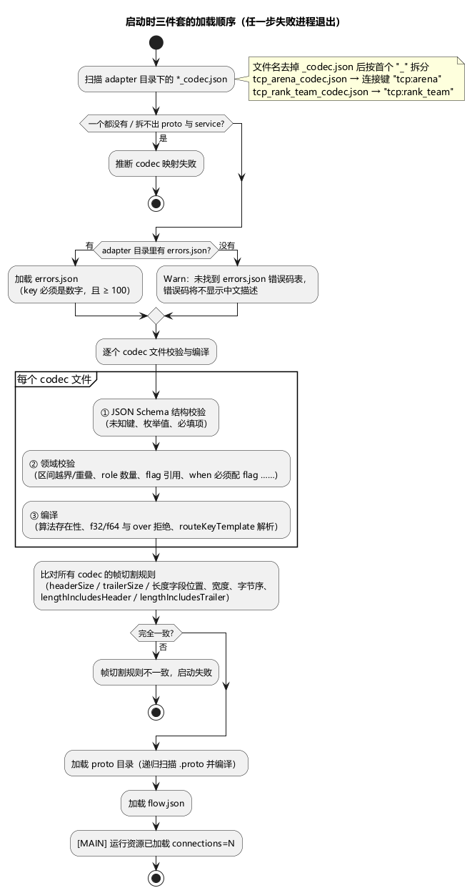
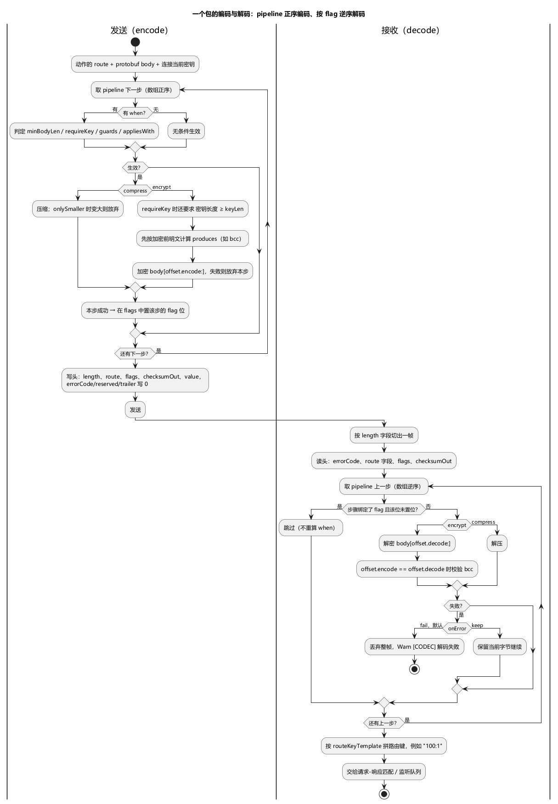

# 第 4 章 让工具认识你的协议：proto 与 codec

> **目标**：把一个新游戏的协议接入 stressbot—— proto（消息结构）、codec（协议头与编解码管线）、errors.json（错误码描述）三件套。这是使用本工具的第一道门槛，本章也最厚。
>
> **前置**：[第 3 章](ch03-core-concepts.md)（知道 service 名、路由键是什么）。本章示例 `examples/ch04/` 可直接运行（流程与第 5 章相同，重点在 adapter 目录：一份 TCP codec + 一份带加密的 UDP codec）。

## 4.1 三件套是怎么被找到的

启动时按**固定顺序**加载：codec → proto → flow，任一步失败进程直接退出（单机模式报 `[MAIN] 单机模式运行失败`，错误链以 `加载运行资源失败:` 开头）。



codec 目录（单机默认 `<config 所在目录>/adapter`，可用 `-adapter` 覆盖）里的文件名决定它属于哪条连接：

| 文件名 | 连接键 | 说明 |
|---|---|---|
| `tcp_arena_codec.json` | `tcp:arena` | 去掉 `_codec.json` 后按**首个** `_` 拆分 |
| `tcp_rank_team_codec.json` | `tcp:rank_team` | service 内部可以再含下划线 |
| `udp_arena_codec.json` | `udp:arena` | 同名 service 的 TCP、UDP 各一份，互不影响 |
| `udparena_codec.json` | — | 拆不出两段，启动报错 |

- 文件名格式 `<proto>_<service>_codec.json`；`<proto>` 是网络协议（`tcp`/`udp`，不是 protobuf），`<service>` 是服务名。`<proto>` 不做取值校验——写成 `ws_arena_codec.json` 也能加载成 `ws:arena`，但没有任何动作会用到它。
- 动作里写 `"service": "arena"`，pattern 是 tcp 类（`tcpConnect`/`tcpRequest`/……）→ 引擎用 `tcp:arena` 找 codec；udp 类同理找 `udp:arena`。找不到不会回退到别的 codec，见 4.8。
- 目录下一个 `*_codec.json` 都没有 → 启动失败；`errors.json` 是目录级共享文件，名字固定、可省略（4.6）。
- **文件必须是不带 BOM 的 UTF-8**。用会写 BOM 的编辑器保存后，启动报 `codec 配置不是合法 JSON: invalid character 'ï' looking for beginning of value`。
- **硬约束：同一 adapter 目录里所有 codec 的帧切割规则必须完全一致**。比对的是 `headerSize`、`trailerSize`、`lengthIncludesHeader`、`lengthIncludesTrailer`，以及长度字段的 `offset`/`size`/`type`/字节序——任何一项不同都报：

  ```
  codec 加载失败：连接 "udp:arena"(udp_arena_codec.json) 与 "tcp:arena"(tcp_arena_codec.json) 帧切割规则不一致（HeaderSize/长度字段口径不同），当前仅支持全局统一帧规则：{HeaderSize:12 TrailerSize:0 LengthIncludesHeader:true ...} vs {...}
  ```

  原因是网络层只用一份元信息切所有连接的帧。同一游戏不同连接帧长不同的，目前表达不了；头里**长度字段以外**的部分（路由字段、flags、管线）各连接可以不同。

## 4.2 proto：消息结构

把 `.proto` 文件放进 proto 目录即可（单机默认 `<config 所在目录>/proto`，可用 `-proto` 覆盖），启动时递归扫描并动态编译，**不需要生成任何 Go 代码**。

```protobuf
syntax = "proto3";
package arena;

message LoginAccountC2S {
  string account = 1;   // 字段编号与真实协议一致
  string version = 2;
}
```

要点：

- 动作里的 `c2sProto`/`s2cProto` 写**全名** `包名.消息名`（如 `arena.LoginAccountC2S`）。短名（最后一段）在全部 proto 里不重名时也能用；一旦两个包里有同名消息，短名就失效，所以建议始终写全名。
- proto 文件之间可以 `import`，路径相对 proto 目录解析；`google/protobuf/*.proto` 这类标准文件不用自己放。
- 目录里一个 `.proto` 都没有 → 启动失败 `加载 proto 文件失败: 未找到任何 .proto 文件`；语法错误 → `加载 proto 文件失败: 编译 proto 文件失败: ...`（后面跟编译器给出的文件和行号）。
- 启动日志两行用来确认加载结果：`[PROTOX] 已加载 proto 文件 count=N`（文件数）、`[PROTOX] 已索引消息类型 count=N`。后者是**索引条目数**：每个消息一条全名，再加一条不冲突的短名，所以通常是消息数的两倍（`examples/ch04` 的 5 个消息显示 `count=10`）。
- **proto 名拼错不是加载期错误**——加载器不校验动作引用的消息是否存在，运行到该动作才报：

  | 拼错的位置 | 报错 | 码 |
  |---|---|---|
  | `c2sProto` | `action=LoginArena proto=arena.LogiC2S: 未找到消息类型: arena.LogiC2S` | 21 |
  | `s2cProto`（动作配了 `store`） | `action=LoginArena proto=arena.LogiS2C 未找到消息类型` | 12 |
  | `s2cProto`（动作没配 `store`） | 不报错——不存储就不解析响应 | — |

  看见这类错先查拼写和 package 名。
- `s2cProto` 留空而 `store` 里有整存映射（`{"setter": "xxx"}`，不写 `field`），存进状态的是响应 body 原始字节。

## 4.3 codec 逐字段讲

先看第 5 章用的 8 字节最小版本（`examples/ch05/adapter/tcp_arena_codec.json`）：

```json
{
  "version": 1,
  "endianDefault": "le",
  "frame": { "headerSize": 8, "trailerSize": 0, "lengthIncludesHeader": false, "lengthIncludesTrailer": false },
  "header": [
    { "name": "bodyLen", "offset": 0, "size": 4, "type": "u32", "endian": "le", "role": "length" },
    { "name": "errCode", "offset": 4, "size": 2, "type": "u16", "role": "errorCode" },
    { "name": "cmd",     "offset": 6, "size": 1, "type": "u8",  "role": "route" },
    { "name": "act",     "offset": 7, "size": 1, "type": "u8",  "role": "route" }
  ],
  "routeKeyTemplate": "{cmd}:{act}",
  "pipeline": []
}
```

codec 文件先过一遍 JSON Schema 结构校验：**任何层级写了不认识的键都会被拒绝**（比如把 `keyLen` 写成 `keyLength`，报 `at '/pipeline/0/keyLength': false schema`），枚举值写错也在这一步拦下。

### 根字段

| 键 | 必填 | 取值 | 含义 |
|---|---|---|---|
| `version` | 是 | 固定 `1` | 配置格式版本 |
| `endianDefault` | 是 | `le` / `be` | 多字节字段的默认字节序；字段上可用 `endian` 覆盖 |
| `frame` | 是 | 对象 | 帧切割参数，见下表 |
| `header` | 是 | 数组，至少 1 项 | 头部每个字段的物理布局与用途 |
| `routeKeyTemplate` | 是 | 非空字符串 | 路由键模板，见本节末 |
| `pipeline` | 否 | 数组，缺省为空 | 压缩/加密/校验和管线，见 4.4；空 = body 就是裸 protobuf |
| `heartbeat` | 否 | 对象 | 连接级心跳，见第 10 章 |

### frame

| 键 | 必填 | 默认 | 含义 |
|---|---|---|---|
| `headerSize` | 是 | — | 头部字节数，≥ 1。**同目录所有 codec 必须一致**（4.1） |
| `trailerSize` | 否 | 0 | 帧尾字节数。编码时帧尾填 0，解码时从 body 末尾去掉 |
| `lengthIncludesHeader` | 否 | false | 长度字段的值是否包含头部本身（有的协议 bodyLen = 全长，有的 = body 长） |
| `lengthIncludesTrailer` | 否 | false | 长度字段的值是否包含帧尾 |

> **帧尾的坑**：网络层切帧时按「头长 + 长度字段换算出的 body 长」取整帧，**不会额外加上帧尾**。所以 `trailerSize > 0` 时必须同时写 `lengthIncludesTrailer: true`，否则每帧会少收 `trailerSize` 字节、后续帧全部错位。

### header 字段属性

| 属性 | 必填 | 取值 | 含义 |
|---|---|---|---|
| `name` | 是 | 非空、全 header 唯一 | 字段名；route 字段的 name 就是动作 `route` 对象里的键名 |
| `offset` | 是 | ≥ 0 | 从头部第 0 字节算起的偏移 |
| `size` | 是 | ≥ 1 | 字节数；定宽类型必须与宽度一致 |
| `type` | 是 | 见类型表 | 数值类型 |
| `role` | 是 | 见 role 表 | 这个字节区是干什么的 |
| `endian` | 否 | `le` / `be`，缺省取 `endianDefault` | 本字段字节序 |
| `bits` | 仅 `flags` | `[{ "name": "encrypted", "bit": 0 }]` | 命名位；bit 范围 `[0, size×8)`，位号和名字都不能重复 |
| `from` | 仅 `checksumOut`（必填） | `"<步骤名>.<产物名>"` | 取哪个管线产物，见 4.4 |
| `source` | 仅 `value` | `{ "kind": "const", "value": 0 }` 或 `{ "kind": "route", "key": "cmd" }` | 取值来源 |
| `repr` | 否 | `hex` / `base64` / `ascii` | 编解码不读取，可不写 |

所有字段的 `[offset, offset+size)` 必须落在 `headerSize` 内，且两两不重叠。头部里没被任何字段覆盖的字节，编码时填 0、解码时忽略。

**type 一览**：

| type | size | 说明 |
|---|---|---|
| `u8` / `i8` | 1 | |
| `u16` / `i16` | 2 | |
| `u24` / `i24` | 3 | 只建议在 `le` 下使用：`be` 字节序的 24 位读写不对称，会读出错值 |
| `u32` / `i32` | 4 | |
| `u64` / `i64` | 8 | |
| `bytes` | 自定 ≥ 1 | 按**小端无符号整数**读写（忽略 `endian`），常用于大块 `reserved` 占位 |
| `f32` / `f64` | 4 / 8 | **不可用**，编译报 `字段 "x" 类型 "f32" 暂未实现（浮点未做 IEEE-754 位转换，会静默错帧），请勿使用` |

> 有符号类型 `i*` 解码时**不做符号扩展**：`i16` 字段里的 -1 解出来是 65535。路由字段要用负值时，发送侧算出的期望键是 `-1`，响应解出来却是 `65535`，请求永远匹配不上——路由字段请用无符号类型和非负值。

**role 一览**：

| role | 数量约束 | 编码时写什么 | 解码时怎么用 |
|---|---|---|---|
| `length` | **有且仅有 1 个** | body 字节数（按 `lengthIncludes*` 加上头/尾） | 切帧 |
| `route` | **至少 1 个** | 动作 `route` 对象里同名键的值（小数向下取整；缺这个键写 0） | 拼路由键 |
| `errorCode` | 0 或 1 个为宜 | 0 | 非 0 即判定动作失败，见 4.6 |
| `flags` | 建议 1 个 | 各步骤生效后累计的位 | 决定解码时执行哪些步骤 |
| `checksumOut` | 任意 | `from` 指向的产物值；该步没执行则写 0 | 加密步解密后校验（条件见 4.4） |
| `value` | 任意 | `const` 写固定值；`route` 写动作 `route` 对象里 `key` 对应的值；不写 `source` 写 0 | 忽略 |
| `reserved` | 任意 | 0 | 忽略 |

- `value` 的 `source.kind` 只支持 `const` 和 `route`。写 `state`/`counter`/`timestamp` 会报 `value 字段 "x" 的 source.kind="state" 不支持：v1 不支持的头字段取值源 kind="state"，留待 v1.1`——需要递增序号这类动态头字段，目前只能交给心跳的 `heartbeatFields`（第 10 章）或改用 Lua 拼包。
- 声明多个 `flags` 字段时，编码会把**同一个累计值**写进每一个，解码时把它们按位或。实际协议都只有一个 flags 字段，照此配置即可。
- 写进字段的值超出字段宽度会被截断：`u8` 的 `cmd` 写 300，线上是 44。请求的期望键仍是 `300:…`，响应解出来是 `44:…`，表现为请求超时。

### 本章示例的 12 字节头

`examples/ch04` 的两份 codec 共用下面的布局（帧切割规则一致，满足 4.1 的约束）：

| 偏移 | 字节数 | name | type | role | 说明 |
|---|---|---|---|---|---|
| 0 | 4 | `bodyLen` | u32 | length | body 长度，不含头 |
| 4 | 2 | `errCode` | u16 | errorCode | 服务器错误码 |
| 6 | 1 | `cmd` | u8 | route | 路由第一段 |
| 7 | 1 | `act` | u8 | route | 路由第二段 |
| 8 | 2 | `index` | u16 | value | `const 0` |
| 10 | 1 | `flags` | u8 | flags | bit0 = encrypted（TCP 版还声明了 bit1 = compressed，但没有步骤绑定它） |
| 11 | 1 | `bcc` | u8 | TCP 版 `reserved`；UDP 版 `checksumOut`，`from: "enc.bcc"` | 加密前明文的 xor8 |

### routeKeyTemplate

- `{name}` 占位必须指向某个 `role: "route"` 字段，否则报 `routeKeyTemplate 占位 {seq} 必须指向某个 role:"route" 字段（未知占位）`；占位之外的文字原样保留，`"{cmd}-{act}"`、`"m{cmd}"` 都合法。
- 发送时用动作的 `route` 算出**期望响应键**（`{"cmd":100,"act":1}` → `"100:1"`），收包时用头里的路由字段拼出**实际键**。请求-响应匹配和监听注册（`listens`/`listenRefs`）都用这个键。
- 所以 `tcpRequest` 要求**服务器响应的路由字段与请求相同**。服务器用另一个 cmd/act 回包的协议，要用「`tcpSend` + `tcpListen`」组合来写（第 8 章）。

## 4.4 pipeline：压缩、加密与校验和

看本章示例里的 UDP 版（`examples/ch04/adapter/udp_arena_codec.json`）：

```json
"pipeline": [
  {
    "op": "encrypt",
    "name": "enc",
    "algo": "xor",
    "keyLen": 16,
    "flag": "encrypted",
    "offset": { "encode": 4, "decode": 0 },
    "when": { "requireKey": true, "minBodyLen": 1 },
    "produces": [ { "name": "bcc", "algo": "xor8", "region": "ciphered" } ],
    "onError": "fail"
  }
]
```

意思是：持有密钥且 body 非空时，保留 body 前 4 字节明文、对其余部分做循环 XOR，并在 flags 里置 `encrypted` 位；加密前先算出明文段的 xor8 写进头里的 `bcc`。收包时看到 `encrypted` 位就整段解密。



### 步骤属性

| 属性 | 必填 | 取值 / 默认 | 含义 |
|---|---|---|---|
| `op` | 是 | `compress` / `encrypt` / `checksum` / `hash` | 步骤类型 |
| `name` | 是 | 管线内唯一 | 供 `flag` 冲突提示、`from`、`appliesWith` 引用 |
| `algo` | 是 | 见下方算法表 | 算法名，拼错在编译期报错 |
| `flag` | 带 `when` 时必填 | header 中某个 `bits[].name` | 本步生效时置位；一个命名位只能被一个步骤绑定 |
| `when` | 否 | 见下表 | 编码时的生效条件；不写 = 每次都生效 |
| `keyLen` | 否 | 默认 0 | 仅 `encrypt`，且**只在 `when.requireKey: true` 时才检查**：要求密钥长度 ≥ keyLen |
| `offset` | 否 | `{ "encode": 0, "decode": 0 }` | 仅 `encrypt`：两个方向各自「前 N 字节保持明文」 |
| `params` | 否 | 对象 | 算法参数，见算法表 |
| `produces` | 否 | `[{ "name", "algo", "region" }]` | 本步顺带算出的校验值，供 `checksumOut` 字段引用 |
| `onError` | 否 | `fail`（默认）/ `keep` | 解码失败时的处理，见下 |
| `over` | — | — | **不要写**：编译直接拒绝（`独立 checksum/hash 的 over 作用域暂未实现，会静默错帧，请勿使用`） |

### when：编码时的生效条件

| 键 | 默认 | 含义 |
|---|---|---|
| `minBodyLen` | 0 | 当前 body（经过前面步骤处理后的）字节数 ≥ 该值才生效 |
| `requireKey` | false | 连接已设置非空密钥才生效；同时启用 `keyLen` 检查 |
| `onlySmaller` | false | 仅 `compress`：压缩后严格变小才采用，否则发原文且不置位 |
| `appliesWith` | — | 另一个步骤名：那一步本次生效了才生效。**只能引用排在前面的步骤**——引用后面的步骤不报错，但本步永远不生效 |
| `guards` | — | `[{ "field": "cmd", "op": "neq", "value": 0 }]`，op 为 `eq`/`neq`/`gt`/`gte`/`lt`/`lte`，全部满足才生效。`field` 取动作 `route` 对象里的键，**名字写错不报错，本步恒不生效** |

**带 `when` 的步骤必须绑定 `flag`**——解码方不重算条件，只看 flag 位还原编码时的决策。反过来，**没绑定 flag 的步骤解码时每帧都执行**，所以服务器若有时发明文、有时发密文，加密步一定要配 flag。

### 编码与解码的执行规则

- 编码按数组**正序**执行；解码按**逆序**执行（先解密再解压），对应编码的「先压后密」。所以压缩步要写在加密步前面。
- 编码时某步失败（压缩出错、加密算法报错）**不报错**：放弃该步、不置位，发出去的是上一步的结果。
- 解码时绑定了 flag 的步骤只在该位置位时执行；未绑定的总是执行。
- `onError` 只管解码：`fail` 丢弃整帧并记 Warn `[CODEC] TCP 解码失败` / `[CODEC] UDP 解码失败`（`reason` 字段写明哪一步、什么原因）；`keep` 保留当前字节（密文或未解压数据）继续往下走。

### offset：部分加密

`encode`/`decode` 各自声明「前 N 字节保持明文」。示例 `encode: 4` 发包时 body 前 4 字节明文（供服务器按明文段查密钥表），收包 `decode: 0` 整体解密——**两个方向独立取值**，正是因为很多游戏收发包布局不对称。TCP、UDP 规则相同，偏移只来自这里。

### produces 与 checksumOut

加密/压缩的同时产出一个校验值，写入 header 里 `role: "checksumOut"` 的槽位（`"from": "enc.bcc"` = 步骤 `enc` 的产物 `bcc`）。产物 `algo` 可以是校验和算法，也可以是哈希算法（取摘要前 8 字节）；写入字段时按字段宽度截断。

| region | 在 encrypt 步上算的是 | 在 compress 步上算的是 |
|---|---|---|
| `ciphered` | 加密前的 `body[offset.encode:]` | 压缩后的 body |
| `bodyPlain` | 进入管线前的原始 body | 同左 |
| `bodyFinal` | 加密前的 body（整段） | 压缩后的 body |
| `header` / `frame` | 恒为 0 | 恒为 0 |

**解码校验**只发生在 encrypt 步、且 `offset.encode == offset.decode` 时：解密后对 `body[offset.decode:]` 重算并与头里的值比对，不一致报 `bcc 校验失败`。重算区域固定是这一段，与声明的 `region` 无关——因此要被校验的产物请用 `ciphered`；其他 region 在偏移对称时会被误判为校验失败。偏移不对称（如示例的 4/0）时不校验，数学上算不出来。compress 步的产物只写不验。

### 算法一览

加密步的密钥**一律是连接当前的密钥**（4.5）；codec 文件里写不了密钥，`params` 里写 `key` 也不会被读取。

| 加密 algo | 密钥要求 | params | 说明 |
|---|---|---|---|
| `none` | — | — | 直通 |
| `xor` | 任意长度 | — | 循环 XOR；密钥为空时等于不加密，但 flag 照样置位 |
| `xor_carry_rol` | **恰好 32 字节** | `rol`：整数，默认 3，超出 [1,7] 钳到边界 | XOR + 进位 + 循环左移；密钥不是 32 字节时**原样返回明文**且照样置位 |
| `rc4` | 1~256 字节 | — | 只为兼容既有协议；密钥为空时同 `xor`，不加密但置位 |
| `aes_ecb` | 16 / 24 / 32 字节 | — | PKCS#7 填充，密文变长 |
| `aes_cbc` | 16 / 24 / 32 字节 | `iv`：**必填**，字符串按原始字节取，必须 16 字节 | PKCS#7 填充 |
| `aes_ctr` | 16 / 24 / 32 字节 | `iv`：同上 | 长度不变 |
| `xxtea` | ≥ 16 字节（取前 16） | — | 加密前补 0 到 4 字节倍数（解密不去掉这些 0）；补齐后不足 8 字节不加密 |

> AES 系列与 `xxtea` 在密钥长度不对、缺 `iv` 时，**编码侧静默发明文且不置位**（加密报错 = 放弃该步）；解码侧则报 `解密失败: aes_cbc 缺少参数 iv`、`解密失败: aes_cbc iv 长度非法：需 16 字节，实际 8`、`解密失败: xxtea key 长度非法：需 16 字节，实际 8` 之类。

| 压缩 algo | 说明 |
|---|---|
| `none` | 直通 |
| `gzip` | 标准 gzip。不配 `when.onlySmaller` 时每个包都压，小包反而变大 |

| 校验和 algo | 说明 |
|---|---|
| `none` | 恒 0 |
| `xor8` | 全字节异或（单字节 bcc） |
| `sum8` | 字节累加 mod 256 |
| `crc16` | CRC-16/CCITT（多项式 0x1021，初值 0xFFFF） |
| `crc32` | CRC-32/IEEE |
| `crc32c` | CRC-32/Castagnoli |

| 哈希 algo | 说明 |
|---|---|
| `md5` / `sha1` / `sha256` | 作为独立 `hash` 步时，连接有密钥就算 HMAC、没有就算普通摘要；作为 `produces` 的 algo 时始终是普通摘要 |

独立的 `checksum`/`hash` 步对**当时的 body** 计算，结果只能经 `produces[0]` 写进 `checksumOut`，解码时不执行也不校验。一般协议用 encrypt 步的 `produces` 就够了。

### 容易踩的坑（源码核实）

1. **`keyLen` 是 ≥ 语义、与算法无联动，而且只在 `requireKey: true` 时才检查**。`xor_carry_rol` 要求密钥恰好 32 字节：keyLen 写 32 能挡住 16 字节的短密钥，却挡不住 48 字节的长密钥——长密钥通过 `≥` 检查后，算法内部「长度不是 32 就原样返回」，**静默明文**；没写 `requireKey` 时 keyLen 根本不生效。AES、xxtea 的密钥不对同样是静默明文（见算法表下的说明）。务必按算法真实要求给密钥，并抓包确认密文确实变了。
2. **偏移不对称（encode ≠ decode）时 bcc 不校验**；偏移对称时只有 `ciphered` 产物能通过校验。
3. **没配 `when` 的步骤每帧都会做**：没配 `when` 的加密步在密钥设置之前也会「加密」（`xor` 空密钥 = 原文），解码时也每帧都解密。
4. **flag 位是解码的唯一依据**：服务器回包的 flags 不带加密位时，客户端不解密，直接把密文当 protobuf 解析——动作配了 `store` 时表现为响应解析失败（码 12）。

## 4.5 密钥从哪来

codec 配置里**没有任何密钥字段**。密钥是每条连接的运行期状态，唯一设置途径是 Lua：

```lua
network.set_tcp_secret_key("arena", key)   -- TCP 连接
network.set_udp_secret_key("arena", key)   -- UDP 连接
local k = network.get_tcp_secret_key("arena")
```

- `key` 是 Lua 字符串，按**原始字节**使用：服务器下发的是十六进制文本，要先在脚本里转成字节；长度以字节计，中文字符占 3 字节。
- 只对**已经建立**的连接生效；连接还没建就调用会被静默忽略。密钥挂在连接对象上，**断开重连后要重新设置**。
- 传空字符串不会清掉已有密钥。
- 典型顺序：建连 → 发密钥交换请求 → 拿到密钥后 `set_tcp_secret_key` → 之后该连接的加解密（以及心跳包）自动用上新密钥。心跳若声明了 `requireSecretKey: true`，在第一次调用这个函数前不会启动（第 10 章）。

声明式 flow 里**没有**设置密钥的动作，需要密钥交换的协议，建连阶段要用 Lua 写（仓库自带的 `conf/scripts/connect_logic.lua` 就是这样）。

## 4.6 errors.json：错误码的人话版

```json
{ "1001": "账号不存在", "3002": "商品已售罄" }
```

- 扁平对象：key 是**字符串形式的十进制数字码**，value 是中文描述字符串。key 不是数字报 `错误码 key "E1001" 不是合法数字`。
- **码段契约**：< 100 是框架保留段，**业务码必须 ≥ 100**。写了 `{"99": ...}` 启动直接报错：`codec 加载失败：错误码文件 "errors.json" 码 99 < 100 属框架保留段，业务码请使用 ≥ 100`。
- 文件可省略——单机启动时有一条 Warn `[MAIN] 未找到 errors.json 错误码表，错误码将不显示中文描述`，功能不受影响。

它和 header 里的 `errorCode` 字段配合工作：

- 响应头 `errorCode` **非 0** 时，该请求/监听动作判定失败，错误码就是这个值（监控、`onError.ignoreCodes` 都按它算）；响应 body 依然会按 `store` 尝试解析存储。
- 错误详情形如 `账号不存在: service=arena route=100:1`；errors.json 里查不到描述时只有 `service=arena route=100:1`。
- 服务器若返回 1~99 的码，会和框架错误码撞在一起（比如 4 会被显示成框架的「超时」）。这类服务器码只能接受显示上的歧义，或在服务器侧调整。

## 4.7 心跳也声明在 codec 里（预告）

同一个 codec 文件里还可以有 `heartbeat` 段：只配 `intervalMs`（+ `route`）的静态心跳、`c2sProto` 的 proto 心跳、`heartbeatFields` 的裸二进制心跳三选一；`c2sProto` 与 `heartbeatFields` 同时写会报 `heartbeat 不能同时配置 c2sProto 与 heartbeatFields，须二选一`。心跳包同样走本连接的头部和 pipeline（会被加密）。不写这段就没有心跳。详见[第 10 章](ch10-heartbeat.md)。

## 4.8 常见报错对照

**启动期**（下列文案均为实测输出，前缀 `加载运行资源失败: 加载 CodecResolver 失败: codec 加载失败：连接 "udp:arena" 文件 "udp_arena_codec.json"：` 省略）：

| 报错（节选） | 原因 |
|---|---|
| `推断 codec 映射失败: codec 文件名 "udparena_codec.json" 无法解析为 <proto>_<service>_codec.json` | 文件名缺下划线 |
| `推断 codec 映射失败: codec 目录 "..." 下无任何 *_codec.json 文件（未声明任何连接的 codec）` | 目录为空或路径不对 |
| `codec schema 结构校验失败 "...": codec 配置不是合法 JSON: invalid character 'ï' ...` | 文件带 BOM，或 JSON 语法错误 |
| `codec 配置结构校验失败: ... at '/pipeline/0/keyLength': false schema` | 写了不认识的键（拼写错误） |
| `at '/heartbeat/heartbeatFields/0/type': value must be one of 'u8', 'u16', ...` | 枚举值写错 |
| `codec schema 校验失败 "...": header 缺少 role:"length" 字段（必须有且仅有 1 个）` | 没声明长度字段 |
| `header 缺少 role:"route" 字段（至少 1 个）` | 没声明路由字段 |
| `header 字段 "cmd" (index 2)：type "u16" 的 size 必须为 2（当前 1）` | 定宽类型 size 写错 |
| `header 字段 "flags" (index 5)：物理区间 [offset=12, offset+size=13) 越界（headerSize=12）` | 字段超出头部 |
| `header 字段物理区间重叠：cmd [offset=6,+1) 与 act [offset=6,+1)` | offset 写重了 |
| `routeKeyTemplate 占位 {seq} 必须指向某个 role:"route" 字段（未知占位）` | 模板引用了不存在的路由字段 |
| `pipeline 步骤 "enc" 带有 when 但未绑定 flag（带 when 的步骤必须绑定 flag，否则 decode 无法复现 encode 决策）` | when 必须配 flag |
| `pipeline 步骤 "enc" 的 flag "enc" 未在任何 role:"flags" 字段的命名位中声明` | flag 名与 `bits[].name` 对不上 |
| `checksumOut 字段 "bcc" 的 from "enc.crc" 指向 step "enc" 中不存在的 produce "crc"` | from 引用写错 |
| `codec schema 编译失败：步骤 "enc" 引用未知算法 "xorr"` | algo 拼错 |
| `codec schema 编译失败：字段 "index" 类型 "f32" 暂未实现（浮点未做 IEEE-754 位转换，会静默错帧），请勿使用` | 用了浮点头字段 |
| `codec schema 编译失败：步骤 "enc" 声明了 over region（kind="frame"），但独立 checksum/hash 的 over 作用域暂未实现，会静默错帧，请勿使用` | 写了 `over` |
| `heartbeat 不能同时配置 c2sProto 与 heartbeatFields，须二选一` | 心跳两种 body 只能选一种 |
| `连接 "udp:arena"(...) 与 "tcp:arena"(...) 帧切割规则不一致（HeaderSize/长度字段口径不同）...` | 同目录帧规则不一致（4.1） |
| `codec 加载失败：错误码文件 "errors.json" 码 99 < 100 属框架保留段，业务码请使用 ≥ 100` | 业务码 < 100 |
| `加载 proto 文件失败: 未找到任何 .proto 文件` | proto 目录为空或路径不对 |

同一个文件有多处领域校验错误时会一次性列出，用 `; ` 分隔。

**运行期**：

| 现象 / 日志 | 原因 |
|---|---|
| Error `[ROBOT] TCP 连接无 codec 配置（resolver 未映射），拨号中止` | 动作的 service 没有对应的 `tcp_<service>_codec.json`（UDP 同理） |
| 动作失败码 11，详情含 `codec 未映射（resolver.Resolve(tcp:xxx) nil）` | 同上，发生在发包时 |
| 码 21 `未找到消息类型` / 码 12 `未找到消息类型` | proto 名拼错（4.2） |
| Warn `[CODEC] TCP 解码失败`，`reason` 为 `encrypt(step 0): 密钥长度不足（need>=16, got=0）` | 服务器回了加密包，但客户端还没设置密钥 |
| `reason` 为 `encrypt(step 0): bcc 校验失败` | 密钥不对、算法/偏移与服务器不一致，或 region 不是 `ciphered` |
| `reason` 为 `compress(step 0): 解压失败: ...` | 服务器置了压缩位但 body 不是 gzip |
| 紧跟着 Warn `[NETWORK] 解码返回空 routeKey，响应被丢弃`，然后请求超时（码 4） | 上面任何一种解码失败的后果 |
| Warn `[NETWORK] 协议头非法或包体过长，关闭连接` | 长度字段解出的 body 超过上限（默认 16MB，`[network] maxBodyLen`），多半是头部布局/字节序/`lengthIncludesHeader` 配错 |
| 请求必定超时、但服务器日志显示已回包 | 响应路由字段与请求不同、值超出字段宽度、或用了负数路由（4.3） |

## 4.9 验收

- [ ] `examples/ch04` 原样启动：`[MAIN] 运行资源已加载 connections=2`（tcp+udp 两份 codec），`[PROTOX] 已索引消息类型 count=10`
- [ ] 能说出 12 字节示例头里每个字段的 role
- [ ] 知道 routeKeyTemplate 拼出的键用在两处：请求-响应匹配 + 监听注册，且 tcpRequest 要求响应路由与请求相同
- [ ] 知道同目录帧规则必须一致、带 when 的步骤必须配 flag、密钥只能来自 Lua、业务码必须 ≥ 100
- [ ] 知道 keyLen 只在 requireKey 下生效，以及哪些算法在密钥不对时会静默发明文

## 延伸阅读

- 算法与管线的完整实现说明：[docs/adapter-layer.md](../docs/adapter-layer.md)
- proto 加载与 wire 结构：[docs/proto-schema.md](../docs/proto-schema.md)
- 错误码体系：[docs/error-code-system.md](../docs/error-code-system.md)
- 下一章：[第 5 章 第一个流程](ch05-first-flow.md)
