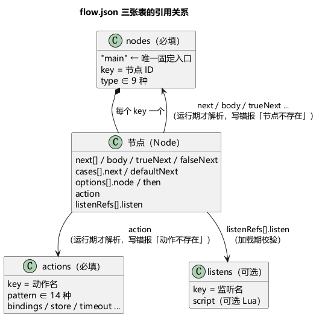
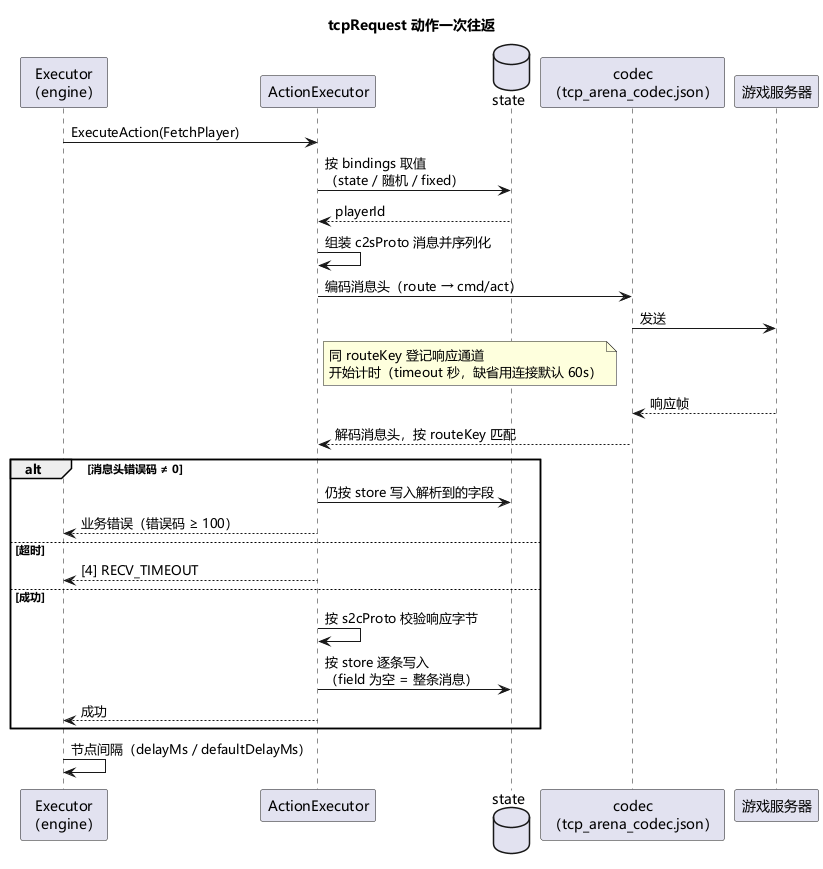
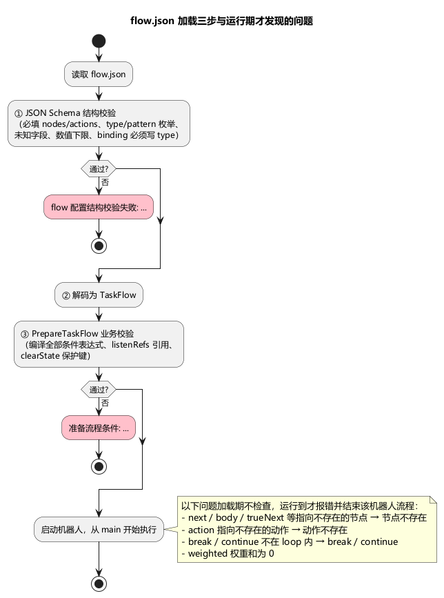

# 第 5 章 第一个流程：连接、登录、拿到数据

> **目标**：写出第一个真实流程——连接服务器 → 账号登录 → 拉角色数据 → 关连接，理解 flow.json 的 nodes/actions 双表结构、字段绑定（bindings）与响应存储（store）。
>
> **前置**：[第 3 章](ch03-core-concepts.md)的五个概念，以及[第 4 章](ch04-protocol.md)的协议与 codec。本章示例自带一份最小协议（虚构游戏"竞技场 ArenaQuest"），协议细节以第 4 章为准。
>
> 端到端跑通本章示例需要一台目标服务器（示例默认 `127.0.0.1:18888`，可在 TOML 里改）；没有服务器也能完成"加载校验通过"的全部步骤，并观察到很有教学价值的失败链。

## 5.1 示例目录

`tutorial/examples/ch05/`：

```
ch05/
├── stressbot.toml              # mainService = "arena"，2 个机器人，30 秒上限
├── flow/flow.json              # 本章主角
├── proto/tutorial.proto        # 竞技场协议（package arena，登录 + 角色数据，5 个消息）
├── scripts/                    # 空目录（必须存在）
└── adapter/
    ├── tcp_arena_codec.json    # 竞技场协议头：8 字节，无加密无压缩
    └── errors.json             # 业务错误码 → 中文描述（4 条）
```

运行（仓库根目录）：

```bash
go run ./cmd/stressbot -config tutorial/examples/ch05/stressbot.toml
```

## 5.2 flow.json 的骨架：三张表 + 一个入口

```json
{
  "nodes":   { "main": { "type": "sequence", "next": [] } },
  "actions": { },
  "listens": { }
}
```

- **nodes**（必填）：流程图。key 是节点 ID；`type` 决定这个节点的字段和语义（9 种：`sequence` / `loop` / `boolean` / `switch` / `weighted` / `wait` / `action` / `break` / `continue`，本章只用 `sequence` 和 `action`，其余见第 6 章）。
- **actions**（必填，可以是空对象 `{}`）：动作仓库。key 是动作名；节点通过 `action` 字段按名字引用——同一个动作可以被多个节点复用。
- **listens**（可选）：推送监听定义（第 8 章），本章为空。
- **入口约定**：引擎从 ID 为 **`main`** 的节点开始执行（类比程序的 main 函数）。没有 `main` 节点时加载照样通过，但每个机器人一启动就报 `节点不存在: main (caller=bot_1140000)` 并结束流程。
- **结构是封闭的**：顶层、节点、动作、绑定里出现 Schema 未定义的字段一律在加载期被拒（见 5.8），字段名拼错不会被悄悄忽略。每个节点都可以多写一个 `description` 字符串做备注，引擎不读它。



## 5.3 流程：一条顺序链

```json
"main":        { "type": "sequence", "next": ["connect", "login", "fetchPlayer", "close"] },
"connect":     { "type": "action", "action": "ConnectArena" },
"login":       { "type": "action", "action": "LoginArena" },
"fetchPlayer": { "type": "action", "action": "FetchPlayer" },
"close":       { "type": "action", "action": "CloseArena" }
```

`sequence` 的 `next` 是按顺序执行的子节点 ID 列表。四个 `action` 节点各自引用一个动作——流程（先做什么后做什么）与动作（具体怎么做）分离，是 flow.json 的核心组织方式。

`action` 节点能写的字段：

| 字段 | 含义 |
|---|---|
| `action` | 引用 `actions` 表里的动作名。名字写错加载期不报错，执行到时报 `动作不存在: Xxx` 并结束该机器人的流程 |
| `delayMs` | 本节点执行完后的等待，见 5.7 |
| `onError` | 动作失败后的处理链路（`ignoreCodes` / `handler` / `retry` / `strategy`），第 9 章 |
| `listenRefs` | 在本节点注册持久化推送监听，第 8 章。`action` 留空、只写 `listenRefs` 的节点是合法的"纯注册"节点 |

`action` 和 `listenRefs` 都没写的 action 节点什么也不做，运行时会打一条 `[ENGINE] action 节点既无 action 也无 listenRefs，节点空转` 警告。

## 5.4 动作：pattern 决定读哪些字段

每个动作必须写 `pattern`（14 种之一，写错在加载期被 Schema 拒绝）。动作上所有字段是一张共享的大表，**每种 pattern 只读其中一部分，多写的字段不报错也不生效**：

| pattern | 读取的字段 | 说明 |
|---|---|---|
| `tcpConnect` / `udpConnect` | `service`、`address` | 建立命名连接；`address` 可写 `state:键名` |
| `tcpClose` / `udpClose` | `service` | 关闭命名连接 |
| `tcpSend` / `udpSend` | `service`、`route`、`c2sProto`、`bindings` | 只发不收 |
| `tcpRequest` / `udpRequest` | `service`、`route`、`c2sProto`、`bindings`、`s2cProto`、`store`、`timeout` | 一发一收 |
| `tcpListen` / `udpListen` | `service`、`route`、`s2cProto`、`store`、`timeout` | 等一条推送，route 必须先经 `listenRefs` 注册（第 8 章） |
| `httpRequest` | `url`、`method`、`contentType`、`bindings`、`store` | HTTP 请求 |
| `setState` | `bindings` | 只写状态，不发包（第 6、7 章） |
| `clearState` | `keys` | 删除状态键 |
| `lua` | `script` | 执行 Lua 脚本（第 11 章） |

本章用到其中三种。

### tcpConnect — 建立连接

```json
"ConnectArena": {
  "pattern": "tcpConnect",
  "service": "arena",
  "address": "state:arenaAddr"
}
```

- `service`：连接的服务名（第 3 章的贯穿线索）。后续 `tcpRequest` 等动作用同一个名字找到这条连接，codec 也按它匹配（`tcp_arena_codec.json`）；
- `address`：目标地址 `host:port`。写成 `state:键名` 时从状态取字符串——`arenaAddr` 来自 TOML 的 `stateExtra`，换目标服务器只改配置不动流程。取到空串时动作失败，错误码 41（ADDR_EMPTY）。

### tcpRequest — 请求-响应（本章主角）

```json
"LoginArena": {
  "pattern": "tcpRequest",
  "service": "arena",
  "route": { "cmd": 100, "act": 1 },
  "c2sProto": "arena.LoginAccountC2S",
  "bindings": [
    { "field": "account", "type": "state", "source": "account" },
    { "field": "version", "type": "fixed", "value": "0.31.49" }
  ],
  "s2cProto": "arena.LoginAccountS2C",
  "store": [
    { "field": "playerId", "setter": "playerId" },
    { "field": "serverTime", "setter": "loginServerTime" }
  ],
  "timeout": 5
}
```

逐字段读：

| 字段 | 含义 |
|---|---|
| `service` | 走哪条命名连接。连接没建立时动作失败，错误码 1（CONN_NOT_FOUND） |
| `route` | 路由标识（键值对象），填进协议头里的路由字段。与 codec 的 `routeKeyTemplate` 对应（本协议 `{cmd}:{act}` → 路由键 `"100:1"`）。**响应就按这个键匹配**（第 3 章 3.4） |
| `c2sProto` | 请求消息的 proto 全名（`包名.消息名`） |
| `bindings` | 请求体每个字段怎么取值，见 5.5 |
| `s2cProto` | 响应消息的 proto 全名。留空时响应不做 proto 解析，`store` 只有"整存"（`field` 为空）那条会把原始字节写进状态 |
| `store` | 响应的哪些字段存进状态，见 5.6 |
| `timeout` | 等响应的超时，**单位是秒**，整数且 ≥ 0。`0` 或不写 = 用连接的默认超时：单机模式固定 60 秒；分布式模式取任务配置里的 TCP 超时（默认 60 秒）。超时报错误码 4（RECV_TIMEOUT） |

一次往返的完整过程：



响应消息头里的错误码不为 0 时，动作按该错误码判失败（业务码 ≥ 100，描述来自 `errors.json`），但 `store` 依然会执行——响应体里有的字段照样写进状态。

### tcpClose — 关闭连接

```json
"CloseArena": { "pattern": "tcpClose", "service": "arena" }
```

只认 `service`。不关也没关系：机器人结束时会统一关闭它名下所有连接。

## 5.5 绑定（bindings）：字段值从哪来

每条绑定描述请求消息里一个字段的取值。**`type` 是必填项**——不写 `type` 在加载期报 `missing property 'type'`（见 5.8），不存在"省略即 fixed"的写法。本章用到三种最基础的（全部 17 种见[第 7 章](ch07-random-bindings.md)）：

| type | 取值来源 | 关键字段 | 取不到值时 |
|---|---|---|---|
| `fixed` | 写死的值（任意 JSON 值） | `value` | `value` 为 `null` → 跳过该字段 |
| `state` | 从机器人状态取（第 3 章的键值记忆） | `source`（顶层状态键名）、可选 `path`（在取到的值里下钻） | **默认报错**（错误码 22） |
| `randomInt` | 闭区间 `[min, max]` 随机整数 | `min` / `max`（整数，不写为 0） | — |

```json
{ "field": "account",  "type": "state",     "source": "account" }
{ "field": "level",    "type": "state",     "source": "playerData", "path": "level" }
{ "field": "version",  "type": "fixed",     "value": "0.31.49" }
{ "field": "deviceId", "type": "randomInt", "min": 1, "max": 999999 }
```

`randomInt` 的 `min > max` 不会在加载期报错，而是每次执行时动作失败：错误码 22，详情 `randomInt 区间反向 min=… > max=…`。

示例里 `LoginArena` 的 `account` 绑定读的是状态键 `account`——这是框架注入的保留键（第 3 章），值就是 `bot_1140000` 这样的账号名。**这就是"一万个机器人各用各的账号"的最小实现**：不需要写任何循环，每个机器人读自己的状态。

### 绑定的通用属性

| 属性 | 作用 |
|---|---|
| `field` | 请求消息里的字段名，支持嵌套路径：`base.name`（子消息字段）、`items[0].id`（列表元素字段）。留空表示不写入消息（常与 `storeAs` 搭配，只为了把值存起来） |
| `type` | 取值方式，必填 |
| `optional` | `true`：取不到值时跳过该字段，不报错 |
| `required` | `true`：取不到值时报错（错误码 22）。`state` 系绑定（`state` / `stateFirst` / `stateRandom` / `stateRandomN` / `stateMapKey` / `stateMapValue`）不写也默认按必填处理，用 `optional: true` 才能放宽 |
| `storeAs` | 取到值后顺手存进状态（点分路径），值为空时不写 |
| `path` / `wrap` / `condition` / `filters` | 下钻、包成列表、按条件启用、过滤候选，第 7 章 |

### 值写进 proto 字段时的类型规则

绑定取到的是"JSON 风格"的值，写入时按目标字段类型转换，规则并不对称：

| 目标字段类型 | 接受的值 | 不匹配时 |
|---|---|---|
| `string` | 只接受字符串 | 动作失败，错误码 22（`"value": 123` 写进 string 字段就会这样） |
| `bool` | 只接受 `true` / `false` | 动作失败，错误码 22 |
| `int32` / `int64` / `uint*` / `float` / `double` / 枚举 | 数字；**数字字符串**（如 `"100"`）会被解析；布尔转 1/0 | 其他类型（列表、对象、非数字字符串）**静默写成 0**，不报错 |
| `repeated` | 只接受列表（如 `randomPickN` 的结果、`wrap: true` 包出来的列表、状态里存的标量列表），元素按上面的规则逐个转换 | 动作失败，错误码 22 |
| `map` | 用 `map` 绑定构造（第 7 章） | 动作失败，错误码 22 |
| 子消息 | 不能整体赋值——`store` 整存的消息、JSON 对象都会失败（错误码 22）。给子消息填值请用嵌套路径逐个字段绑定：`"field": "base.name"` | 动作失败，错误码 22 |

数值字段"静默写 0"是最容易漏掉的一类配置错误：比如从列表里取了整个元素却忘了写 `path`，请求照样发出去，只是字段值为 0（第 7 章的示例就踩过这个坑）。

## 5.6 存储（store）：响应存到哪去

```json
"store": [
  { "field": "playerId", "setter": "playerId" },
  { "field": "serverTime", "setter": "loginServerTime" }
]
```

- `setter`（必填）：存进状态的路径。点分路径会逐层创建映射，例如 `"setter": "login.serverTime"` 写到状态键 `login` 下的 `serverTime`；
- `field`：从响应消息里取哪个字段，支持嵌套路径（`player.base.coins`）和列表下标（`items[0].itemId`）；
- **`field` 省略 = 整存**：`FetchPlayer` 的 `{ "setter": "playerData" }` 把整个响应消息（名字/等级/金币/道具列表）存成一个键。

取值时的几条细节：

- 标量字段即使服务器没发（proto3 默认值），也按默认值写入（`0`、`""`、`false`）；
- **没设置的子消息、空列表、空 map 视为"不存在"，这条 store 被跳过**，状态里该键保留上一次的值（或继续不存在）；
- 列表字段存成列表，元素若是消息则以消息形态保存，之后可用第 7 章的 `stateRandom` + `path` 取元素里的字段。

存进去的值怎么再读出来：

```json
{ "field": "playerId", "type": "state", "source": "playerId" }
{ "field": "level",    "type": "state", "source": "playerData", "path": "level" }
```

条件表达式里同样能按路径读：`"state:playerData.level >= 10"`（第 6 章）。注意绑定的 `source` 只认顶层键，下钻一律写在 `path` 里。

`FetchPlayer` 演示了流程内的数据接力：请求体里的 `playerId` 绑定读状态键 `playerId`——正是 `LoginArena` 存进来的登录结果。**上一个动作的响应变成下一个动作的请求参数**，这是流程串联数据的标准方式。

## 5.7 节点间隔：动作之间的默认节奏

不配置时，引擎在**每个 action 节点执行完之后等待 1000ms**——成功、失败（含 onError 处理完之后）都等；`sequence`、`loop`、`boolean` 这类控制节点自身不等待。这是任务级参数，不是流程里的字段：

- 单机：TOML `[standalone.bot]` 的 `defaultDelayMs`。`0` 或不写 = 引擎默认 1000ms；正数 = 自定义（上限 600000）；`-1` = 全局禁用等待；其他值启动时报错；
- 分布式：任务启动配置里的同名参数，语义相同；
- 节点级覆盖：action 节点上的 `delayMs`（`> 0` 用节点值；`= 0` 或不写用全局间隔；`< 0` 该节点不等待）。

```json
"login": { "type": "action", "action": "LoginArena", "delayMs": 3000 }
```

本章示例没配，跑起来每个动作间隔 1 秒——第 5.9 节的日志时间戳能直接验证（连续失败的动作相隔整 1 秒）。

## 5.8 加载期校验：写错了立刻知道

flow.json 在启动时过三道关，任何一道失败进程直接退出：



1. **JSON Schema 结构校验**：必填缺失、`type` / `pattern` 不在枚举里、未知字段、数值越界（如权重为负、`timeout` 为负）；
2. 反序列化到内部模型；
3. **业务校验**：编译全部条件表达式、检查 `listenRefs` 引用的监听存在、检查 `clearState` 没删保留键。

要特别注意**加载期不检查的东西**：`next` / `body` / `trueNext` 等指向的节点 ID、`action` 指向的动作名、`break` / `continue` 是否在循环内。这些写错了能正常启动，执行到那一步才报错（`节点不存在: xxx (caller=bot_1140000)`、`动作不存在: Xxx`），该机器人的流程随即结束，日志里是一条 `[ENGINE] 流程异常退出` 警告加一条 `[ROBOT] 流程异常退出` 错误。

真实报错文案（日志里前面还有 `加载运行资源失败: 加载流程配置失败: ` 前缀），遇到时对号入座：

| 报错 | 触发原因 |
|---|---|
| `flow 配置结构校验失败: jsonschema validation failed with 'https://stressbot.local/schemas/flow.schema.json#'`<br>`- at '/actions/A/bindings/0': missing property 'type'` | 绑定没写 `type` |
| `- at '/nodes/main/nexts': false schema` | 字段名拼错（这里把 `next` 写成了 `nexts`），未知字段一律报 `false schema` |
| `- at '/actions/A/pattern': value must be one of 'tcpRequest', ...` | pattern 拼错 |
| `准备流程条件: 节点 "main" listenRefs[0] 引用的 listen "nope" 在 listens 中无定义` | 节点引用了不存在的监听 |
| `准备流程条件: 节点 "main" condition 条件表达式语法错误 "level >= 10": 条件表达式 "level >= 10" 缺少前缀：必须以 "state:"（内置比较）或 "lua:"（脚本求值）开头` | 条件没写前缀（第 6 章） |
| `准备流程条件: action "C" clearState 不允许清除内置状态 "account"` | clearState 想删保留键 `id` / `index` / `account` |
| `codec 加载失败：错误码文件 "…/errors.json" 码 99 < 100 属框架保留段，业务码请使用 ≥ 100` | errors.json 里业务码用了 < 100 |

> proto 与 codec 的完整配置法见[第 4 章](ch04-protocol.md)。本章的 `tcp_arena_codec.json` 是最小可用的一个：8 字节头（长度 + 错误码 + 两个路由字段）、无加密无压缩。**仓库自带场景 `conf/flow/flow.json` 的建连走的是 Lua 脚本路径**（`connect_logic.lua`，因为登录前要先做密钥交换）——声明式 `tcpConnect` 与 Lua 建连是等价能力的两种写法，简单协议用前者。

## 5.9 运行与观察

### 有目标服务器时（【需目标服务器】）

`stateExtra` 里 `arenaAddr` 指向你的服务器，启动后：

```
[MAIN] 运行资源已加载  {"connections": 1, "nodes": 5, "actions": 4, "listens": 0}
[ROBOT] 启动  {"id": 1140000, "index": 0, "account": "bot_1140000"}
[MONITOR] 动作                       成功   失败   超时  RTT avg  RTT p95   client apdex exec   qps
[MONITOR] ConnectArena              2    0    0  ...
[MONITOR] LoginArena                2    0    0  ...
```

监控表按动作名分行，每 5 秒（`[monitor]` 的上报间隔）打印一次，往返类动作的 RTT 列出现真实毫秒数。

### 没有服务器时（教学现场）

示例默认地址 `127.0.0.1:18888` 上没有服务器，你会看到一条教科书式的**失败链**（每步间隔整 1 秒——正是 5.7 的默认间隔）：

```
[ROBOT] TCP 连接建立失败  {"service": "arena", "addr": "127.0.0.1:18888", "error": "TCP 拨号失败 127.0.0.1:18888: dial tcp ...: connectex: ..."}
[ENGINE] 动作执行失败  {"robot": "bot_1140000", "action": "ConnectArena", "pattern": "tcpConnect", "onErrorStrategy": "resume", ..., "error": "[2] service=arena address=127.0.0.1:18888", "errorCode": 2}
[ENGINE] 动作执行失败  {"robot": "bot_1140000", "action": "LoginArena",   "pattern": "tcpRequest", ..., "error": "[1] service=arena", "errorCode": 1}        ← 连接没建起来
[ENGINE] 动作执行失败  {"robot": "bot_1140000", "action": "FetchPlayer",  "pattern": "tcpRequest", ..., "error": "[22] action=FetchPlayer field=playerId", "errorCode": 22}  ← 依赖的 playerId 不存在
```

三个错误码值得认识（都是 < 100 的框架码，业务码 ≥ 100 才是服务器返回的）：

| 码 | 名称 | 这里的含义 |
|---|---|---|
| `2` | CONN_CLOSED | 连接失败（拨号被拒也记这个码，监控错误栏显示为 `[框架 CONN_CLOSED]`） |
| `1` | CONN_NOT_FOUND | 名为 `arena` 的连接不存在 |
| `22` | BIND_FIELD | 必填绑定取不到值，详情给出动作名和字段名 |

注意两点：

- 流程**没有在第一步失败后停下**——动作失败的默认策略是 `resume`（继续走），所以后续动作接二连三失败。"上游失败后不要继续执行依赖请求"是压测流程设计的重要原则，第 9 章的 onError 链路（`strategy: abort/skip`、`handler` 恢复分支）就是解决它的；
- 四个动作走完（约 4 秒）机器人就停止了，**所有机器人的流程都结束后进程会提前退出**，不会等满 TOML 里的 30 秒，最后导出一份 `metrics/metrics_*.csv`。这么短的运行凑不满一个 5 秒上报周期，控制台可能一行 `[MONITOR]` 表格都没有，结果看 CSV 即可。

## 5.10 动手练习

1. 把 `FetchPlayer` 的绑定改成 `"source": "playerID"`（故意用错键），跑一次看 `[22] action=FetchPlayer field=playerId` 的报错，再改回来；
2. 在 `LoginArena` 的 bindings 里加一条随机字段：`{ "field": "deviceId", "type": "randomInt", "min": 1, "max": 999999 }`（需先在 proto 里给 `LoginAccountC2S` 加 `int32 deviceId = 3;`）；再把 `min` 改成大于 `max`，观察它不是加载期报错而是每次执行报 22；
3. 删掉某条绑定的 `"type"`，看 5.8 表中第一行的加载期报错；
4. 把 `close` 节点从 `main` 的 `next` 里删掉，观察连接何时被回收（机器人结束时统一清理，日志 `[CLIENT] 关闭所有连接`）。

## 5.11 验收

- [ ] 示例目录原样运行：资源加载行显示 `connections=1 nodes=5 actions=4 listens=0`
- [ ] 能说清 route / c2sProto / bindings / s2cProto / store / timeout 各自管什么，以及每种 pattern 读哪些字段
- [ ] 能解释没服务器时三个错误码（2/1/22）的因果链
- [ ] 知道哪些错误加载期就拦下、哪些要到运行期才暴露
- [ ] 知道节点默认间隔 1000ms 在哪配、怎么按节点覆盖

## 延伸阅读

- 节点/动作/绑定的全量字段：[docs/flow-node-system.md](../docs/flow-node-system.md)
- 协议接入完整讲解：[第 4 章 让工具认识你的协议](ch04-protocol.md)
- 下一章：[第 6 章 流程控制](ch06-flow-control.md)
