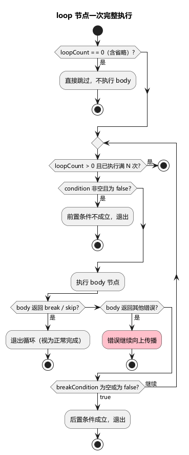
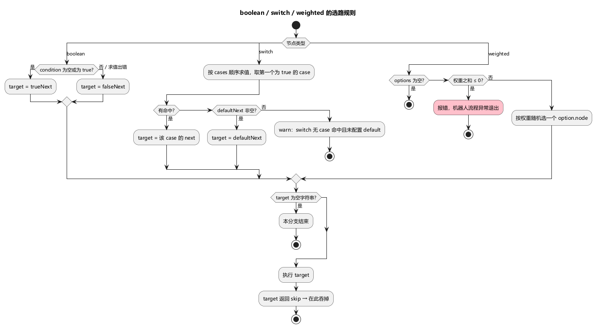

# 第 6 章 流程控制：循环与分支

> **目标**：让流程表达真实玩家的行为节奏——"刷副本直到体力不足"、"等级高打难本"、"随机挂机"。掌握 9 种节点里除 `action` 外的 8 种控制节点与条件表达式。
>
> **前置**：[第 5 章](ch05-first-flow.md)。示例 `examples/ch06/`：竞技场机器人无限循环刷本，体力 < 10 停。

## 6.1 示例流程鸟瞰

```
main: sequence
 ├─ connect / login / fetchPlayer        （第 5 章的老朋友；fetch 顺带存 level、stamina）
 ├─ idle: loop（无限次，breakCondition: stamina < 10）
 │   └─ battleRound: sequence
 │       ├─ chooseStage: boolean  ── level >= 10 ? 难本 : 简单本（setState 写 stageId）
 │       ├─ startBattle: action   ── 存 lastWin / stamina / lastGain
 │       ├─ afterBattle: switch    ── 赢了 celebrate / 输了 mourn
 │       └─ rest: weighted         ── 30% 聊天 / 70% 发呆（随机 200~800ms）
 └─ close
```

9 种节点一览（`type` 必填，写错在加载期被 Schema 拒绝）：

| type | 专属字段 | 一句话 |
|---|---|---|
| `sequence` | `next` | 按序执行子节点 |
| `loop` | `loopCount`、`body`、`condition`、`breakCondition` | 循环 |
| `boolean` | `condition`、`trueNext`、`falseNext` | 二分支 |
| `switch` | `cases[]`（`condition` + `next`）、`defaultNext` | 多条件首匹配 |
| `weighted` | `options[]`（`node` + `weight`） | 加权随机 |
| `wait` | `waitMs`、`waitMin`、`waitMax`、`then` | 显式等待 |
| `action` | `action`、`listenRefs`、`onError`、`delayMs` | 执行动作（第 5 章） |
| `break` / `continue` | 无 | 循环控制 |

所有节点都可以写 `description`（备注，引擎忽略）。Schema 只按"所有节点共用一张字段表"校验，**给节点写了不属于它类型的字段（比如给 sequence 写 `body`）不会报错，只是不生效**。所有指向其他节点的字段（`next`、`body`、`trueNext` 等）加载期不检查目标是否存在，写错的 ID 要执行到才报 `节点不存在: xxx (caller=…)`。

## 6.2 sequence：顺序与"跳过剩余"

```json
"battleRound": { "type": "sequence", "next": ["chooseStage", "startBattle", "afterBattle", "rest"] }
```

`next` 数组按序执行，空数组合法（什么也不做）。关键行为：

- 某个子节点返回"skip"时，**跳过本层剩余子节点，sequence 视为正常完成**（skip 来自 onError 的 `strategy: "skip"`，第 9 章）；
- 其他错误（`abort`、节点不存在、break/continue 信号等）中断本层并继续上抛；
- 停止压测（取消）时，本层还没执行的 action 子节点会被记一次"已取消"样本，便于监控面统计被打断的动作；只看本层 `next`，不会深入嵌套 sequence 内部。

## 6.3 loop：循环次数与三种退出方式

```json
"idle": { "type": "loop", "loopCount": -1, "body": "battleRound", "breakCondition": "state:stamina < 10" }
```

| 字段 | 语义 |
|---|---|
| `loopCount` | `> 0` 至多 N 次；`-1`（任意负数）无限循环；**`0` 直接跳过循环体——不写 `loopCount` 就是 0**，循环体一次都不会执行 |
| `body` | 循环体，**单个**节点 ID；有多步就让它指向一个 sequence（示例的 `battleRound`） |
| `condition`（前置） | 每轮**开始前**求值，false 退出循环 |
| `breakCondition`（后置） | 每轮**结束后**求值，true 退出循环 |



四种常见写法：

```json
"repeat3":  { "type": "loop", "loopCount": 3,  "body": "round" }
"whileHp":  { "type": "loop", "loopCount": -1, "body": "round", "condition": "state:hp > 0" }
"untilWin": { "type": "loop", "loopCount": -1, "body": "round", "breakCondition": "state:lastWin == 1" }
"atMost10": { "type": "loop", "loopCount": 10, "body": "round", "breakCondition": "state:stamina < 10" }
```

要点：

- `continue` 跳过本轮剩余逻辑后**仍会评估 breakCondition**（对齐 do-while 语义）——否则靠后置条件退出的无限循环永远退不出去；
- skip 由最近一层能捕获它的节点吞掉（sequence / loop / boolean / switch / weighted）。body 是 sequence 时（最常见），skip 先被这个 sequence 吞掉，效果只是**结束本轮剩余步骤**，循环照常进入下一轮；只有 body 直接是 action 节点时，skip 才会让**整个循环退出**；
- body 里冒出的其他错误（`abort`、节点不存在等）会穿过循环继续上抛；
- **无限循环必须有出口**：`condition`、`breakCondition` 或循环体里的 `break` 节点，否则只能靠运行时长兜底。

前置还是后置？语义差别在"条件里的键还不存在时"：条件对缺失键求值为 false（6.9），于是前置条件**立即退出**；后置条件**不退出**继续循环。示例无服务器运行时正是后者：stamina 永远缺失，循环一直转到 30 秒时长上限。

## 6.4 boolean：二分支

```json
"chooseStage": {
  "type": "boolean",
  "condition": "state:level >= 10",
  "trueNext": "pickHardStage",
  "falseNext": "pickEasyStage"
}
```

- 两个目标按求值结果**二选一**；条件求值出错（如键不存在）按 false 走 `falseNext`；
- 目标为空串或不写 = 走到该分支就**正常结束**；
- 分支子树执行完，回到 boolean 所在 sequence 的下一个兄弟继续——分支目标不写"回来"的边；
- 分支子树里的 skip 在 boolean 这里被吞掉；
- **空 condition 恒为 true**（走 trueNext）——别依赖这个特性，条件写清楚。

## 6.5 switch：多条件首匹配

```json
"afterBattle": {
  "type": "switch",
  "cases": [
    { "condition": "state:lastWin == 1", "next": "celebrate" },
    { "condition": "state:lastWin == 0", "next": "mourn" }
  ],
  "defaultNext": ""
}
```

- 每个 case 的 `condition` 和 `next` 两个键都必须写（Schema 必填），值可以是空串；
- cases 按声明顺序求值，**第一条命中即执行并结束**本节点（无 fall-through）；命中 case 的 `next` 为空串 = 命中后什么也不做；
- 全不命中：`defaultNext` 有值走它；没配则打一条 `[ENGINE] switch 无 case 命中且未配置 default，分支静默结束` 警告后**正常结束**（不是错误）；
- case 的 condition 为空串恒命中——可以故意把空条件 case 放最后当兜底，效果同 `defaultNext`。



## 6.6 weighted：加权随机

```json
"rest": {
  "type": "weighted",
  "options": [
    { "node": "doChat", "weight": 3 },
    { "node": "doIdle", "weight": 7 }
  ]
}
```

- 按权重比例随机选一个 option 执行，每次执行独立抽取；示例中聊天概率 = 3/(3+7) = 30%；
- `node`、`weight` 都必填，`weight` 是 ≥ 0 的整数。`weight: 0` 的选项**永不命中**（合法，常用来临时关掉一个分支）；
- 负权重在加载期就被拒绝：`- at '/nodes/rest/options/0/weight': minimum: got -1, want 0`；
- `options` 为空数组：什么也不做，正常结束；
- 全部权重都是 0：加载能通过，但执行到时报 `weighted 节点权重之和 ≤ 0，无分支可选: options=2 (caller=bot_1140000)`，**该机器人的流程异常退出**——这是配置错误，别这么写。

## 6.7 wait：显式等待

```json
"doIdle":  { "type": "wait", "waitMin": 200, "waitMax": 800 }
"cooling": { "type": "wait", "waitMs": 1500, "then": "retryBuy" }
```

| 配置 | 行为 |
|---|---|
| `waitMin`、`waitMax` 都 > 0 | 闭区间 `[waitMin, waitMax]` 毫秒随机等待，`waitMs` 被忽略；`waitMin >= waitMax` 时固定等 `waitMin` 并警告 `[ENGINE] wait 节点 waitMin >= waitMax，使用 waitMin` |
| 只有 `waitMin`、`waitMax` 其中一个 > 0 | **完全不等待**，警告 `[ENGINE] wait 节点 waitMin/waitMax 必须同时 > 0`，`waitMs` 也不会生效 |
| 只有 `waitMs` > 0 | 固定等待 `waitMs` 毫秒 |
| `waitMs` < 0 | 不等待，警告 `[ENGINE] wait 节点 waitMs < 0，跳过` |
| 全都没写 / 为 0 | 不等待 |

- `then` 是等待后要执行的唯一后继节点，空 = 到此正常结束；即使等待因参数不合法被跳过，`then` 照样执行；
- 等待期间停止压测会立即中断，不会等满。

## 6.8 break / continue

```json
"stop": { "type": "break" }
"next": { "type": "continue" }
```

- `break` 跳出**最近一层** loop，循环后的兄弟照常执行；`continue` 结束本轮（仍评估 breakCondition）；
- 它们通常挂在 boolean / switch 的分支上（"满足某条件就跳出"）。信号会一路穿过中间的 sequence、boolean、switch、weighted 向上找最近的 loop；
- 没有 loop 包裹却冒出 break/continue → 一路上抛到根，**该机器人的流程异常退出**，日志 `[ENGINE] 流程异常退出` 的 error 字段就是 `break` 或 `continue`。这是配置错误，加载期不拦。

## 6.9 条件表达式：能写什么

条件出现在 boolean 的 `condition`、loop 的 `condition` / `breakCondition`、switch 的 `cases[].condition`、绑定的 `condition`（第 7 章）。所有条件在**加载期全部编译**，语法错误直接让进程启动失败。

**必须带前缀**，缺前缀加载期报错（日志里带 `准备流程条件: 节点 "main" condition 条件表达式语法错误 "level >= 10": ` 这样的定位前缀）：

```
条件表达式 "level >= 10" 缺少前缀：必须以 "state:"（内置比较）或 "lua:"（脚本求值）开头
```

整个条件只能二选一：要么 `state:` 内置表达式，要么 `lua:` 脚本，**不能在一个条件里混用**。

### state: 内置表达式

`state:` 前缀**只在最开头写一次**，后面整串都是表达式，里面的裸标识符就是状态路径：

```
state:stamina < 10                       单比较
state:playerData.name == "bot_1"         路径支持点分与下标：key.sub.field、key.list[0].id
state:a >= 5 && (b == 2 || c != 3)       复合：&&、||、!、括号
state:coins + bonus > 1000               算术：+ - * / %
state:level % 2 == 0                     取模（仅整数）
state:-hp < -10                          一元负号
state:!isVip                             裸路径作布尔值（状态值必须是布尔）
```

在表达式中间再写 `state:` 是最常见的错误：

```
准备流程条件: 节点 "main" condition 条件表达式语法错误 "state:a >= 5 && state:b == 2": 词法错误: 非法字符 ':'（位置 15）
```

（位置是去掉开头 `state:` 之后的字节偏移。）

**运算符优先级**（从低到高）：

| 级别 | 运算符 | 说明 |
|---|---|---|
| 1 | `\|\|` | 逻辑或，左结合，短路 |
| 2 | `&&` | 逻辑与，左结合，短路 |
| 3 | `!` | 逻辑非（一元）。`!a == b` 等价于 `!(a == b)` |
| 4 | `==` `!=` `>` `>=` `<` `<=` | 比较，**不可连写**：`1 < x < 3` 加载期报 `存在多余 token "<"（位置 …）`，要写成 `x > 1 && x < 3` |
| 5 | `+` `-` | 加减 |
| 6 | `*` `/` `%` | 乘除取模 |
| 7 | 数字、字符串、路径、`( … )`、一元 `-` | 操作数 |

**操作数**：

- 数字：整数或小数（`10`、`1.5`），负数用一元负号；
- 字符串：双引号括起，**不支持转义**、不支持单引号；
- 路径：字母或 `_` 开头，由字母、数字、`_` 组成，可接 `.字段` 与 `[数字]`。中文键名、带 `-` 的键名无法在条件里引用；
- **没有 `true` / `false` / `nil` 字面量**——裸写 `true` 会被当成名为 `true` 的状态键。

**类型规则**（违反时这一处求值出错，见下）：

- `==` / `!=` 只比较同类：数字和数字、字符串和字符串、布尔和布尔。数字与字符串比较是错误——**`!=` 也一样得到 false**，不会因为"类型不同所以不等"得到 true；
- `>` `>=` `<` `<=` 和算术运算只接受数字；`%` 只接受整数；整数相除向零截断（`7 / 2` 为 3），除以 0 是错误；
- `&&` / `||` / `!` 的操作数必须是布尔值（比较的结果、或值为布尔的状态键）；把数字状态键直接当条件（`state:coins`）是错误，要写 `state:coins > 0`。

**求值出错时**：比如键不存在（`state 路径 "level" 不存在`）、类型不匹配、除以 0。出错的子表达式按 false 参与后续的 `&&` / `||` / `!` 运算，并打一条 `[ENGINE] 条件表达式求值失败` 警告，不会让机器人停下：

- `state:missing > 0`、`state:missing != 1`：整个条件为 false；
- `state:missing > 0 || ok == 1`：左边按 false，继续算右边；
- `state:missing > 0 && …`：左边已是 false，右边短路不算；
- `state:!(missing > 0)`：括号里按 false，**被 `!` 翻成 true**。想表达"键不存在时为真"可以这样写，但会伴随一条警告。

**`state:` 后面什么都不写**等价于恒 true。

其他加载期语法错误文案：`非法字符 '='（位置 3，是否想用 ==）`（单个 `=`）、`意外的 token ""（位置 4）`（表达式不完整，如 `state:hp >`）、`缺少右括号 )（位置 …）`、`未闭合的字符串字面量（位置 …）`、`数组下标必须为数字（位置 …）`、`数组下标缺少右括号 ]（位置 …）`。

### lua: 脚本求值

```json
"condition": "lua:check_ready.lua"
```

- 前缀后面整串就是脚本文件名（相对 `scripts` 目录），脚本里定义 `function execute(r)`；
- **必须 `return true` 或 `return false`**。返回数字、字符串或什么都不返回都算错误，条件按 false，错误信息如 `布尔脚本 check_ready.lua 必须 return true/false，实际类型 number`、`布尔脚本 check_ready.lua 未返回值，必须 return true/false`；
- 脚本文件是否存在加载期不检查；运行时找不到会打 `[ROBOT] 条件脚本不存在，条件判断默认拒绝`，条件按 false。

Lua 条件适合字符串包含、跨多个状态的复杂判断等内置表达式写不出来的情况，脚本写法见第 11 章。

## 6.10 节点间隔复习

控制节点（sequence/loop/boolean/switch/weighted/wait/break/continue）**后没有节点延迟**，默认 1000ms 间隔只作用于 action 节点（第 5 章 5.7）。所以示例里真正决定节奏的是 `startBattle` / `Chat` 等 action 的间隔加 `rest` 的随机等待。注意一个无限循环里如果全是控制节点和 `delayMs: -1` 的动作，它会以 CPU 能跑的最快速度空转。

## 6.11 运行与观察

```bash
go run ./cmd/stressbot -config tutorial/examples/ch06/stressbot.toml
```

启动行显示 `connections=1 nodes=17 actions=10 listens=0`。无服务器时：

1. connect / login / fetch 依次失败（错误码 2 / 1 / 22，resume 继续）；
2. 进入循环后每一轮：`chooseStage` 求值 `level` 失败（警告 `state 路径 "level" 不存在`）→ 按 false 走 `pickEasyStage`，这个 setState 动作**成功**；`StartBattle` 失败（错误码 1）；`afterBattle` 的 `lastWin` 也不存在，两个 case 都按 false，打出 `switch 无 case 命中且未配置 default` 警告；`rest` 随机选聊天（`Chat` 成功）或等待；
3. stamina 永远缺失 → 后置 breakCondition 恒 false → 循环一直转到 30 秒时长到。

监控表里 `PickEasyStage`、`Chat` 的成功数和 `StartBattle` 的失败数持续增长，就是循环在转的证据。有服务器时（【需目标服务器】）：观察 `Celebrate` / `Mourn` 的成功数比例≈胜率，`Chat` 与等待的比例≈3:7。

## 6.12 练习与验收

练习：

1. 把 `idle` 的 `breakCondition` 换成 `condition`（`state:stamina >= 10`），无服务器重跑，观察机器人是否还活到 30 秒（答案：不会，前置条件对缺失键求值 false，循环立即退出；所有机器人走完流程后进程提前退出）；
2. 删掉 `idle` 的 `loopCount`，观察循环体一次都没执行；
3. 把 `chooseStage` 的条件改成 `state:level >= 10 && state:stamina > 0`，看 6.9 的"非法字符 ':'"报错，再改成正确写法 `state:level >= 10 && stamina > 0`。

- [ ] 能说出 loop 的循环次数规则（含省略 = 0）、三种退出方式与前置/后置对缺失键的差别
- [ ] 知道 weighted 的 weight:0 与全 0、switch 的空 condition、wait 的半随机区间各自的行为
- [ ] 能写一个带 `&&` / 括号的条件表达式并一次通过加载，知道 `state:` 只写一次

## 延伸阅读

- 节点类型全量字段与实现：[docs/flow-node-system.md](../docs/flow-node-system.md)
- 下一章：[第 7 章 数据构造：随机化与过滤](ch07-random-bindings.md)
