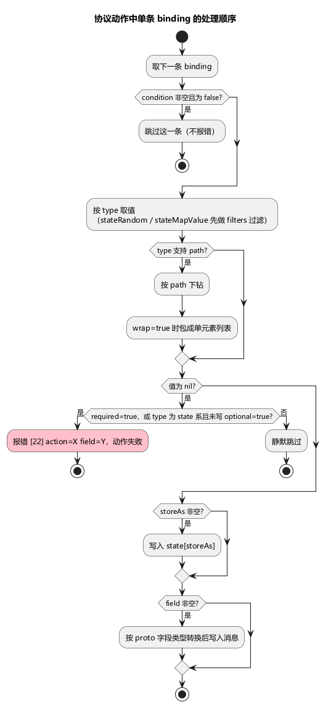

# 第 7 章 数据构造：随机化与过滤

> **目标**：让一万个机器人各不相同——随机选、随机造、按条件筛。掌握 17 种绑定的选型与过滤器的全部运算符。
>
> **前置**：[第 5 章](ch05-first-flow.md)（用过 fixed/state/randomInt）。示例 `examples/ch07/`：逛商店 → 按价格过滤后随机买 → 随机聊天 → 上报随机标签。

## 7.1 绑定全家族速览

17 种 type 按用途分四族（关键字段见括号）：

**取值**（第 5 章已学）

| type | 语义 | 关键字段 |
|---|---|---|
| `fixed` | 固定值（`type` 必填，省略会在 Schema 校验失败） | `value` |
| `state` | 从状态取 | `source` |
| `stateFirst` | 从状态列表取**第一个** | `source` |

**随机选取**（从已有数据里挑）

| type | 语义 | 关键字段 |
|---|---|---|
| `randomPick` | 从配置的候选列表均匀随机一个 | `values` |
| `randomPickN` | 从候选列表取 N 个（不重复） | `values` + `count` |
| `randomPickMap` | 按 key 从分组候选里随机（key 先从状态取） | `values` + `keySource` |
| `randomExclude` | 从候选（或状态列表）里排除一个指定值后随机 | `values` 或 `source` + `excludeSource` |
| `stateRandom` | 从状态列表随机一个，**支持 filters 先过滤** | `source` + `filters` |
| `stateRandomN` | 从状态列表过滤后取 N 个 | `source` + `count` + `filters` |
| `stateMapKey` | 从状态 map 随机取一个键 | `source` |
| `stateMapValue` | 从状态 map 随机取一个值，支持 filters | `source` + `filters` |

**随机生成**（凭空造）

| type | 语义 | 关键字段 |
|---|---|---|
| `randomInt` | 闭区间整数；`min > max` 加载后运行即报错 | `min` / `max` |
| `randomFloat` | 随机小数，按 `precision` 位四舍五入 | `min` / `max` / `precision` |
| `randomBool` | 随机布尔 | — |
| `randomString` | 随机字符串 | `length`（默认 8）+ `charset` |

**辅助**

| type | 语义 | 关键字段 |
|---|---|---|
| `listSize` | 状态列表长度（不存在 = 0，永不报错） | `source` |
| `map` | 构造 proto map 字段 | `entries`（见 7.4） |

运行时一条绑定从定义走到写进消息，经过下图这些关口。过滤器只作用在「从已有列表/map 里挑」的那一族；`fixed` / `randomInt` 这类生成值没有 filters。



## 7.2 本章示例用到的三种

```json
{ "field": "itemId", "type": "stateRandom", "source": "shopItems",
  "filters": [
    { "path": "price", "op": "lt", "value": 100 },
    { "path": "stock", "op": "gt", "value": 0 }
  ] }
```

商店列表（`BrowseShop` 的响应整存进 `shopItems`）先按"价格 < 100 **且** 库存 > 0"过滤，再从 survivors 里随机挑一个商品——**先过滤再随机**，多个 filters 之间是与关系。

```json
{ "field": "channel", "type": "randomPick", "values": [1, 2, 3] }
```

世界/公会/队伍三选一，均等概率。

```json
{ "field": "text", "type": "randomString", "length": 8, "charset": "lower" }
```

`charset` 内置别名：`lower` / `upper` / `alpha`（大小写）/ `numeric` / `alphanum`（默认）；**其他非空值按自定义字符集字面使用**（如 `"charset": "01"` 只出 0 和 1）。

## 7.3 重要的坑：值缺失时谁报错、谁沉默

- **隐式必填的 6 种**：`state` / `stateFirst` / `stateRandom` / `stateRandomN` / `stateMapKey` / `stateMapValue`——source 取不到值时**动作直接失败**（错误码 22），不是填 nil；
- `optional: true` 优先级最高，能压制隐式必填：取不到就**静默跳过该字段**（适合"有就带上"的可选参数）；
- **过滤后为空**同样走隐式必填 → 报错 22。想让"没有便宜货就买别的"成为合法路径，用 `optional: true` 或先在流程里做条件分支；
- `randomPick` 系和 `listSize` 不隐式必填：候选空/列表缺失 → 跳过或 0。

另一个容易误会的：`path` 和 `wrap` 只对部分类型生效（fixed/state/stateFirst/stateRandom/stateMapValue/randomPick/randomExclude）；`stateRandomN`、`randomString`、`randomInt` 等提前返回的类型上写了也不起作用。

## 7.4 map 绑定：构造 proto map 字段

```json
{ "field": "tags", "type": "map",
  "entries": [
    { "key": 1, "value": { "type": "fixed", "value": "tutorial" } },
    { "key": 2, "value": { "type": "randomString", "length": 4, "charset": "numeric" } }
  ] }
```

对应 `map<int32, string> tags = 1;`。每个 entry 的 `value` 是一个**完整的绑定**（可以用任何 type），`optional`/`condition` 对单个 entry 也有效。

## 7.5 过滤器 12 运算符

`filters` 用在 `stateRandom` / `stateRandomN` / `stateMapValue` 上，FilterDef 五字段：

| 字段 | 含义 |
|---|---|
| `path` | 在**每个候选元素**上导航取参与比较的值：点分路径 + `[N]` 下标 + **`[]` 数组通配**（摊平列表）。空 = 拿元素本身比较 |
| `op` | 见下表；空 = `eq` |
| `value` | 比较目标（字面量） |
| `source` | 比较目标从状态取——**写裸键名**（`"source": "maxPrice"`，不带 `state:` 前缀）；非空时优先于 value |
| `mode` | path 产出多个值时的聚合：`any`（默认，至少一个命中）/ `all` / `none`（全不命中） |

| op | 语义 |
|---|---|
| `eq` / `neq` | 相等（数值按数值比，否则按字符串比；符号别名 `==` `!=`） |
| `gt` / `gte` / `lt` / `lte` | 仅数值比较（别名 `>` `>=` `<` `<=`） |
| `contains` / `notContains` | 列表找成员；或字符串包含 |
| `in` / `notIn` | 候选值 ∈ value 给的列表 |
| `notNil` / `isNil` | 只判候选侧是否为 nil，忽略 value |

实用细节：`mode: "none"` 是"字段不存在"的唯一兜法——path 没命中任何值时，any/all 返回 false、none 返回 true。

## 7.6 运行与观察

```bash
go run ./cmd/stressbot -config tutorial/examples/ch07/stressbot.toml
```

无服务器时前三个动作失败后，`BrowseShop` 失败（resume）→ `BuyCheapItem` 因 `shopItems` 缺失报错误码 22（隐式必填的现场演示）→ `Shout`/`ReportStats` 因无连接报 1。有服务器时（【需目标服务器】）多机器人各买各的商品、聊天文本两两不同——这就是"一万个机器人各不相同"的形态。

## 7.7 练习与验收

练习：给 `BuyCheapItem` 的 `itemId` 绑定加 `"optional": true`，无服务器重跑，观察 22 报错是否消失（消失，改为静默跳过该字段，动作继续因连接问题失败）。

- [ ] 能按"取值/选取/生成/辅助"四族说出 17 种 type 的选型
- [ ] 能解释隐式必填 6 种 + optional 的压制关系
- [ ] 会用 `source` 让过滤阈值来自状态（而非写死在流程里）

## 延伸阅读

- 绑定全字段：README「bindings」；过滤器：README「filters」
- 下一章：[第 8 章 推送与监听](ch08-listens.md)
