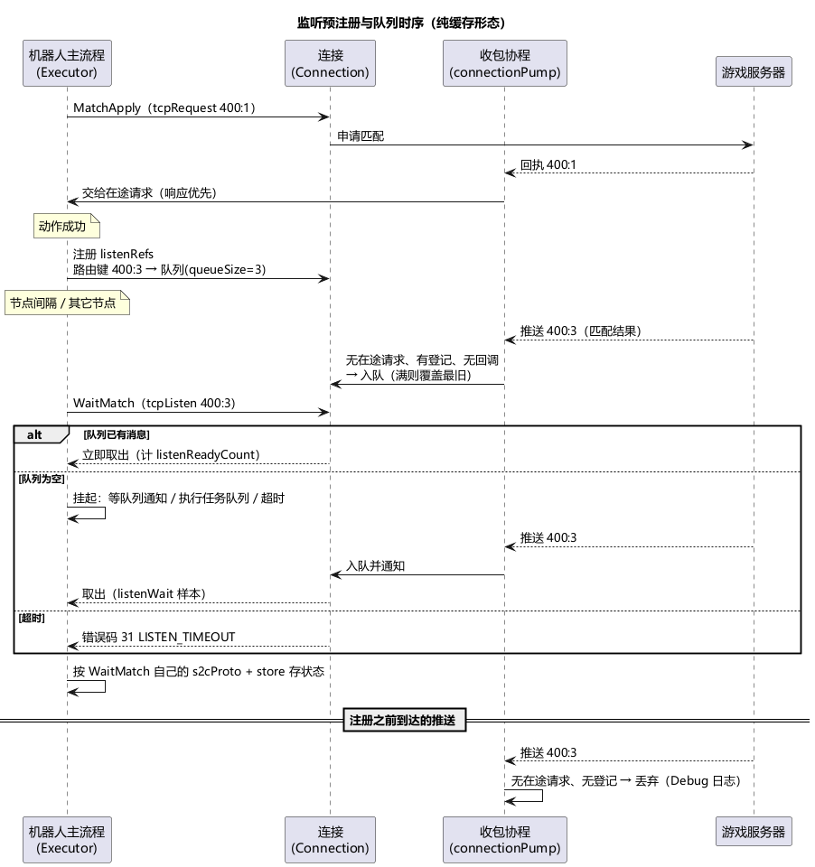

# 第 8 章 推送与监听

> **目标**：处理服务器主动推送——游戏压测区别于 HTTP 压测的关键能力。掌握 listens 三种形态、listenRefs 预注册、tcpListen/udpListen 等待、队列与回调的分工，以及监听指标。
>
> **前置**：[第 5 章](ch05-first-flow.md)、[第 6 章](ch06-flow-control.md)（loop/boolean）。示例 `examples/ch08/`：申请匹配 → 等匹配结果推送（循环 3 轮）；登录时顺带订阅公会广播。

## 8.1 为什么"注册"和"等待"是两步

机器人主流程是协作式的：发请求、等响应、睡觉都不阻塞别人，但**等一条不知道什么时候来的推送**可能等很久。stressbot 把"接收"和"等待"拆开：

1. **注册**（listenRefs）：在某条连接上挂一个"路由键 → 队列/回调"的登记——此后到达的该路由推送都由这条登记认领；
2. **等待**（tcpListen / udpListen 动作）：流程走到需要这条推送时，从队列取；队列里已有就直接拿（不产生等待时长），没有就挂起等通知或超时。

**推送先到、流程后等，不丢**（队列缓存着）；但**注册之前**到达的推送无人认领，会被直接丢弃（只在 Debug 级别留一行 `OnReceive 未匹配任何请求或监听`）——所以注册要尽量早，通常挂在"触发推送的那个动作"的节点上。



## 8.2 listens 表：一个监听的三种形态

```json
"listens": {
  "matchFound":   { "s2cProto": "arena.MatchFoundS2C" },
  "guildNotice":  { "s2cProto": "arena.GuildNoticeS2C",
                    "store": [ { "field": "notice", "setter": "guildNotice" } ] }
}
```

listens 是顶层的"监听定义表"，key 是监听名，value（ListenDef）只有三个字段：

| 字段 | 类型 | 含义 |
|---|---|---|
| `s2cProto` | string | 解析推送消息体用的 proto 全名 |
| `store` | 数组 | 推送字段 → 状态的映射（与动作的 `store` 同格式：`field` 支持嵌套路径，`setter` 是状态 key） |
| `script` | string | Lua 回调脚本名（相对 scripts 目录），脚本里定义 `on_message(r, msg)` |

三个字段的组合决定形态：

| 形态 | 配置 | 推送到达时发生什么 |
|---|---|---|
| **纯缓存** | 不引用 listens（listenRef 的 `listen` 留空），或引用的定义只写 `s2cProto` 不写 `store`/`script` | 进队列，等 tcpListen/udpListen 来取 |
| **到达即存** | `s2cProto` + `store` | 网络收包协程当场解析，再把"写状态"投递给机器人；**不进队列** |
| **Lua 回调** | `script`（可选 `s2cProto`） | 把消息投递给机器人，由它调用脚本的 `on_message(r, msg)`（第 11 章）；**不进队列** |

两条约束，都不静默：

- `store` 与 `script` **互斥**，同时配置在注册时报错：`监听 "x" 同时配置了 store 与 script：二者互斥…`；
- listenRef 引用了 listens 表里不存在的名字，在**加载期**拦截：`节点 "x" listenRefs[0] 引用的 listen "y" 在 listens 中无定义`。

### "到达即存"什么时候在状态里看得到

推送由连接的收包协程（connectionPump）接收，它**不直接碰机器人状态**：解析完成后把"写状态"包装成任务投递进机器人的任务队列（容量 256），由机器人主流程在**空闲窗口**里执行。空闲窗口包括：节点间隔（delayMs）、wait 节点、请求/监听等待、Lua 里的 `utils.sleep` 与各种网络等待。

所以"到达即存"不需要专门的等待动作，但写入会在**下一个空闲窗口**落地——一条中间完全不等待的流程（例如所有节点 `delayMs: -1` 且全是本地动作）会一直攒着不执行。任务队列满时新任务被丢弃并告警 `[ROBOT] 任务队列已满，丢弃 listen 回调任务`。

解析失败（proto 不匹配等）记 Error 日志 `[ROBOT] 解析推送消息失败`，并以错误码 **62**（CALLBACK_PARSE）计入该回调的监控行。

## 8.3 listenRefs：在哪个节点注册

```json
"applyMatch": {
  "type": "action",
  "action": "MatchApply",
  "listenRefs": [
    { "route": { "cmd": 400, "act": 3 }, "server": "tcp:arena", "listen": "matchFound", "queueSize": 3 }
  ]
}
```

| 字段 | 必填 | 含义 |
|---|---|---|
| `route` | 是 | 路由，与动作的 `route` 同格式；由该连接 codec 的 `routeKeyTemplate` 算出路由键（如 `{cmd}:{act}` → `"400:3"`），决定认领哪条推送 |
| `server` | 是 | 连接标识，格式固定 `协议:服务名`（`"tcp:arena"`、`"udp:battle"`）；格式错误或该连接没有 codec 在注册时报错 |
| `listen` | 否 | 引用 listens 表的 key；**不写或空串 = 纯缓存监听**（连 listens 表都不用进） |
| `queueSize` | 否 | 队列容量，不写默认 **1**；显式配置必须 ≥ 1（Schema 加载期即拦截 0 和负数） |

注册时机：

- 在节点的**动作成功之后**注册；ignoreCodes 命中（第 9 章，"算继续"）同样注册；动作**最终失败不注册**——连接都没连上时，后面的注册根本不会发生；
- **纯监听节点**也合法：`action` 字段留空、只写 listenRefs，节点只做注册（随后照常走节点间隔），专门用来"先订再说"。`action` 和 listenRefs 都为空的节点会告警 `[ENGINE] action 节点既无 action 也无 listenRefs，节点空转`；
- 注册时连接不存在（例如前面关掉了连接、动作本身不依赖连接），打 Warn 跳过：`[ROBOT] 连接未建立，监听注册被跳过（该服务的推送将收不到）`，不报错——后面的 tcpListen 会干等到超时。

注册规则（登记挂在**连接对象**上）：

- 同一路由键、同一 queueSize、同一形态（回调/纯缓存）重复注册是**幂等**的，回调更新为最新一次；所以循环里反复执行的节点挂 listenRefs 没问题；
- 同一路由键 queueSize 不同 → 报错 `监听注册冲突：…queueSize…`；一处是回调、另一处是纯缓存 → 报错 `…模式不一致…`；
- 登记跟着连接走：`tcpClose` 后重新 `tcpConnect` 得到的是新连接，**需要重新注册**（把 listenRefs 挂在重连之后会再次执行的节点上）；
- 注册失败按该节点的 onError 处理（第 9 章）：`resume` 下记录 `[ENGINE] 注册监听失败` 并继续，`skip` 跳出当前层级，`abort` 以错误码 **32**（LISTEN_REGISTER）中断流程。

在 Lua 里也能注册纯缓存监听：`network.ensure_tcp_listener(service, "400:3")` / `ensure_udp_listener`，第二个参数是**路由键字符串**，队列容量固定 1（第 11 章）。

## 8.4 tcpListen / udpListen：等待与消费

```json
"WaitMatch": {
  "pattern": "tcpListen",
  "service": "arena",
  "route": { "cmd": 400, "act": 3 },
  "s2cProto": "arena.MatchFoundS2C",
  "store": [ { "field": "battleId", "setter": "battleId" } ],
  "timeout": 10
}
```

- **tcpListen 不会自己注册监听**——它只是等。等谁？用它自己的 `service + route` 算出路由键，找**之前 listenRefs 注册过同键**的队列。route 写得和注册处不一致 → 永远超时；
- `timeout` 单位**秒**，不配（或 0）默认 **60**；
- 取到消息后按**动作自己的** `s2cProto + store` 解析存储（不是 listens 表里那份）；消息头里带非 0 错误码时按业务错误处理（第 9 章）；
- 超时是动作失败：错误码 **31**（LISTEN_TIMEOUT），detail 形如 `action=WaitMatch service=arena route=400:3 timeout=10s elapsed=10s；route 未通过 listenRefs 预注册，请在前驱节点添加 listenRefs 并设置 listen=null`。最后这句提示的意思是"加一条纯缓存的 listenRef"——在 JSON 里**不写 `listen` 字段或写空串**即可（Schema 要求 `listen` 是字符串，写 `null` 会被拒）；
- 连接不存在时 tcpListen 同样会等满 timeout 后报 31。

## 8.5 路由键别撞车

同一条连接上，一个入站消息按以下顺序被认领：

1. **在途请求的响应**：tcpRequest/udpRequest 正在等的路由键优先；
2. **监听登记**：有回调执行回调，没有回调进队列；
3. 都没有：丢弃（Debug 日志）。

所以同键的回执会被在途请求吃掉，进不了监听队列。示例的设计就是范本——

```
MatchApply   tcpRequest  route 400:1   ← 申请回执（服务器立即回，走请求-响应）
matchFound   listenRef   route 400:3   ← 匹配结果（服务器稍后推，走监听队列）
WaitMatch    tcpListen   route 400:3   ← 与注册同键
```

> 路由键用的是配置里的**原始数值**，而线上帧里的路由字段会按 codec 声明的宽度截断。示例 codec 把 `cmd` 声明为 `u16`；如果把 `cmd` 声明成 `u8` 又在流程里写 `cmd: 400`，期望路由键是 `"400:3"`，线上帧里却是 `144`，永远匹配不上。路由字段的宽度要能装下你用到的最大值。

## 8.6 队列与回调的互斥（易踩）

队列是固定容量环形队列，**队满覆盖最旧**（不是拒绝新消息），并告警 `[NETWORK] 监听队列已满，覆盖丢弃最旧消息`（字段 `dropped` 为累计丢弃数）——容量 1 时只留最近一条。需要依次处理多条（如连发的多个奖励推送）时把 `queueSize` 调大。

但注意：

- 注册的是**回调形态**（到达即存 / Lua 脚本）时，消息**不进队列**；
- 于是"同一路由又配了回调、又被 tcpListen 等"必然等满超时（码 31）。这个组合没有配置期校验——自己保证别这么配。想"既存状态又让流程等到它"，就用纯缓存监听 + tcpListen 动作自带的 `store`。

## 8.7 监听指标怎么看

tcpListen/udpListen 动作在监控里归为**监听**类（`listen`），主指标列是监听等待而不是 RTT：

| 指标（接口字段名） | 含义 |
|---|---|
| `listenWait`（分布） | 真实等待时长：从开始等待算到帧在内核可读的时刻（不是机器人被唤醒读到它的时刻），避开协作式调度的量化误差 |
| `listenReadyCount` | 等待开始前消息已在队列里的次数（等待时长为 0，不产生分布样本，只计次） |
| `listenTimeoutCount` | 等待超时次数 |
| `listenTimeoutRate` | 超时 /（等待样本 + ready + 超时） |

监听类**不参与 Apdex**（耗时主体是服务端业务时长，掺进往返类会让分数随动作构成漂移），界面显示"不适用"。

回调形态的处理结果单独成行，内部名为 `callback:<监听名>`（如 `callback:guildNotice`），界面上显示为带橙色"推送"标签的监听名：成功计数，失败按错误码聚合（Lua 回调失败 61、推送解析失败 62）。动作表右上角的"隐藏推送"开关可以把这些行藏起来。

## 8.8 运行与观察

```bash
go run ./cmd/stressbot -config tutorial/examples/ch08/stressbot.toml
```

无服务器时实测的路径：

1. `ConnectArena` 失败（码 2，`service=arena address=127.0.0.1:18888`）；默认 strategy 是 resume，流程继续；
2. `LoginArena`、`MatchApply` 因连接不存在失败（码 1，CONN_NOT_FOUND）——**动作失败不注册监听**，所以这里不会出现"注册被跳过"的告警，登记根本没发生；
3. `WaitMatch` 每轮等满 10 秒报码 31（`route=400:3`）；
4. `checkMatch` 求值时 `battleId` 不存在，告警 `[ENGINE] 条件表达式求值失败 … state 路径 "battleId" 不存在`，按 false 处理 → `MarkGiveUp`；
5. 每轮约 14 秒（10 秒监听等待 + 各节点 1 秒间隔），`duration = "30s"` 内大约跑 2 轮就到时停止。

控制台汇总里能看到 `WaitMatch` 的超时计数与 `tout=10000ms`，错误分布里是 `[框架 CONN_NOT_FOUND]` 等框架码。整条"超时降级"路径正好走一遍。

有服务器时（【需目标服务器】）：登录成功后注册 `guildNotice`，公会广播随时到达、在下一个空闲窗口写进 `guildNotice` 键（监控出现带"推送"标签的 `guildNotice` 行）；申请匹配成功后注册 `matchFound`，匹配推送到达进队列 → `WaitMatch` 取到 → `battleId` 存入 → `MarkReady`。

## 8.9 练习与验收

练习：

1. 把 `WaitMatch` 的 timeout 改成 2，无服务器重跑：每轮缩短到约 6 秒，30 秒内的轮数和 `listenTimeoutCount` 都变多（loopCount 3 跑满后流程正常结束）；
2. 把 `matchFound` 的 listenRef 改成 `queueSize: 0`，观察加载期报错；
3. 给 `matchFound` 再加一条 `store`，思考为什么 `WaitMatch` 会变成必然超时。

- [ ] 能说清 listenRefs / tcpListen / listens 三者各自负责什么
- [ ] 知道"推送先到不丢"的前提是**已注册**，注册前到达的被丢弃；注册在动作成功后才发生
- [ ] 知道路由键冲突时响应优先、回调与 tcpListen 等待互斥、登记跟着连接走
- [ ] 会在监控里看 `listenTimeoutRate` 判断推送链路健康度，看"推送"行判断回调是否出错

## 延伸阅读

- 网络层实现：[docs/network-layer.md](../docs/network-layer.md)；监听指标：[docs/monitoring-system.md](../docs/monitoring-system.md)
- 下一章：[第 9 章 失败怎么办：onError 错误链路](ch09-onerror.md)
