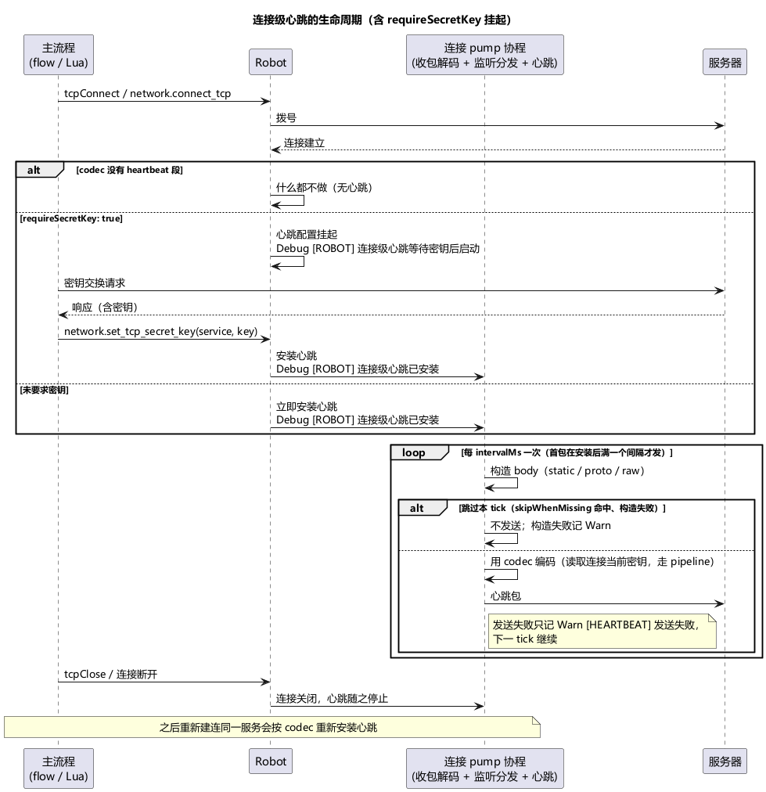

# 第 10 章 心跳与连接保持

> **目标**：让长连接机器人挂机不掉线。心跳是**每条连接**的声明式配置，写在 codec 文件里，不在 flow.json 里。
>
> **前置**：[第 4 章](ch04-protocol.md)（codec 结构）。示例 `examples/ch10/`：ch06 的挂机流程 + 带心跳段的 codec。

## 10.1 三种心跳形态

codec 文件的 `heartbeat` 段决定这条连接要不要保活、怎么保活：

```json
"heartbeat": {
  "intervalMs": 3000,
  "route": { "cmd": 2, "act": 1 },
  "skipWhenMissing": true,
  "heartbeatFields": [
    { "type": "u32", "source": "counter", "start": 1, "step": 1 },
    { "type": "u64", "source": "timestamp", "unit": "ms" }
  ]
}
```

| 形态 | 配置 | 适用 |
|---|---|---|
| **静态心跳** | 只配 `intervalMs` + `route`，body 为空 | 协议只要"包在就行"的保活 |
| **proto 模式** | `c2sProto` + `bindings` | 心跳是标准 proto 消息；bindings 每 tick 全量重求值（state 源每 tick 重读、随机类每 tick 重掷） |
| **raw-binary 模式** | `heartbeatFields`（不依赖 proto） | 心跳是定长小端二进制块，字段按声明顺序打包 |

三选一（`c2sProto` 与 `heartbeatFields` 互斥，加载期校验）；**heartbeat 段整个不写 = 这条连接没有心跳**。

`skipWhenMissing` 是 heartbeat **根字段**（不是 `heartbeatFields` 某一项的属性），只作用于 raw-binary 模式的 `state` 源：`true` 时缺 key 就跳过本 tick；`false`（默认）本 tick 报错并记 Warn、不发包。proto / 空 body 模式不用这个字段。

## 10.2 heartbeatFields 的六种取值源

raw 模式每个槽位一个字段（`type` 是宽度、`source` 是取值方式）：

| source | 字段 | 语义 |
|---|---|---|
| `fixed` | `value` / `floatValue` | 固定值（缺了报错，不静默填 0） |
| `state` | `key` | 每 tick 读机器人状态；缺 key 时的行为由 heartbeat 根字段 `skipWhenMissing` 决定 |
| `counter` | `start`（默认 0）/ `step`（默认 1） | **私有计数器**：每 tick 发当前值、成功后 +step——"递增 seq"用它 |
| `stateCounter` | `key` | 状态里的共享计数器自增（发递增后的新值） |
| `timestamp` | `unit`（`ms`/`s`，默认 ms） | 当前时间戳 |
| `randomInt` | `min` / `max` | 每 tick 随机 |

注意区分两种计数器：`counter` 是连接私有、不进机器人状态；`stateCounter` 写状态（心跳体系里唯一的 state 写副作用），流程和脚本能看到。

**proto 模式没有 counter 语义**——17 种绑定里没有自增类型，要递增序号得自己在流程里推进 state 再用 `state` 绑定读。这是两种模式的实质能力差。

## 10.3 启动时机与密钥

- 连接**建立成功即启动**心跳，独立于主流程——流程在睡觉、等推送、跑长脚本，心跳照发（每连接独立 goroutine）；
- `requireSecretKey: true` 时心跳**挂起**，直到 Lua 调 `network.set_tcp_secret_key(service, key)` 才启动（典型：登录前先密钥交换）。声明式 flow 里**没有**设置密钥的动作，密钥只能来自 Lua；
- 心跳 route 在安装时固定，不每 tick 重算；密钥每 tick 重取（支持中途换密钥）。

心跳装上之后和主流程怎么并行，见下图。Lua 里 `utils.sleep` 或 `network.tcp_listen` 只挡住这个机器人的主流程，connectionPump 仍按 `intervalMs` 发心跳。



## 10.4 失败与断开行为

- **发送失败不停跳**：下一 tick 继续尝试（warn `[HEARTBEAT] 发送失败`）；
- **连接关闭即停**：心跳随连接死亡；流程之后重新建连同服务会重新安装；
- 没有连接级自动重连：**TCP 主连接断开 → 机器人停止**（第 3 章），其他连接断开只记录。UDP 连接断开连记录都只是 Debug（UDP 无连接语义）；
- 监控里**没有心跳专属计数**——心跳流量体现在带宽（发送 MB/s）里，发送失败看 warn 日志。

## 10.5 运行与观察

```bash
go run ./cmd/stressbot -config tutorial/examples/ch10/stressbot.toml
```

无服务器时心跳到不了发送阶段（连接都没建立）；心跳是否"已安装"的日志是 Debug 级（`[ROBOT] 连接级心跳已安装`），排查时把 `[log] level = "debug"` 打开看。有服务器时（【需目标服务器】）：长跑挂机，服务器无掉线踢人；把 `intervalMs` 调大到超过服务器容忍窗，观察被踢——这是验证心跳配置生效的最直接办法。

## 10.6 验收

- [ ] 能说出三种形态的选择依据与"不写 heartbeat 段 = 无心跳"
- [ ] 知道递增 seq 要用 `counter`/`stateCounter`，proto 模式表达不了
- [ ] 知道 requireSecretKey 心跳挂在密钥后面、密钥只能来自 Lua
- [ ] 知道主连接断开停机器人、心跳失败不停跳

## 延伸阅读

- 心跳编译与打包实现：`engine/heartbeat_plan.go`（源码注释）
- 下一章：[第 11 章 Lua：声明式表达不了的行为](ch11-lua.md)
