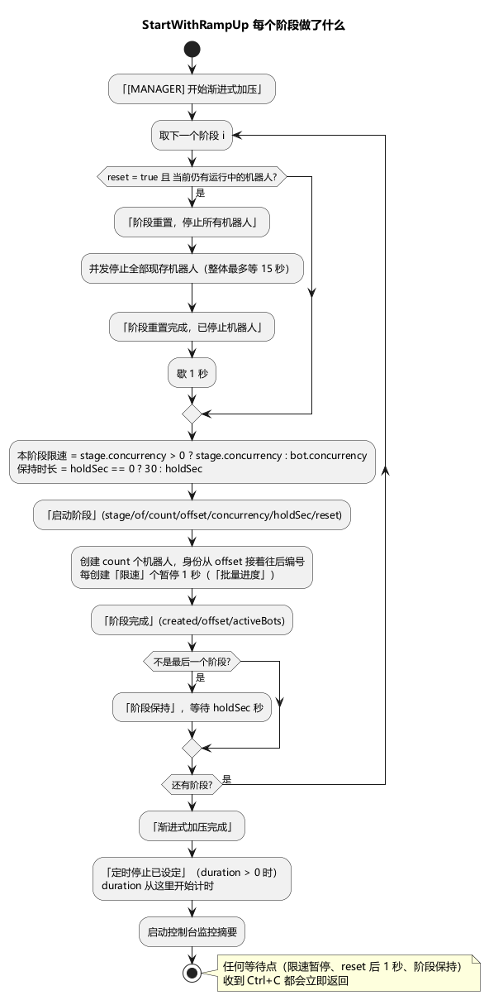
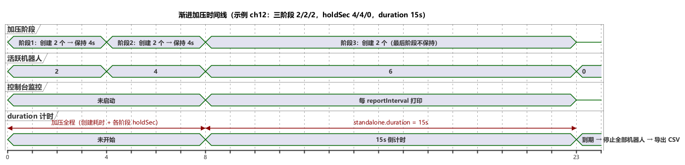

# 第 12 章 加压策略与运行参数

> **目标**：从"能跑"到"压得像真实负载"——机器人数量、创建节奏、渐进加压、运行时长、初始状态注入。
>
> **前置**：[第 1 章](ch01-quick-start.md)（toml 基础）、[第 3 章](ch03-core-concepts.md)。示例 `examples/ch12/`：三阶段 2/2/2 渐进加压，无网络依赖可直接跑。

## 12.1 数量与节奏：standalone.bot

```toml
[standalone.bot]
accountPrefix  = "bot_"    # 账号前缀，不写默认 "bot_"
startNumber    = 1140000   # 起始编号，不写或写 0 都按 1
totalBots      = 100       # 机器人总数，不写或写 0 都按 1
concurrency    = 20        # 创建期批量限速：每创建 20 个暂停 1 秒（0 或负数 = 不限速，一次性全建）
mainService    = "logic"   # 主连接服务名，必填
# defaultDelayMs = 500     # 动作节点之间的默认间隔（毫秒）
```

逐项说明：

| 键 | 说明 |
|---|---|
| `accountPrefix` + `startNumber` | 第 i 个机器人（i 从 0 起）的 `id = startNumber + i`，`account = accountPrefix + id`。换一批账号压测，改 `startNumber` 即可 |
| `totalBots` | 机器人总数。配置了渐进加压时，各阶段 `count` 之和必须与它相等 |
| `concurrency` | 再强调一次第 3 章的结论：它是**创建期限速**不是运行期并发——机器人全部起来后并发数就是 `totalBots`。作用是削平拨号瞬间的 CPU/内存尖峰。每暂停一次打一条 `[MANAGER] 批量进度`（`batchCreated`/`batchTotal`）；最后一批创建完不再暂停 |
| `mainService` | 主连接服务名，以它命名的 TCP 连接意外断开时机器人停止（第 3 章）。不写直接启动失败 `standalone.bot.mainService 未配置` |
| `defaultDelayMs` | 每个 action 节点执行完后的默认等待：不写或 0 = 1000ms；正数 = 自定义；`-1` = 不等。只允许 `-1` 或 `0~600000`，否则启动失败。设置了非 0 值时启动日志会多一行 `[MAIN] 配置节点执行间隔 {"delayMs": 500}`。节点自己写了 `delayMs` 时以节点为准 |

估算创建耗时：一次性创建 N 个、限速 C 时，暂停次数约为 `⌈N/C⌉ - 1` 秒。例如 `totalBots = 100`、`concurrency = 20` 时约 4 秒创建完。

单机模式下请求等待上限的默认值固定为 60 秒（动作没写 `timeout` 时使用），HTTP 请求超时固定为 10 秒，这两项没有 TOML 键。

## 12.2 运行时长：standalone.duration

```toml
[standalone]
duration = "10m"   # Go 时长格式：如 "90s"、"10m"、"1h30m"
```

- 空字符串或 `"0"` = 不限时：一直跑到全部机器人流程走完，或收到 Ctrl+C / SIGTERM；
- 写成不带单位的 `"10"` 会启动失败：`解析 standalone.duration 失败: time: missing unit in duration "10"`；负数时长同样视为不限时；
- **`duration` 在全部机器人创建完成之后才开始计时**（日志 `[MANAGER] 定时停止已设定 {"duration": 600}`，字段单位是秒）。一次性创建时，限速暂停的那几秒不算在内；渐进加压时，整个加压过程都不算在内——总运行时长 = 创建/加压全程 + `duration`。这是最常被误解的一条；
- 到期时打印 `[MANAGER] 运行时长已到，自动停止`，随后停止全部机器人并导出 CSV；
- `duration` 是上限：机器人流程提前全部走完，进程会提前退出。想压满整个时长，流程里要有无限循环（如示例 ch12 的 `loopCount: -1`）。

## 12.3 渐进加压：rampUp.stages

不配 `rampUp` = 一次性全量创建（日志 `[MANAGER] 开始创建机器人`）。配置后分阶段创建：

```toml
[standalone.bot]
# ……bot 的所有键要写在 stages 之前……
totalBots = 100

[[standalone.rampUp.stages]]
count = 20          # 本阶段新增机器人数
holdSec = 30        # 本阶段创建完后保持多少秒再进下一阶段（0 视为未填，回退默认 30）
# concurrency = 10  # 可选：本阶段的创建限速，不写或 ≤0 用 standalone.bot.concurrency
# reset = false     # 可选：true = 开始本阶段前先停掉所有现存机器人（模拟"一波退场一波进场"）

[[standalone.rampUp.stages]]
count = 30
holdSec = 60

[[standalone.rampUp.stages]]
count = 50          # 最后阶段的 holdSec 不起作用（见下）
```

每个阶段只有这四个键，写别的键会报"未知字段"。

> **TOML 书写陷阱**：`[[standalone.rampUp.stages]]` 一旦出现，它下面的所有键都属于这个阶段，直到下一个 `[...]` 表头。如果把 `mainService = "..."` 这类 bot 的键写在了阶段表头后面，会报 `包含未知字段: standalone.rampUp.stages.mainService`。bot 的键、`[standalone.stateExtra]` 都要写在阶段之前，或者用新的表头隔开。

每个阶段内部做的事：



规则与实测行为：

- **各阶段 count 之和必须等于 totalBots**，否则启动报错：`standalone.rampUp.stages 各阶段 count 之和 (2) 不等于 standalone.bot.totalBots (3)`；
- **身份连续编号**：每个阶段的机器人从上一阶段结束的位置接着编号（日志里的 `offset`），即使中间有 reset，新进场的也是一批新账号，不会复用旧账号；
- **限速两级**：阶段的 `concurrency` 大于 0 时覆盖 `standalone.bot.concurrency`，否则沿用全局值；
- **holdSec**：`0`（或不写）回退默认 **30** 秒，日志里显示的是回退后的值；显式写的正数原样照办，不做下限钳制；单机模式不校验负数，负数等于不保持。**最后一个阶段不保持**，创建完直接进入运行期；
- **reset = true**：先打印 `[MANAGER] 阶段重置，停止所有机器人`，并发停掉全部现存机器人（整体最多等 15 秒，超时会打 error 并强制继续），打印 `阶段重置完成，已停止机器人`，再歇 1 秒后开始本阶段。被停掉的机器人在监控 `robots:` 行里计入"停止"。没有现存机器人时（例如放在第一阶段）静默跳过 reset；
- 加压过程中任何一个等待点（限速暂停、reset 后的 1 秒、阶段保持）收到 Ctrl+C 都会立即中断；
- 某个机器人创建失败只打 error 并跳过，不影响同批其他机器人；但一个阶段一个都没建起来会报错终止。

## 12.4 看到加压节奏



单机模式（实测）：

- 阶段信息只有 `[MANAGER]` 日志：`开始渐进式加压` → 每阶段 `启动阶段` → `阶段完成` → （非最后阶段）`阶段保持` → 最后 `渐进式加压完成`、`定时停止已设定`；
- **控制台监控摘要在加压结束后才开始打印**，`[monitor.http]` 的 HTTP 端口也是加压结束后才启动，所以 `[MONITOR] robots:` 的运行数看不到阶梯过程，只能看到最终满载值；
- 监控采集本身从启动时就在进行：第一行摘要的时长和 `total` 包含整个加压期间，第一行的 `qps` 也因为覆盖了整段加压期而明显偏大，从第二行起才是正常的区间值；
- 想看完整阶梯曲线：用分布式形态的前端监控（节点从任务开始就在上报，并带当前阶段进度），单机下就以 `[MANAGER]` 日志的时间戳为准。

实测输出（示例 ch12，三阶段 2/2/2、holdSec 4/4/0、duration 15s；去掉了时间戳前缀和 `service` 字段）：

```
15:23:37.739  [MAIN] 渐进加压模式启动     {"stages": 3}
15:23:37.739  [MANAGER] 开始渐进式加压   {"stages": 3, "totalBots": 6, "defaultConcurrent": 2}
15:23:37.739  [MANAGER] 启动阶段  {"stage": 1, "of": 3, "count": 2, "offset": 0, "concurrency": 2, "holdSec": 4, "reset": false}
15:23:37.740  [MANAGER] 阶段完成  {"stage": 1, "created": 2, "offset": 2, "activeBots": 2}
15:23:37.741  [MANAGER] 阶段保持  {"stage": 1, "holdSec": 4, "activeBots": 2}
15:23:41.741  [MANAGER] 启动阶段  {"stage": 2, "of": 3, "count": 2, "offset": 2, "concurrency": 2, "holdSec": 4, "reset": false}
15:23:41.742  [MANAGER] 阶段完成  {"stage": 2, "created": 2, "offset": 4, "activeBots": 4}
15:23:41.742  [MANAGER] 阶段保持  {"stage": 2, "holdSec": 4, "activeBots": 4}
15:23:45.743  [MANAGER] 启动阶段  {"stage": 3, "of": 3, "count": 2, "offset": 4, "concurrency": 2, "holdSec": 30, "reset": false}   ← 0 回退显示 30，但最后阶段不保持
15:23:45.743  [MANAGER] 阶段完成  {"stage": 3, "created": 2, "offset": 6, "activeBots": 6}
15:23:45.744  [MANAGER] 渐进式加压完成  {"plannedOffset": 6, "activeBots": 6}
15:23:45.744  [MANAGER] 定时停止已设定  {"duration": 15}                         ← duration 从此刻才开始跑
[MONITOR] 9s | goroutines=52 | mem=7.7MB | gc=6 | total=36                        ← 第一行包含加压期间的累计
[MONITOR] robots: 6运行 0停止 0错误 | conn: 0建立 0失败 0断连 | 0.0/0.0 MB/s
[MONITOR] Tick                     36    0    0     --ms     --ms      0ms  0.00    0  36.0
[MONITOR] 10s | goroutines=52 | mem=7.7MB | gc=6 | total=42
...
[MONITOR] Tick                     42    0    0     --ms     --ms      0ms  0.00    0   6.0
...
15:24:00.746  [MAIN] 压测已结束，正在关闭...                                       ← 加压 8s + duration 15s ≈ 23s
```

本例每个阶段只有 2 个机器人、限速也是 2，所以没有出现 `批量进度`。

## 12.5 stateExtra：给机器人发"出生资料"

```toml
[standalone.stateExtra]
authAddr = "http://127.0.0.1:20000"
version  = "0.31.49.171222"
channel  = "mine"
platform = "1000"
```

每个机器人创建时注入同样的键值对，流程里的 `state` 绑定、`state:` 条件和 Lua `robot.get` 都能读到。典型用途：认证地址、版本号、渠道号这类"非身份"参数。

书写规则：

- **值只能是字符串**。写成不带引号的数字（`platform = 1000`）会启动失败：`toml: cannot decode TOML integer into string`；
- 因为是字符串，在条件表达式里要按字符串比较：写 `state:platform == "1000"`；写成 `state:platform == 1000` 或 `state:platform > 500` 会因为类型不匹配求值出错。需要数值时在 Lua 里用 `tonumber(robot.get("platform"))` 转换；
- 值支持环境变量展开，例如 `authAddr = "${AUTH_ADDR:-http://127.0.0.1:20000}"`，同一套配置可以按环境切换地址；
- 所有机器人拿到的是同一份值；需要"每个机器人不同"的数据，请在流程里用 `id`/`index`/`account` 加随机绑定生成。

**保留键保护**：`id` / `index` / `account` 是框架身份键，stateExtra 里写了会被**忽略**，并且**每个机器人**都打一条 warn（实测）：

```
warn  [ROBOT] stateExtra 键与框架保留键冲突，已忽略  {"id": 1140000, "key": "id"}
warn  [ROBOT] stateExtra 键与框架保留键冲突，已忽略  {"id": 1140001, "key": "id"}
...
```

否则整批机器人共用一个身份，日志和服务端会话全对不上。同样的保留键还受两处保护：flow.json 里 `clearState` 动作的 `keys` 包含这三个键会在**加载期**直接报错（`action "X" clearState 不允许清除内置状态 "id"`）；Lua 的 `robot.delete("id")` 或不带参数的 `robot.clear()` 会跳过它们并打 warn `[SCRIPT] 拒绝删除框架保留键`。注意 `setState` 动作和 Lua `robot.set` 写这三个键**不会被拦截**，不要这样做。

分布式形态下 stateExtra 对应任务启动表单里的初始状态配置（第 18 章）。

## 12.6 Redis 共享状态什么时候要

脚本 `require("share")` 才需要 Redis（跨机器人/跨节点的共享数据、分布式锁、队列）。启动期递归扫描脚本目录自动判定（注释里的 `require("share")` 不算）：

- 没用 share → 不连 Redis，即使配了 `[redis]` 也不连，日志 `[MAIN] Redis 共享状态未启用（脚本未使用 share）`；
- 用了且 `[redis] host` 非空 → 启动时连接，成功后日志 `[MAIN] Redis 共享状态已启用 {"addr": "...", "runId": "standalone-<毫秒时间戳>-<进程号>"}`，所有 key 按这个 runId 隔离，退出时自动清理（`[MAIN] 共享状态已清理`）；
- 用了但 `host` 为空 → 启动失败 `流程脚本使用了共享状态 share，但未配置 Redis`；连不上 → `连接共享状态 Redis 失败: ...`。

声明式流程、stateExtra、心跳都**不**碰 Redis——共享状态是纯 Lua 侧能力。

## 12.7 运行与观察

```bash
go run ./cmd/stressbot -config tutorial/examples/ch12/stressbot.toml
```

零依赖示例（流程是无限循环的 setState），对照 12.4 的实测输出逐行确认：相邻两个 `启动阶段` 的时间差就是 holdSec（4s、4s）加上创建耗时；`定时停止已设定` 出现后约 15 秒进程退出，整体约 23 秒。

练习：

1. 把 `concurrency` 改成 1，观察每个阶段内多出的 `批量进度` 日志和 1 秒间隔；
2. 加一个 `reset = true`、`count = 2` 的第 4 阶段（`totalBots` 相应改成 8），观察 `阶段重置，停止所有机器人`、新机器人的账号从 `bot_1140006` 开始，以及监控里"停止"数变成 6；
3. 把第一阶段的 `holdSec` 删掉，确认日志显示 `holdSec: 30` 且真的等了 30 秒。

## 12.8 验收

- [ ] 能说清 `concurrency` / `rampUp.stages[].concurrency` 两级创建限速的关系
- [ ] 能解释"总时长 = 创建/加压全程 + duration"与"最后阶段不保持"
- [ ] 知道单机看阶梯靠 `[MANAGER]` 日志、监控摘要在加压结束后才开始打印
- [ ] 知道 stateExtra 值必须是字符串，以及三个保留键的忽略告警行为

## 延伸阅读

- 实现细节：[docs/ramp-up.md](../docs/ramp-up.md)、[docs/state-store.md](../docs/state-store.md)
- 下一章：[第 13 章 部署实操](ch13-deploy.md)
