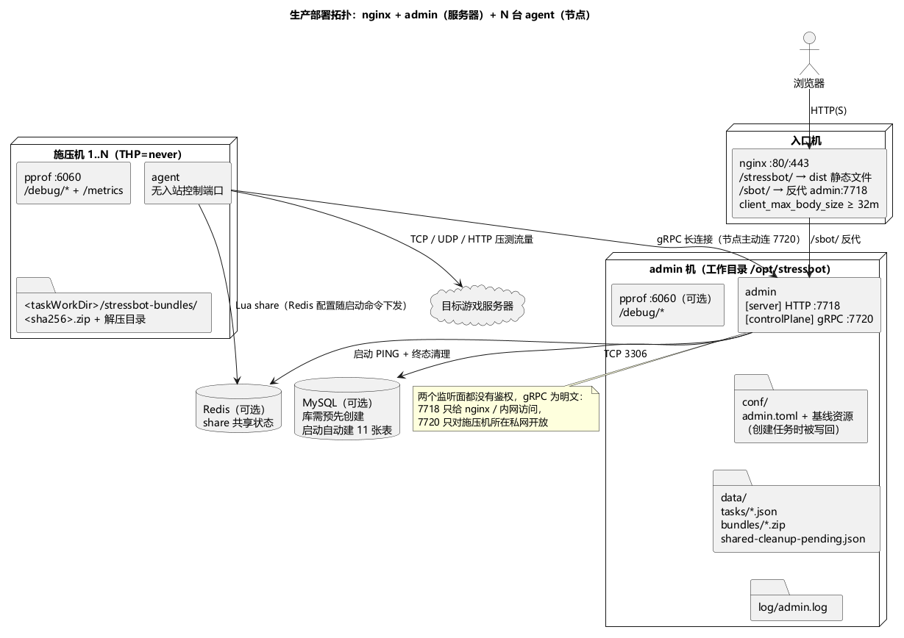

# 第 13 章 部署实操：从源码到常驻服务

> **目标**：在一台干净机器上把工具部署成可长期运行的服务。本章讲**单进程的编译、安装与守护**；多机组网是下一章。
>
> **前置**：[第 2 章](ch02-architecture.md)（知道要部署哪个二进制）。示例 `examples/ch13/`：supervisor 配置 + 端口速查表。

## 13.1 编译与产物

```bash
# 前端（admin 的管理界面）
cd cmd/web && npm install && npm run build     # 产物在 cmd/web/dist/

# 后端——注意 make 与 release 的差别：
make build-current   # 只编 bin/agent 和 bin/admin（本机平台）
go build -o stressbot.exe ./cmd/stressbot      # 单机模式自己编
make all             # = 前端 + linux/windows 四个产物（同样不含 stressbot）
```

三个二进制启动日志里的 `version`，以及节点卡片上的版本，都来自编译期 `main.Version`。打 `v*` tag 走 GitHub Release 时写入 tag 名（例如 `v1.2.0`）；`make build` 写入 `git describe --tags` 的结果。自己 `go build` / `go run` 不带 `-ldflags` 时是 `dev`。核对：`admin.exe -version`。

**发布包**（`git push` 打 `v*` tag 触发 GitHub Actions，6 平台矩阵）结构：

```
stressbot-<tag>-<os>-<arch>/
├── stressbot / agent / admin      ← 三个二进制都在包根
├── conf/                          ← stressbot/agent/admin 三个 toml + flow/proto/scripts/adapter 样例 + deploy/
└── dist/                          ← 前端产物（注意：在包根 dist/，不在 conf/ 里）
```

两个实测出的坑，部署时必处理：

1. **staticDir 不匹配**：`conf/admin.toml` 默认 `staticDir = "cmd/web/dist"`（相对工作目录），而发布包前端在包根 `dist/`——从发布包启动 admin 前要把 `staticDir` 改成 `"dist"`，否则管理页面 404；
2. **前端按子路径构建**：vite `base = "/stressbot/"`，生产环境的正确形态是 **nginx 托管在 `/stressbot/` 子路径**（见 13.4）；admin 内置静态托管只适合配合该布局或开发场景。

## 13.2 部署前关闭透明大页（仅 Linux）

跑 `agent` 或单机 `stressbot` 的 Linux 机器，在拉起进程之前关掉透明大页（Transparent Huge Pages，THP）。不关的话，每结束一轮压测，系统已用内存下不来，多轮之后越积越高；同时 pprof 里的 Go 堆是正常的，看起来像隐式泄漏。

原因：Go 用 mmap 拿匿名内存，回收时 scavenger 按 4KB 页 `madvise` 还给内核。THP 开启时，内核把连续的 4KB 页合并成 2MB 大页。一场压测会短时间分配大量堆（连接缓冲、消息体、每个机器人的状态），这些区域很容易被提升成大页。任务结束、对象释放之后，pprof 看到的堆占用已经回到低位；但一张 2MB 大页只要还剩任意一页被占用，或者 `madvise` 只打在大页的一部分上，内核就不会把整张大页从进程 RSS 里划掉。系统侧仍记着这块内存，下一轮任务再分配一轮，内存就台阶式升高。抓 heap profile 对不上 `free` 看到的数字，是因为两边量的不是同一层。

先看当前值（方括号里是正在生效的那一项），再关掉分配和整理：

```bash
cat /sys/kernel/mm/transparent_hugepage/enabled
cat /sys/kernel/mm/transparent_hugepage/defrag
echo never | sudo tee /sys/kernel/mm/transparent_hugepage/enabled
echo never | sudo tee /sys/kernel/mm/transparent_hugepage/defrag
```

`enabled` 和 `defrag` 都要变成 `never`。这个开关不拆已经提升过的大页，改完要重启 admin / agent / stressbot 才对后续分配生效。

开机后保持关闭，放一个一次性 systemd 单元，在业务进程之前执行：

```ini
[Unit]
Description=Disable Transparent Huge Pages
DefaultDependencies=no
After=sysinit.target local-fs.target
Before=basic.target

[Service]
Type=oneshot
ExecStart=/bin/sh -c 'echo never > /sys/kernel/mm/transparent_hugepage/enabled && echo never > /sys/kernel/mm/transparent_hugepage/defrag'

[Install]
WantedBy=basic.target
```

单元文件路径用 `/etc/systemd/system/disable-thp.service`。任务结束后用 `grep AnonHugePages /proc/meminfo` 看大页是否还在涨：pprof 已回落而这项居高不下，就是 THP 仍开着。

## 13.3 目录布局与启动

推荐布局（supervisor 配置示例按此写）：

```
/opt/stressbot/
├── admin / agent / stressbot     # 二进制
├── conf/                         # 从发布包 conf/ 或仓库 conf/ 拷贝
├── dist/                         # 前端产物
└── log/                          # 日志（toml 里 log.path 指向这里）
```

启动命令与守护 flag：

```bash
./admin -config conf/admin.toml          # 前台运行，日志同时落文件
./admin -config conf/admin.toml -d       # Linux fork 守护子进程
```

**Windows 注意**：`-d` 或配置 `daemon = true` 时，进程向 stderr 打印 `[DAEMON] Windows 不支持守护进程模式，进程即将退出...` 后以码 0 退出，不会转成前台继续跑。Windows 不要加 `-d`，配置保持 `daemon = false`，直接前台运行或用服务包装器。Linux 下 `-d` fork 的子进程不继承 stdout，日志只看 `log.path` 文件。

生产环境常见的摆法如下。admin 和节点不必和目标游戏服在同一台机器上；节点只需要出站连 admin 的控制面。



## 13.4 前端托管两种形态

**形态 A（生产推荐）：nginx 子路径**。仓库自带样例 `conf/deploy/nginx/nginx.conf`（注意它是多项目共存配置，stressbot 相关段）：

```nginx
location ^~ /stressbot/ {                  # 前端静态资源（子路径与 vite base 一致）
    alias /data/stressbot/web/dist/;
    try_files $uri $uri/ @stressbot;
}
location /sbot/ {                          # API 转发给 admin
    proxy_pass http://127.0.0.1:7718;
}
```

**形态 B：admin 内置 staticDir**。`admin.toml` 的 `server.staticDir` 指到 dist 目录，admin 自己托管——但受 vite base 子路径限制，配合 nginx 反代或开发场景使用。

## 13.5 进程守护与开机自启

Linux 用 supervisor（示例 `examples/ch13/supervisord.conf`，含 admin 与 agent 两个 program 块）：`autostart` 开机拉起、`autorestart` 崩溃重启、`stopasgroup` 整组停止。supervisor 与 `-d` 二选一，别叠加。Windows 用 NSSM 等服务包装器或前台运行。

## 13.6 端口与探活

速查表见 `examples/ch13/PORTS.md`。要点：admin **没有专用 /healthz**，用 `GET /sbot/system` 探活；agent 与单机 stressbot 的 6060/6061 是 JSON 指标 + pprof，只绑内网。admin 的 pprof 默认未启用（toml 里注释着），需要排查时再开。

## 13.7 日志、升级与可选观测栈

- 日志落盘与轮转都在各 toml 的 `[log]` 段（大小/份数/天数/gzip）；
- **升级注意**：MySQL 表结构"首版不迁移"（启动时 `CREATE TABLE IF NOT EXISTS`）——升级 admin 前确认无 schema 变更需求，历史数据用 `retentionDays`（默认 90 天，每天清理一轮，标星任务不清理）管理；
- 可选观测栈：`docker-compose.yml` 起的是**中间件容器**（MySQL/Redis/nginx/Loki/Grafana/Vector），admin/agent 仍跑宿主机。Vector 采集 `log/agent.log` → Loki → Grafana；注意样例里数据卷路径是 Windows 宿主写法（`D:/docker/volumes/...`），Linux 部署要改；Grafana 仪表盘 JSON 需手动导入（没有自动 provisioning）。

## 13.8 验收

- [ ] Linux 施压机上 `transparent_hugepage/enabled` 与 `defrag` 均为 `never`，并且进程是在关闭之后启动的
- [ ] 干净机器上按 13.3 布局放置产物；`[mysql] host` 已填时连不上就退出，`host` 留空则不启用历史/模板库仍能监听 7718/7720
- [ ] supervisor 拉起 + `supervisorctl status` 运行中；`kill -9` 后自动重启
- [ ] 改对 staticDir 后浏览器能打开管理页面（或按形态 A 配好 nginx）
- [ ] 知道 `-d` 在 Windows 会退出、`/sbot/system` 当探活、`/metrics` 是 JSON

## 延伸阅读

- [docs/deployment.md](../docs/deployment.md)（注意：以其描述与本教程冲突时，以本教程实测为准）；下一章：[第 14 章 从单机到集群](ch14-cluster.md)
