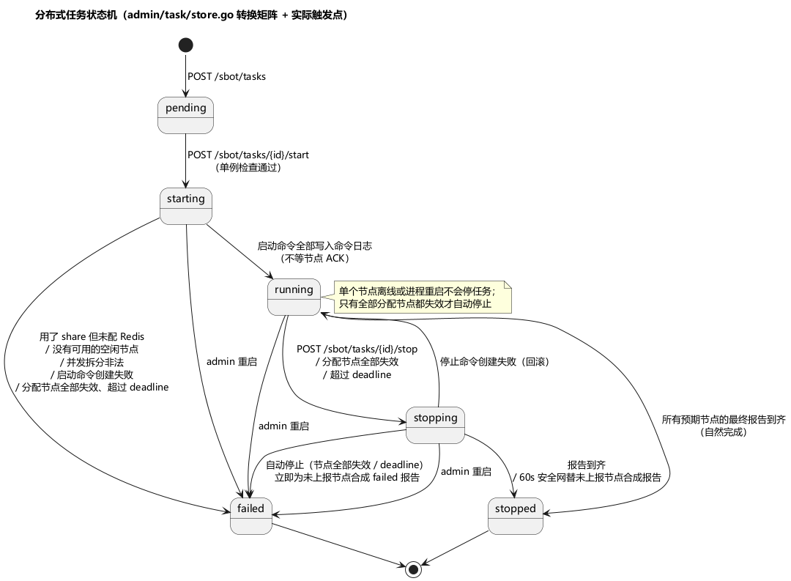

# 第 14 章 从单机到集群：Admin 与 Agent

> **目标**：搭起多节点压测环境：依赖准备、最小配置、组网验证、任务生命周期与失联语义。部署完成的标志是能在前端"节点管理"看到节点在线。
>
> **前置**：[第 2 章](ch02-architecture.md)、[第 13 章](ch13-deploy.md)（产物与守护）。组网检查单：`examples/ch14/deploy-notes.md`。

## 14.1 依赖准备

- **MySQL（历史归档与模板库需要）**：`[mysql] host` 非空时，admin 启动第一步就连库并自动建 11 张表，连不上直接退出——实测文案 `连接 MySQL 失败: dial tcp 127.0.0.1:3306: ...`。给空库即可，**不要手工建表**（表结构"首版不迁移"，随代码走）。`host` 留空则 admin 照常启动，历史与模板库接口返回未启用。
- 11 张表：`task_history` / `task_assignment` / `task_report` / `task_aggregated` / `task_timeseries` / `task_config_archive` / `task_agent_events` / `task_meta` / `flow_template` / `action_template` / `listen_template`。
- **Redis（按需）**：只有任务脚本用了 `share` 才需要。启动带 share 脚本的任务时未配 Redis 会被拒绝：`任务脚本使用了共享状态(share)，但服务器未配置 Redis，无法启动`。

## 14.2 最小配置与启动顺序

admin 侧（`conf/admin.toml` 关键三处）：

```toml
[server]       port = 7718   # 浏览器管理面（HTTP + /sbot/ API）
               staticDir = "dist"   # 指向实际前端产物（第 13 章的坑）
[controlPlane] port = 7720   # Agent gRPC 控制面
[mysql]        host/port/database/...   # 空库即可
```

agent 侧（`conf/agent.toml` 关键四处）：

```toml
[agent]
id = "agent-001"                 # 全集群唯一
adminAddress = "127.0.0.1:7720"  # 指向 admin 的 gRPC 控制面（是 7720，不是 7718！）
maxBots = 5000                   # 本机容量——任务分配按它算
reconnectMaxRetries = -1         # 无限重连
```

启动顺序无所谓：**Agent 先起也能活**。实测（admin 未启动时）：

```
[AGENT] 启动中  agentID=agent-001 adminAddress=127.0.0.1:7720 reconnectMaxRetries=-1
[AGENT] gRPC 控制面不可用，准备重连  retryAttempt=1 backoff=2.4s
[AGENT] gRPC 控制面不可用，准备重连  retryAttempt=2 backoff=6.7s
[AGENT] gRPC 控制面不可用，准备重连  retryAttempt=3 backoff=33.6s   ← 指数退避+抖动
```

admin 起来后 agent 自动完成 Hello/Welcome 握手注册（协议版本校验、下发心跳间隔与租约时长），前端"节点管理"出现 idle 节点。agent 只需**出站**连接 admin，施压机不开入站端口。

## 14.3 健康判定与租约（默认值成对记）

| 参数 | 默认 | 含义 |
|---|---|---|
| 心跳间隔 | 10s | Agent→Admin 控制会话心跳 |
| 租约 leaseDuration | 45s | Agent 失联超过它就**自行取消当前任务** |
| unhealthyAfter | 30s | 心跳超时标记不健康（仅告警档） |
| offlineAfter | 60s | 判离线，从注册表移除 |

设计意图：租约 45s 卡在"重连最坏耗时"与"离线判定"之间——**Agent 先自杀、Admin 后判死**，避免节点短暂断网时任务状态与实际流量脱节。Agent 进程重启会被识别（启动时间戳变化），正在跑的任务按"节点进程重启，任务已丢失"处理。

## 14.4 任务生命周期（分布式形态）

创建任务（管理面表单或 `POST /sbot/tasks`，multipart 上传）：任务自带全套资源（flow.json + proto + scripts + adapter），`robotConfig` 里带 mainService / defaultDelayMs / apdexT / rampUp / 并发等运行参数。创建后 `pending`，同时资源镜像到服务器基线目录（资源管理面板读写的就是这份基线）。

启动任务后的全自动流水：

1. 单例检查：已有活跃任务 → 409 冲突（同一时刻全集群只能有一个活跃任务）；
2. **自动分配节点**：不是用户选机器——从 idle 节点里按 `maxBots` 容量**比例分配**机器人；总容量不够 → `没有可用的空闲节点`；
3. 资源打包：任务内嵌资源打成 zip、按内容 sha256 落盘（同内容复用，不重复传）；
4. 下发 StartTask 命令 → Agent 按 sha256 下载 bundle（断点续传、逐块校验、损坏自动重下）解压缓存；
5. Agent 从 bundle 加载资源起机器人 → 全部节点 ACK 成功 → `running`；
6. 指标每 5s 经独立 gRPC 流上报，Admin 聚合供前端拉取；10s 采样器写时序表。

停止：`POST /sbot/tasks/{id}/stop`（仅 running 可停）→ 各节点优雅取消（ctx 取消 → StopAll 清理）→ 汇报齐 → `stopped`。**没有强杀**：60 秒安全网只是替未响应节点合成报告后转终态。

状态机与失败语义：



```
pending → starting → running → stopping → stopped
                ↘ failed（启动失败/全部节点失效/admin 重启）
```

- **单节点丢失不停任务**；分配的全部节点失效才自动停止（`所有分配节点已失效`）；
- **Admin 重启**：磁盘上仍是活跃态的任务一律重置 `failed`（`admin restart, task lost`）——Agent 若还在跑，重连时会被孤儿停机命令叫停（`Admin 不再持有该任务，停止孤儿压测`）；
- 任务本体存服务器磁盘 `data/tasks/`，MySQL 只存历史归档与模板库；`pending` / `stopped` / `failed` 可删，`starting` / `running` / `stopping` 占用单例位，不允许删除。

## 14.5 组网验证（本章验收）

按 `examples/ch14/deploy-notes.md` 检查单走一遍【需 MySQL 环境】：

- [ ] admin 启动无 error，`/sbot/system` 探活通过
- [ ] 两台 agent 上线，节点管理显示 idle、容量正确
- [ ] kill 一台 agent：60s 后判离线清理；若有任务在跑，单节点丢失任务继续
- [ ] 创建并启动一个任务（可复用第 5 章 ArenaQuest 资源）：自动分配、running、停止后 stopped
- [ ] 全程未用命令行操作任务（资源上传与任务操作走管理面——第 16/18 章展开）

## 延伸阅读

- [docs/distributed-architecture.md](../docs/distributed-architecture.md)、[docs/admin-implementation.md](../docs/admin-implementation.md)、[docs/agent-implementation.md](../docs/agent-implementation.md)、[docs/resource-sync.md](../docs/resource-sync.md)
- 下一章：[第 15 章 全局界面与运行控制条](ch15-ui-overview.md)
