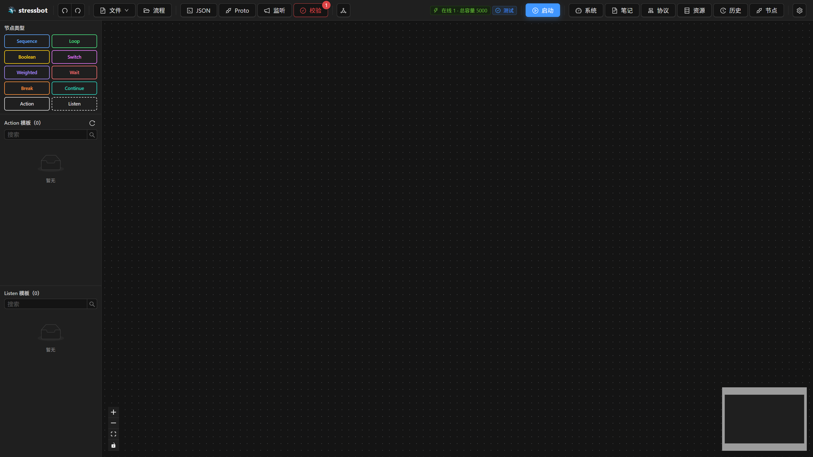
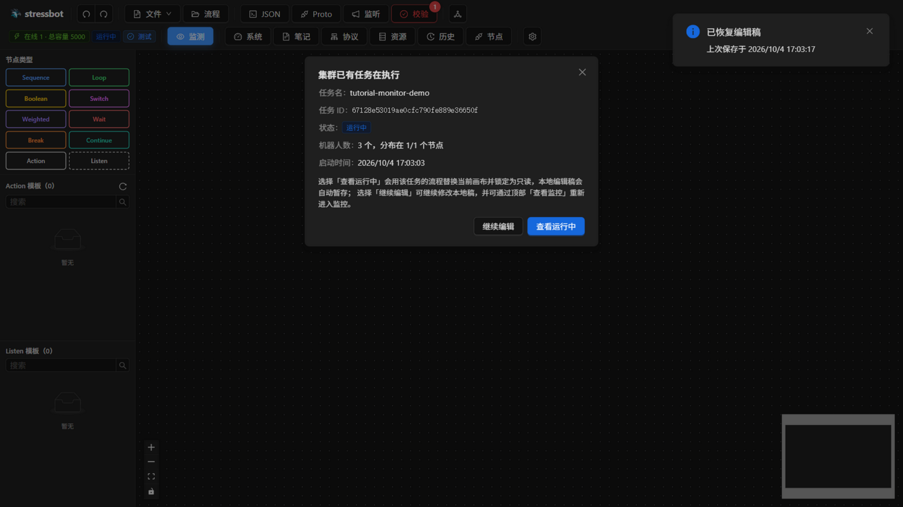
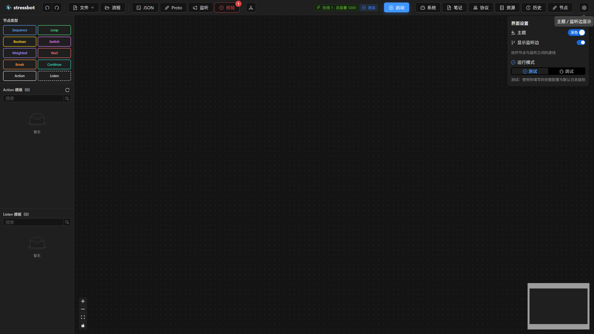
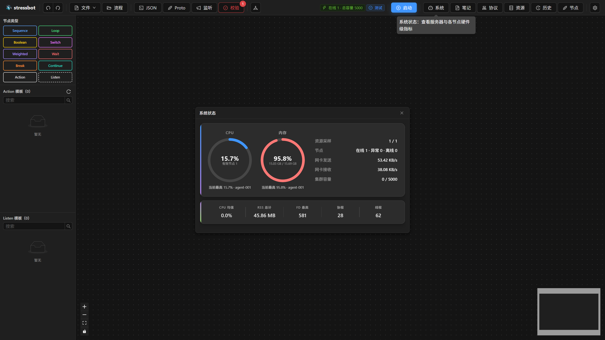
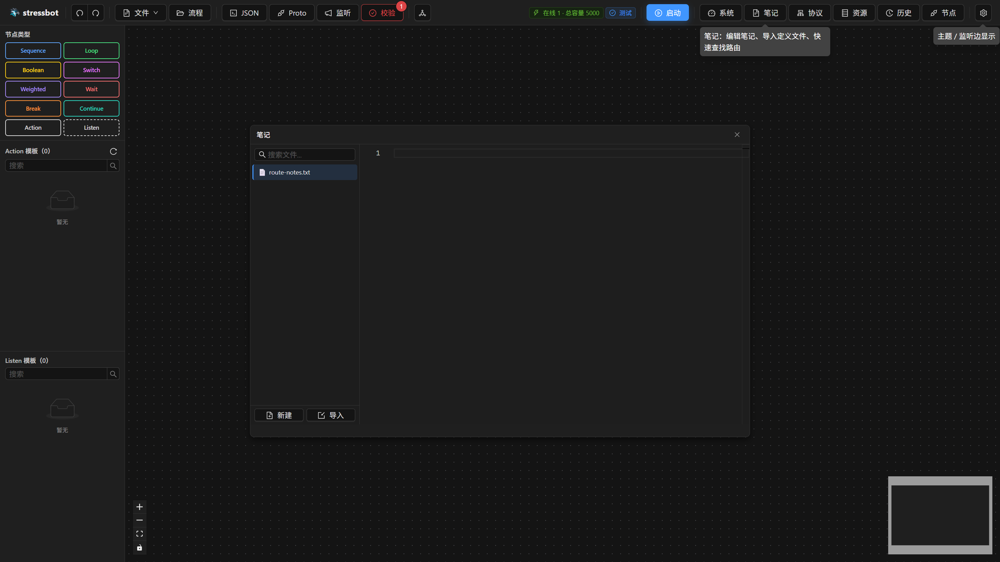
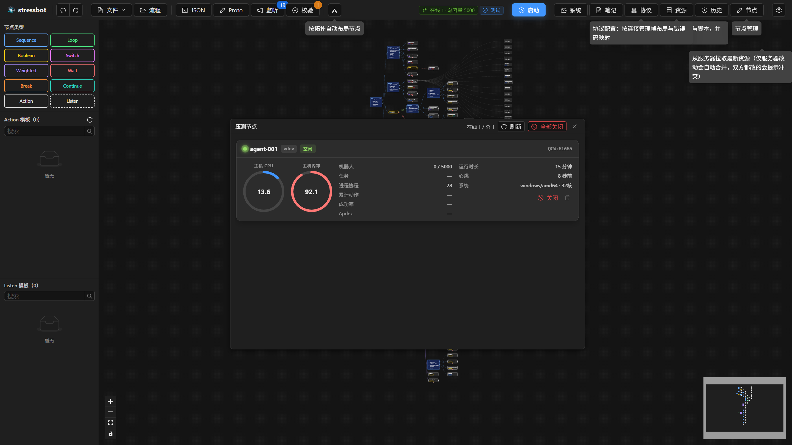

# 第 15 章 全局界面与运行控制条

> **目标**：认识管理面整体布局，逐个掌握顶部运行控制条（RuntimeBar）的每个按钮。本章是第五部分（前端操作指南）的地图。
>
> **前置**：第 14 章组网完成，浏览器打开管理面。界面文案与截图取自实际管理面。

## 15.1 整体布局

管理面是**单页应用**（无路由无侧边导航）：中央流程画布 + 顶部工具栏（左段编辑工具、内嵌运行控制条）+ 底部监控面板（编辑模式隐藏，任务运行时自动展开）+ 各功能浮窗/抽屉（可拖动缩放，ESC 关最顶层）。深浅色主题自动记忆。

开屏会先转圈「正在连接服务器...」，同时探测历史功能和有没有活跃任务。

**开屏自检**：若集群已有任务在执行，弹出守卫弹窗「集群已有任务在执行」——显示任务名/ID/状态/机器人数/启动时间，二选一：

- **查看运行中**：用该任务的流程替换画布并锁定只读（本地编辑稿自动暂存）；
- **继续编辑**：继续改本地稿，之后仍可从顶栏进入监控。

这和启动时撞上单例约束不是同一扇窗。启动请求被拒时标题是「已有任务在执行」，正文是任务「X」当前处于某状态，需先停止才能启动新任务。按钮是「查看运行中」/「取消」；拿不到详情时只有「我知道了」。

本地有未提交的画布草稿时，右上角会提示「已恢复编辑稿」，并写上次保存时间。上次「恢复配置」做到一半，页面最顶上会出现横幅「配置恢复未完成」和「重试恢复」（第 16.7 节）。

## 15.2 运行控制条逐按钮

左侧状态区（编辑模式）：

| 元素 | 文案/提示原文 | 说明 |
|---|---|---|
| 节点容量 Tag | `在线 N · 总容量 N`（悬停 `在线节点 N · 总容量 N`） | idle 节点数与 maxBots 总和；`连接中…`/红 Tag `服务器连接异常` 是两种异常态 |
| 模式 Tag | `测试` / `调试` | 调试=自动装填 1 机器人/并发 1/debug 日志/尽量单节点；测试=用你填的完整配置 |

主操作区：

| 按钮 | 出现条件 | 行为 |
|---|---|---|
| `启动` | 编辑态且无远端任务 | 打开任务启动弹窗（第 18 章）。**没有在线节点时禁用**（提示 `没有在线的节点，无法启动`） |
| `监测` | 编辑态且有远端任务 | 进入当前运行任务的监控，画布切只读（悬停 `进入当前运行任务的监控面板，画布将切换为只读`） |
| `返回编辑` + `停止` | 监控中 | 返回编辑；停止会弹确认 `停止任务？`（`任务 "xxx" 将进入停止中状态，等待所有节点完成后转为已停止`）。任务由其他客户端发起时仍可停（服务端允许任意客户端停止） |
| `返回编辑` | 终报态 | 悬停 `退出监控状态，画布与最后一份监控数据保留，可继续修改流程`；清理异常时显示 `部分清理`/`清理超时` 等 Tag |

顶栏右侧图标，悬停原文与打开的浮窗：

| 按钮 | 悬停 | 打开什么 |
|---|---|---|
| `系统` | `系统状态：查看服务器与各节点硬件级指标` | 浮窗「系统状态」，见 15.5 |
| `笔记` | `笔记：编辑笔记、导入定义文件、快速查找路由` | 笔记浮窗，见 15.6 |
| `协议` | 有问题时按钮带数字角标 | 协议配置编辑器，第 16 章 |
| `资源` | `资源管理：编辑定义文件与脚本，并在启动任务时下发到节点`；与服务器基线冲突时橙色角标 | 资源抽屉，第 16 章 |
| `历史` | 未启用时禁用，并提示检查服务器配置 | 先到列表；点进详情、再打开报告、以及多选对比，都在第 20 章 |
| `节点` | `节点管理` | 浮窗「压测节点」，见 15.7 |

左侧编辑工具栏（撤销、文件、流程、JSON、Proto、监听、校验、自动布局）在第 17 章逐项写。

## 15.3 第一次打开时先导入 conf/

服务器 `conf/` 里已经有 proto、Lua、codec 和默认流程。画布在**没有本地草稿**时会自动去拉 `conf/flow/flow.json`，成功就能看到默认流程，不是必须先点「加载基线流程」。资源抽屉和协议编辑器不会自动写满本地存储——启动任务打包的是浏览器这份，所以这两处仍要先拉下来。

空画布只出现在：自动加载失败（服务器没挂 `conf/`）、或你点了 `文件` → `新建`。校验角标发红，多半是 proto / 脚本还没进本地。

按这个顺序做，少走回头路：

1. 顶栏 `资源` → `拉取`：把服务器 `conf/proto`、`conf/scripts` 写进本地。双方都改过的文件会进冲突处理（第 16 章）。
2. 顶栏 `协议` → `从基线载入`：把 `conf/adapter/*_codec.json` 和 `errors.json` 拉下来。资源抽屉里没有协议页签。
3. 画布已经是基线流程就不用再加载。本地草稿和服务器不一致、想换回服务器那份，再用 `文件` → `加载基线流程`。想留着当前稿，先 `文件` → `导出流程 JSON`。
4. 看一眼校验徽章。引用的脚本若还缺，界面会提示从 `conf/scripts` 补缺。

第 16 章把资源抽屉和协议编辑器走完，第 17 章再改节点。不要先在空画布上拖节点再回头补协议——动作的目标连接、route 字段都来自协议配置。

## 15.4 界面设置

顶栏最右侧齿轮打开 Popover「界面设置」，三项都只存在这台浏览器里：

| 项 | 控件 | 说明 |
|---|---|---|
| `主题` | Switch `深色` / `浅色` | 立即切换，刷新后仍在 |
| `显示监听边` | Switch | 打开后，动作节点和 Listen 卡片之间画出虚线 |
| `运行模式` | Segmented `测试` / `调试` | 与顶栏模式 Tag、启动弹窗是同一份状态。切换**不会**回滚已经填进启动表的数字 |

## 15.5 系统状态

顶栏 `系统` 打开浮窗「系统状态」。摘要行包括上报节点数、在线 / 异常 / 离线、网卡发送、网卡接收、集群容量（当前机器人数 / 容量上限）。进程指标卡为 `CPU 均值`、`RSS 总计`、`FD 最高`、`协程`、`线程`；悬停能看到当前最高的那台节点。这是施压机自身的资源，不是第 19 章动作表里的请求耗时。

## 15.6 笔记

顶栏 `笔记` 打开本地笔记，不参与任务下发。

左侧可以 `搜索文件...`，底部 `新建` / `导入`。`新建` 弹出「新建文件」，文件名要带扩展名（占位文案 `文件名（含扩展名，如 notes.txt）`）。每一行可以重命名，删除前确认「确认删除？」。空列表显示 `暂无文件`，搜索无结果显示 `无匹配文件`。编辑器空态是 `选择或新建文件开始编辑`。这里适合放协议备忘、路由对照；要进压测的 proto / Lua 仍走第 16 章的资源抽屉。

## 15.7 压测节点

顶栏 `节点` 打开浮窗「压测节点」。右上角是 `在线 N / 总 N`、`刷新`、`全部关闭`（没有在线节点时悬停 `没有在线节点` 并禁用；有在线节点时悬停 `关闭所有在线节点`）。没有任何注册记录时，空态是 `暂无节点，请先在目标机器上启动节点程序`。

每张卡片按状态排序，展示主机 CPU / 内存、机器人、任务、进程协程、累计动作、成功率、运行时长、心跳、系统（操作系统 / 架构 / 核数）。在线节点可以 `关闭`（悬停 `关闭此节点进程`）。`删除` 只对离线节点可用：在线时悬停 `只能删除离线节点`，离线时悬停 `从注册表删除`。关闭是停掉那台机器上的节点进程；删除只是从服务器的注册表里去掉已经离线的记录。

## 15.8 验收

- [ ] 第一次打开后先走完 15.3：资源拉取、协议载入；没有本地草稿时画布会自动出现基线流程
- [ ] 能说出每个按钮的触发条件与行为，完成一次"启动 → 监测 → 停止 → 返回编辑"往返
- [ ] 能分清开屏「集群已有任务在执行」和启动时「已有任务在执行」两扇窗
- [ ] 会用界面设置切换主题、监听边和运行模式
- [ ] 能打开「系统状态」「笔记」「压测节点」三个浮窗，并说清笔记不进任务下发、删除节点只对离线记录生效

## 延伸阅读

组件源码：`cmd/web/src/components/runtime/RuntimeBar.tsx`；下一章：[第 16 章 资源管理](ch16-resources.md)
