# 第 16 章 资源管理：定义文件与下发

> **目标**：从顶栏走进资源，把这一扇门里能点到的每一层走完。协议配置是旁边另一扇门，文件菜单里的备份是第三扇。三扇都写到没有下一层为止。
>
> **前置**：[第 4 章](ch04-protocol.md) 的 proto / codec / 错误码，[第 11 章](ch11-lua.md) 的脚本。主路径上先做本章，再去画布上引用这些文件。

本地改动放在浏览器里。顶栏说明写的是：从服务器拉取最新资源到本地；本地改动会在启动任务时随配置一并提交到服务器。服务器上的那份是 `conf/` 基线。启动时再打包下发到节点。想马上落到基线，用各编辑器里的保存或「从基线载入」，不要等启动。

第一次打开管理面，按第 15 章 15.3 的顺序做：先在本抽屉点 `拉取`，再去「协议」点 `从基线载入`，最后 `文件` → `加载基线流程`。只上传 proto、不拉 Lua，启动时会红条报缺脚本；只拉资源、不载入协议，动作编辑器里选不到目标连接。

仓库 `conf/proto/`、`conf/scripts/` 就是基线。本机开发时 admin 从工作目录读这两处；发布包里它们在包根 `conf/` 下。

## 16.1 第一层：资源抽屉

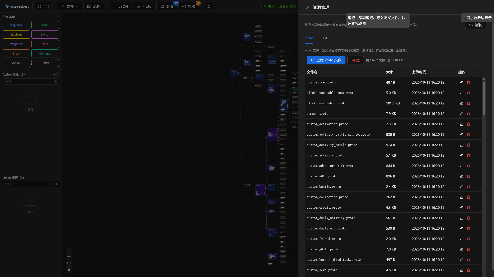

顶栏 `资源` 打开抽屉。页签只有 `Proto` 和 `Lua`。每一页上方是 `上传 Proto 文件` 或 `上传 Lua 文件`（可多选），旁边是 `清空`，以及 `共 N 个文件`。表格列是文件名、大小、上传时间、操作。空表写着：点击上方「上传」开始，或启动任务时自动从基线同步。

点 `拉取` 之后，Lua 页会列出 `conf/scripts/` 里的脚本。只拉 Proto、不拉 Lua，启动弹窗会红条报缺脚本。

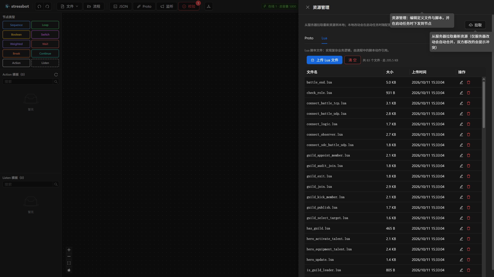

页眉 `拉取` 的悬停是：从服务器拉取最新资源（仅服务器改动会自动合并，双方都改的会提示冲突）。成功且有新增时提示 `已从服务器拉取，新增 N 个资源`。双方都改过的文件不在这一层决定，进入 16.4。

这一层每一行能点两下：`查看 / 编辑`，以及 `删除`。

## 16.2 点进行：编辑文件

`查看 / 编辑` 打开「编辑 {文件名}」。里面是整页编辑器，Proto 按 proto 高亮，Lua 按 lua 高亮。`取消` 关掉不保存，`保存` 写回本地存储。流程里引用的脚本，在动作编辑器里写完也会进这张表，不必先回到抽屉再上传一次。

`删除` 先问 `确认删除 {文件名}？`。`清空` 的标题是 `清空所有 Proto？` 或 `清空所有 Lua？`，确认后提示 `已清空`。清空只清这一页的类型。

## 16.3 上传时的同名确认

选中的文件里有和表中同名的，先弹出「发现同名文件」，写明已选多少个、其中多少个同名。`覆盖全部` 用新文件替换。其余文件仍是新的时，取消按钮是 `仅上传新文件`；整批都同名时，取消按钮是 `取消`。点遮罩或 Esc 与取消相同，只上传新文件、跳过同名。全部跳过时提示 `已跳过全部同名文件`。

## 16.4 拉取或启动时的冲突

`拉取`，或第 18 章点启动时，若本地和服务器都改过同一文件，打开冲突处理。标题在资源抽屉里是基线同步；从启动弹窗进来时标题是「处理本次任务资源冲突」，说明是：请确认本次任务使用本地存储版本还是服务器版本。应用后将继续启动任务。

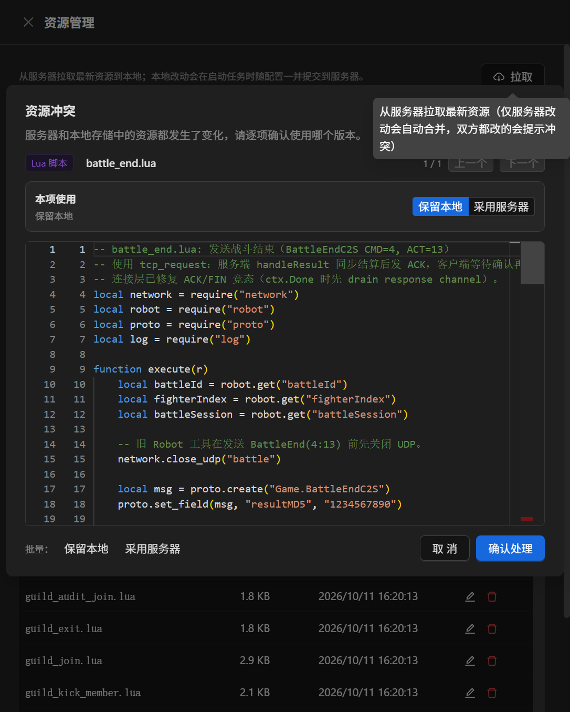

左栏是本地，右栏是服务器，一次看一项。`上一个` / `下一个` 切换。每一项默认 `保留本地`；也可以 `采用服务器`。服务器上没有这个文件时，采用服务器等于删掉本地这份。工具条上的 `保留本地` / `采用服务器` 是批量，作用于全部剩余项。`确认处理` 后按选择写回并继续；`取消` 停留在冲突之前的那一步，任务不会因此启动。

## 16.5 另一扇门：协议配置

顶栏 `协议` 打开编辑器，左右是两段：`协议配置`（每个连接一份 codec）和 `错误码映射`（共用的 errors.json）。

协议配置这一层的控件：

| 控件 | 点下去 |
|---|---|
| `当前连接` | 切换正在编辑的连接。来源标 `已保存` 或 `模板（未保存）`。有未保存改动时出现红色 `· 未保存` |
| `新建` | 选协议、填 service。service 不能含 `:` 或 `_` |
| `复制` | 用当前编辑器里的内容（含还没保存的草稿）做成一条新连接 |
| `删除` / `清空` | 去掉当前连接或清空内容。没有当前连接时 `清空` 禁用 |
| `从基线载入` | 悬停是从服务器拉取全部协议配置到本地。仅服务器改过的自动合并；双方都改的再次进入 16.4 |
| `导入` | 选一个 JSON。校验通过才落库，提示 `已导入并保存：文件名` |
| `保存` | 通过校验后提示 `已保存，启动任务时会自动上传`。校验失败拒绝保存，并给出第 1 条问题 |
| `结构化` / `源码` | 同一份配置的两种看法。错误码那段没有这个切换 |

还没保存就切换连接、从基线载入或新建，会先问「有未保存改动」：当前对象的修改尚未保存，继续将丢失。

结构化下面五个页签，都还在这一扇门里，不是新窗口：

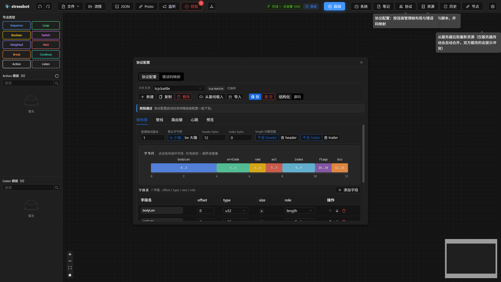

1. `帧布局`：字节尺和字段表。点色块选中字段，红色斜纹表示越界或重叠。

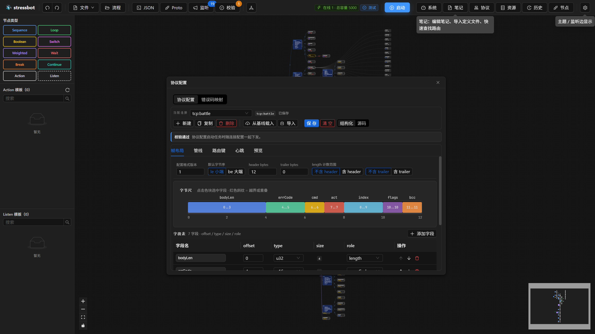

2. `管线`：步骤卡片。解码顺序是编码的反序。

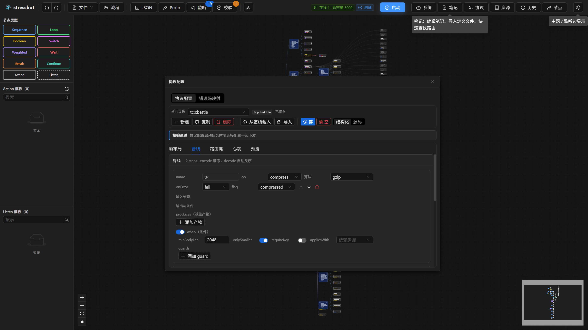

3. `路由键`：模板和拼出来的示例。
4. `心跳`：对应第 10 章的三种形态。

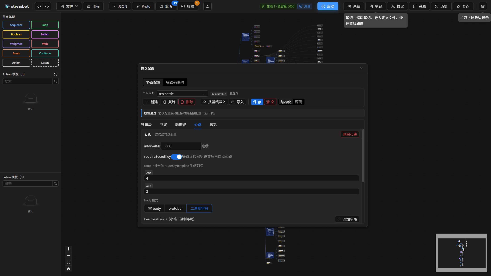

5. `预览`：切 `编码` / `解码`。编码填路由字段和 body hex；解码填完整帧 hex。可选 key hex。点「预览」后看帧 hex、字段解释表和路由键。结果只用来核对、不保存、不影响任务下发。

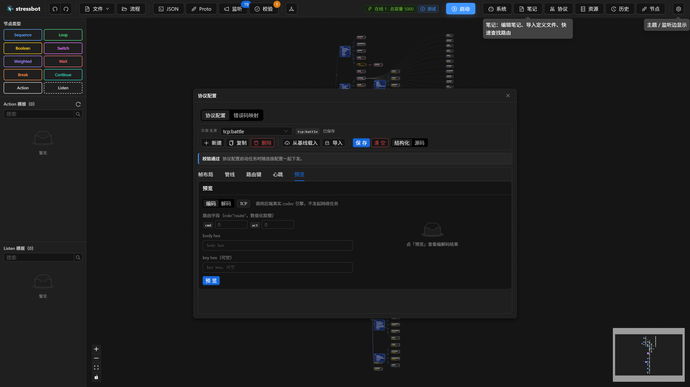

底部状态条：`校验通过`，或 `N 处问题：` 加上第一条。多于一条时可以展开 `查看全部 N 处问题`。文件名不合法时状态是 `协议配置文件名非法`。还没有任何连接时是 `配置文件不存在`，旁边写着请新建连接或从基线载入。

## 16.6 错误码映射这一段

仍在协议编辑器里，切到错误码。上面一行是码、中文描述、`添加`。

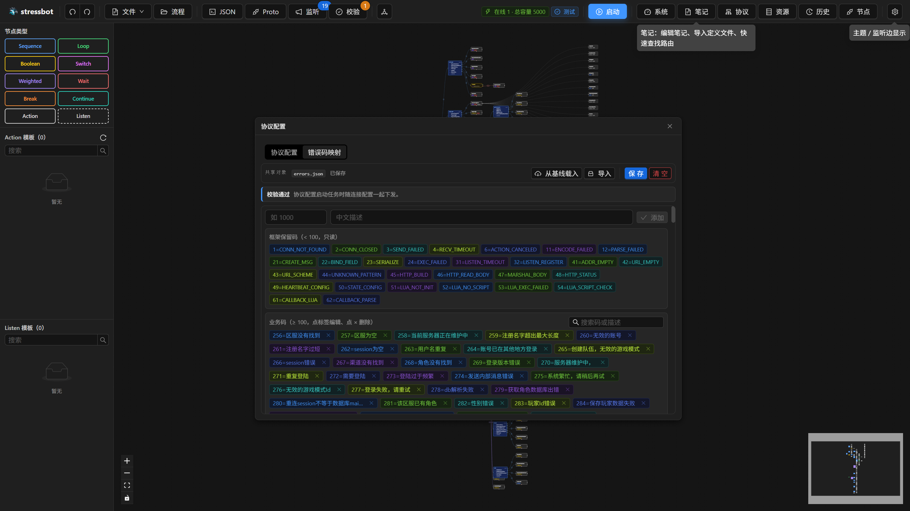

下面分成两块：`框架保留码（< 100，只读）`，以及 `业务码（≥ 100，点标签编辑、点 × 删除）`。可以按码或描述搜索。小于 100 或重复的码保存时被拒绝：`errors.json 有 N 处错误（含 < 100 或重复码），无法保存`。导入同样先校验，不通过的文件不会伪装成已保存。

## 16.7 第三扇门：文件菜单里的备份

顶栏 `文件` → `备份配置...` / `恢复配置...`。这扇门不在资源抽屉里，但备份的就是上面那些本地内容。

备份勾选分区后下载一个 JSON：`流程`（已保存的流程和当前草稿）、`资源`（proto / lua / codec / 错误码）、`模板库`、`工具`（笔记）。备份里可以有协议和脚本，没有服务器地址、数据库密码和运行历史。

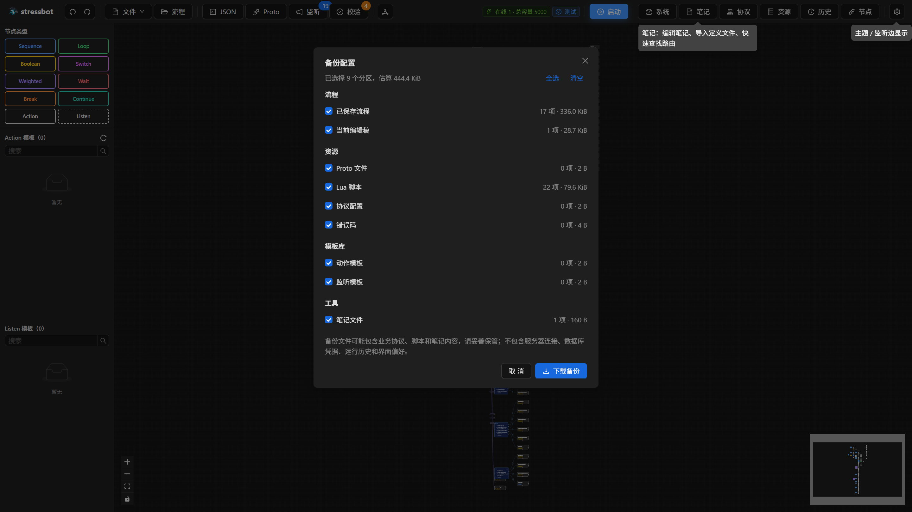

恢复先选文件，再选恢复哪些部分。`合并导入` 遇到重复时可选全部覆盖、逐个处理或全部忽略。`完整恢复` 会删掉备份里没有的本地配置，有单独警告和第二次确认。逐个处理时每一项是 `覆盖` / `保留两份` / `忽略`，可以勾选应用到后面同类冲突。

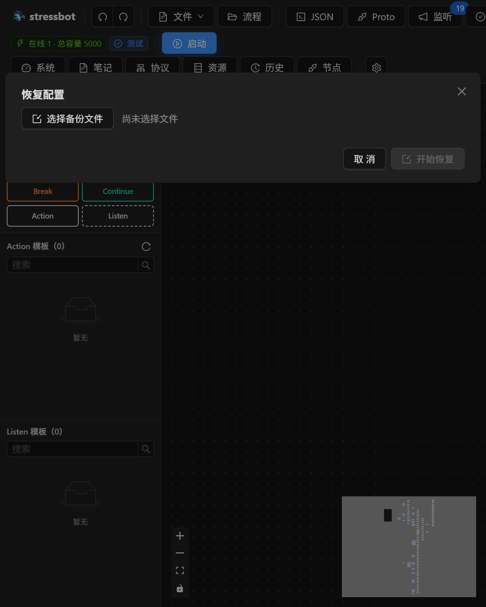

恢复做到一半被打断，页面顶部留下「配置恢复未完成」，并提供 `重试恢复`。这条横幅在，说明本地配置是半份，先处理再去启动任务。

## 16.8 验收

- [ ] 上传一份 proto，点进行编辑再保存；再上传同名文件，分别试 `覆盖全部` 和 `仅上传新文件`
- [ ] 在协议编辑器的 `帧布局` 和 `预览` 里看同一条连接；故意保存一个小于 100 的错误码，看到拒绝保存
- [ ] 改完本地资源后点 `拉取`，若出现冲突，用 `上一个` / `下一个` 各选一次并 `确认处理`
- [ ] 备份后清空 Proto 页，再从备份恢复，确认文件回到表里

## 延伸阅读

组件在 `cmd/web/src/components/modules/`。下一章：[第 17 章 可视化流程编辑器](ch17-flow-editor.md)
