# 第 17 章 可视化流程编辑器

> **目标**：把第 5~9 章手写的 JSON 流程切换到图形方式编写——FlowEditor 的全部操作面。两种方式编辑的是同一份产物，文件互通。
>
> **前置**：第 5~9 章（知道节点/动作/监听是什么），以及第 15.3 节已经把 `conf/` 基线拉进浏览器。画布是页面主体，工具栏在其上方。空画布上先 `文件` → `加载基线流程`，再改节点。

## 17.1 画布与节点编辑

- **左侧栏三段**，见 17.5：上面是节点格子（9 种流程节点再加 Listen），下面是 Action 模板库和 Listen 模板库。监控/终报等只读模式下面板隐藏；
- **连线**：从节点边缘拖出连接指定后继；boolean 的 true/false 双出口、监听边（动作节点 ↔ 监听的虚线）在界面设置里开关显示；
- **节点编辑抽屉**：action 节点配置 pattern / proto / bindings / store / delayMs（与第 5 章字段一一对应）；switch 编辑分支增删与排序；条件字段直接写 `state:` / `lua:` 表达式（第 6 章文法）；
- **Proto 浏览器**：顶栏 `Proto` 按钮打开，浏览已加载消息类型选字段填绑定——proto 未加载时徽章四态提示（已加载 N 文件/加载中/失败/未加载）。

## 17.2 工具栏全按钮

左侧起：

| 按钮 | 行为 |
|---|---|
| `撤销 (Ctrl+Z)` / `重做 (Ctrl+Shift+Z)` | 编辑栈；只读模式禁用 |
| `文件` 菜单 | 见下图。`新建` 清空草稿且**不确认**；`加载基线流程` 拉服务器 `conf/flow/flow.json`；`导入/导出流程 JSON` 与单机 `-flow` 文件互通；`备份/恢复配置...` 见第 16 章 |

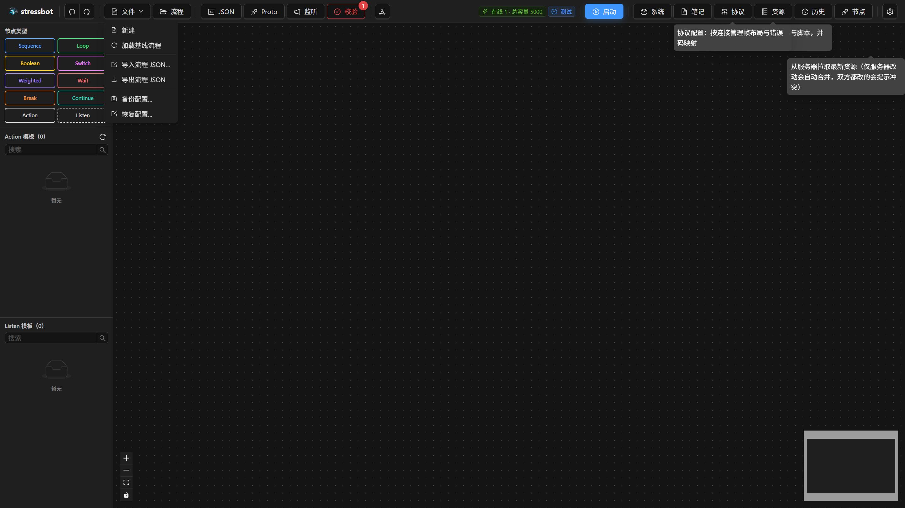
| `流程` | 打开「流程」浮窗，见 17.2.1 |
| `JSON` | 预览当前画布生成的 flow.json（可复制对照第 5 章手写产物） |
| `Proto` | Proto 浏览器（见 17.1） |
| `监听` | 监听脚本管理（带监听数徽章）——第 8 章的 listens 表在界面上的家 |
| `校验` | 打开校验报告（见 17.3）；按钮徽章实时显示 `N 处错误`（红）/`N 处警告`（橙）/`校验通过` |
| 自动布局图标 | `按拓扑自动布局节点`（LR 方向）；只改位置，只读时也能点 |

画布左下角是缩放 / 适配控件，右下角是缩略图。运行中节点卡片会回填主指标 p99、Apdex、成功数和「当前正在执行：N 个机器人」。

### 17.2.1 流程库

标题是「流程」。上面一排：名称框（占位 `输入流程名称保存当前草稿...`，默认 `未命名流程 MMDD_HHmm`）+ `另存为新流程`（先校验，有错误会拒绝）+ `导入流程` + `导出流程`（后两个和文件菜单同一套逻辑）。

表格每页 10 条，空表是 `暂无保存的流程`。仓库 `conf/flow/` 里的基线、排位、公会、乱斗等，以及 `tutorial/examples/ch05` 起的各章示例，都可以用「导入流程」或服务器流程库收进来。列是流程名称、节点、更新时间、操作：

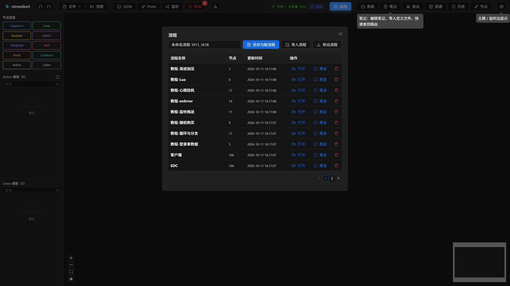

| 操作 | 行为 |
|---|---|
| 双击名称 | 行内改名；Enter / 失焦提交，Esc 取消 |
| `打开` | 把这份存稿铺到画布上 |
| `覆盖` | 先确认 `用当前草稿覆盖 "X"？`，确认按钮是 `覆盖` |
| 删除 | 先确认 `确定要删除 "X" 吗？` |

服务器没开流程库时，接口报 `FLOW_LIBRARY_DISABLED`，界面用中文 toast 提示。启动弹窗里「已保存流程」读的就是这张表。

## 17.3 校验报告：加载期错误的第一现场

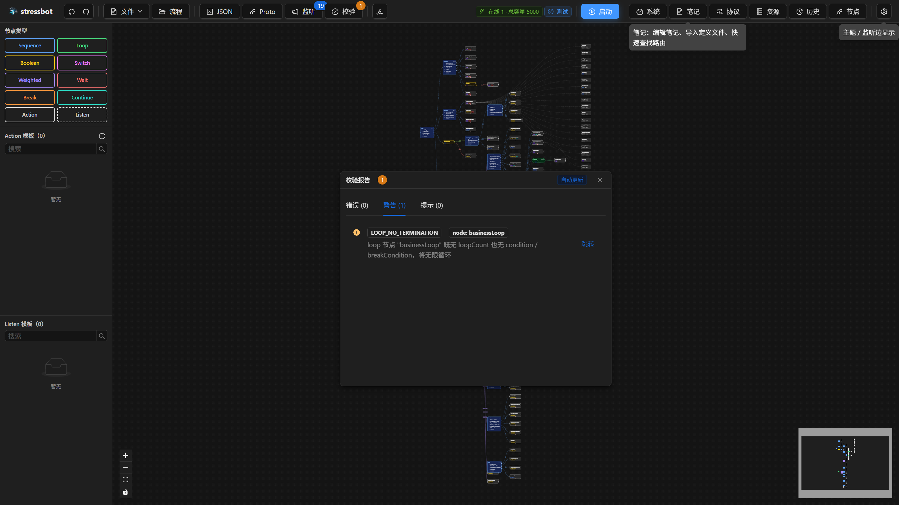

「校验」浮窗三页签 `错误 (N)` / `警告 (N)` / `提示 (N)`，右上角 `自动更新`——改一处刷一处。每条 = 级别图标 + 错误码 Tag + 位置 Tag（`节点: xxx` / `动作: xxx`）+ 消息 + **`跳转`** 链接（直接定位到问题节点）。全零时绿色横幅：`校验通过`——`所有节点、动作和监听引用均合法，可以导出流程配置。`

第 5 章 5.8 的那些加载期报错（listenRefs 引用不存在、条件缺前缀……）在发布前就会被这里拦下——**发布前看一眼校验徽章是零错误**，这是界面时代的纪律。

## 17.4 与手写 JSON 的关系

同一份 flow.json 的两种编辑形态：`导出流程 JSON` 的文件可被单机模式 `-flow` 直接运行；单机调试好的文件用 `导入流程 JSON…` 进画布。推荐工作流：**画布上搭结构 → 校验零错误 → 单机模式快速验证行为 → 回画布继续**（或直接走第 18 章的界面启动）。

## 17.5 左侧栏：节点格子与模板库

左侧栏固定在画布左边，分三段，互不影响滚动。

**节点格子**（5×2，不滚动）。格子上的字就是 flow.json 里的类型名，不翻译成中文，避免和校验报告、导出的 JSON 对不上。悬停是「做什么 · 拖入画布创建某节点」：

| 格子 | 悬停里的说明 |
|---|---|
| Sequence | 顺序执行子节点 |
| Loop | 循环执行循环体，支持条件与次数 |
| Boolean | 条件为真/假走不同分支 |
| Switch | 按条件首次匹配单跳 |
| Weighted | 按权重随机选一个分支 |
| Wait | 等待指定时长 |
| Break | 跳出当前循环 |
| Continue | 跳过本次循环迭代 |
| Action | 执行一个动作（收发消息等） |
| Listen | 定义一个服务端推送监听 |

拖 Listen 不会变成流程节点，而是新建一条监听定义。其余 9 个拖进去就是对应类型的节点。

**Action 模板** 和 **Listen 模板** 占剩余高度，标题带数量，例如 `Action 模板（3）`。每段有自己的 `搜索` 框，空列表显示 `暂无`。卡片可以：

- 拖进画布：同时把模板里的动作或监听定义写进当前流程，并放上对应节点；
- 双击：打开模板编辑器，改的是模板本身，不会自动写进当前流程；
- 右键：`编辑模板` / `复制到剪贴板` / `删除`。复制之后到画布空白处右键 `粘贴` 选择落点。

标题栏的刷新按钮无文字，无障碍名称是 `刷新模板库`。刷新失败时提示 `模板库刷新失败，继续显示上次数据`，列表不闪空。

服务器没开模板库时，两段模板都不请求，整块显示 `共享模板库功能未启用，请检查服务器配置`。正在询问能力时显示 `正在确认共享模板库状态`。动作或监听的编辑抽屉里有 `加入模板库`：默认用当前名字；同名已存在会问 `模板 "…" 已存在，是否覆盖？`，确认按钮是 `覆盖`。画布上对 Action 节点或监听卡片右键，还有 `保存为模板…`。

双击左侧模板卡片打开模板编辑器。改的是模板本身，保存后只影响今后从模板拖出来的节点。

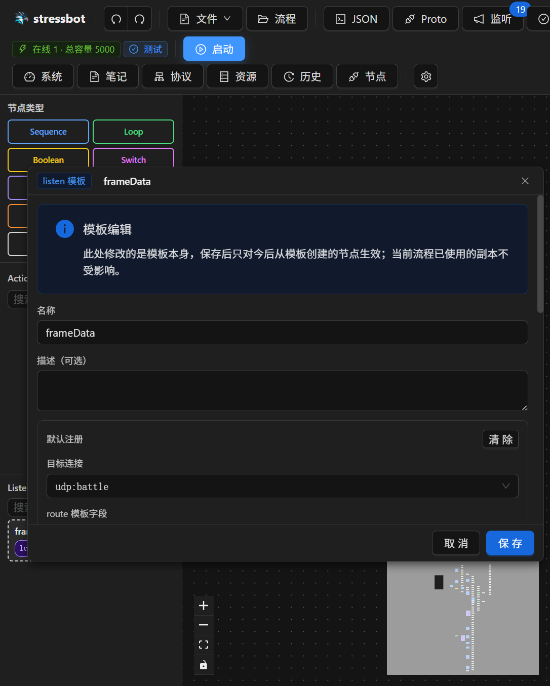

## 17.6 画布右键与快捷键

在节点上右键：

| 项 | 快捷键 | 说明 |
|---|---|---|
| `编辑…`（只读时为 `查看…`） | | 打开该节点的编辑抽屉 |
| `复制` | Ctrl+C | 只读时不出现 |
| `剪切` | Ctrl+X | 只读时不出现 |
| `保存为模板…` | | 仅 Action 节点和监听卡片 |
| `删除` | Del | 只读时不出现 |

在连线上右键：`删除连线`（Del）。在空白处右键：剪贴板有内容才能 `粘贴`，下面是 `新建节点`，类型与 F 键对应——Sequence 到 Action 依次是 F1…F9，Listen 是 F10。顶栏撤销 / 重做另有 Ctrl+Z、Ctrl+Shift+Z；在输入框或脚本编辑器里按 Ctrl+Z 只撤销正在打的字，不回退整张流程。

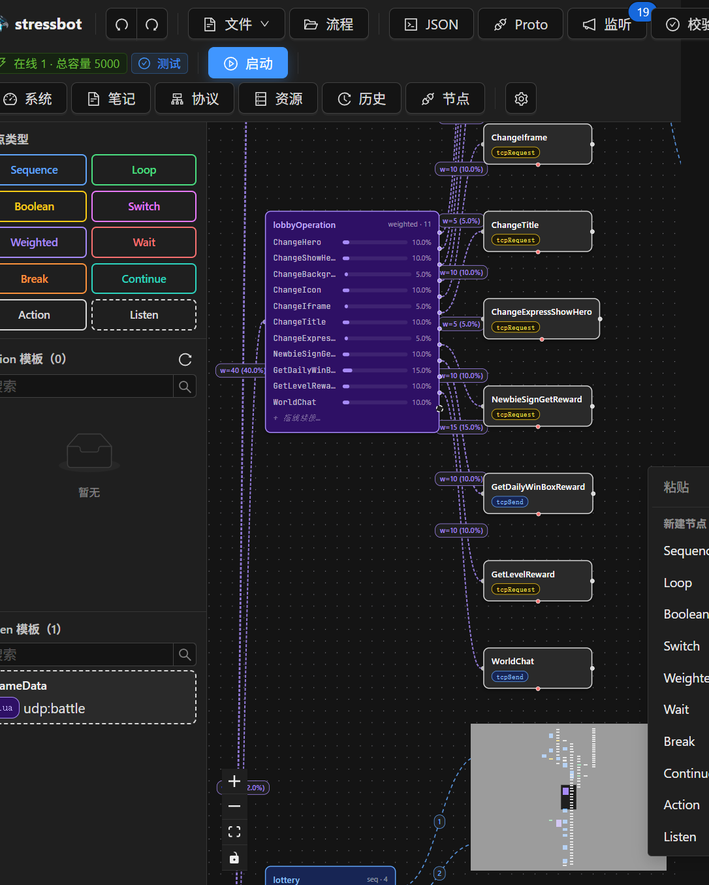

## 17.7 双击之后：节点编辑窗

双击节点打开浮动窗口（Break / Continue 没有编辑窗）。标题是类型标签 + `编辑节点 {id}`。右上角 `还原` 只还原这次打开后的改动；`删除` 会同步清掉别人对它的引用（next / body / trueNext 等）。`节点名称` 改完要点 `重命名`，不能空、不能有空白、不能以 `__` 开头。`描述` 显示在节点卡片上。

按类型能改的东西：

| 类型 | 表单 |
|---|---|
| Sequence | `子节点（按序执行）`，每行可上移 / 下移 / 删除 |
| Loop | `loopCount`（`<0` 无限、`=0` 跳过、`>0` 固定次数）、必填的 body、可选前置 `condition` 与后置 `breakCondition` |

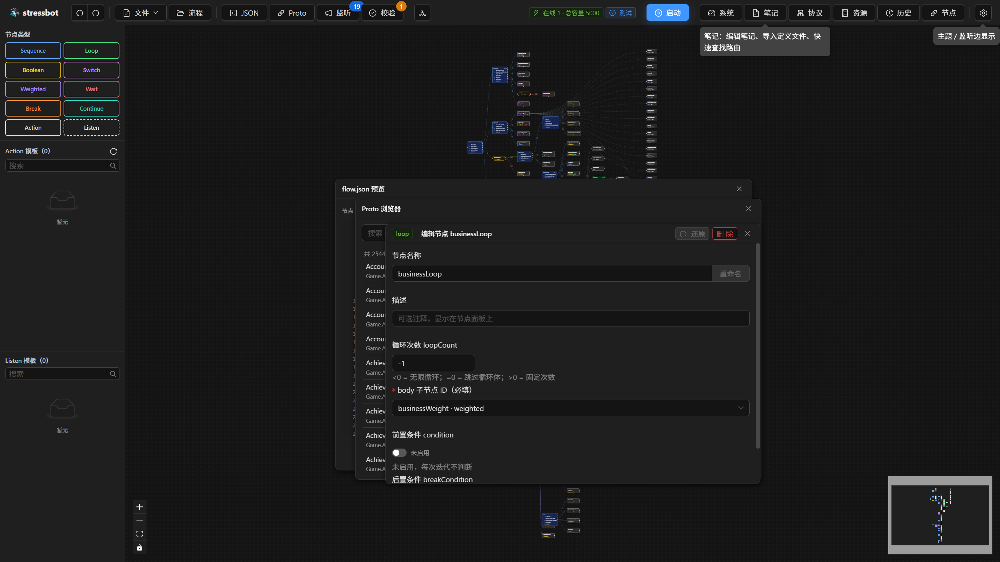
| Boolean | 必填条件、`true 分支` / `false 分支`（留空 = 不跳转） |
| Switch | 按顺序的 Case，首个命中就跳、没有 fall-through；底部可选默认分支 |
| Weighted | 节点 + 权重；底部显示权重总和，占比按相对比例算，不必归一化到 100 |
| Wait | `固定` 或 `随机` 时长；后继只能靠连线 |
| Action | 见 17.8 |

条件输入是两个单选：`state:` 或 `lua:`。缺前缀在加载期就报错，编辑器里也会拦。`lua:` 会打开脚本编辑框，入口签名按布尔脚本。

## 17.8 Action 编辑与监听

pattern 按组排列：网络通信、连接管理、监听、状态操作、Lua。换 pattern 会裁掉用不上的字段。

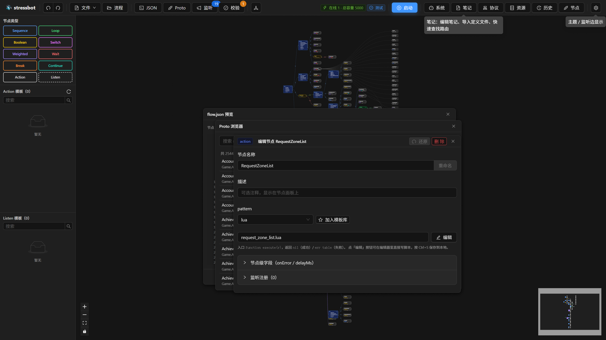

- 发 / 请求类：目标连接来自「协议」里已有的连接，route 字段按该连接的 `routeKeyTemplate` 生成。先做第 16 章的「从基线载入」，这里才有选项。
- `tcpListen` / `udpListen`：说明写着此 route 必须先在前面节点的 listenRefs 里预注册（`listen=null`），否则运行时超时。
- `setState`：添加状态行，取值方式分组为常用 / 从已有状态 / 从候选值 / 复合值。
- `clearState`：多选。`id` / `index` / `account` 标成内置不可清除。
- `lua`：脚本文件名 + `编辑`。编辑器里有 7 个模块的接口参考，入口是 `execute(r)`。
- 发 / 请求 / 监听 / setState 还有「预览」：打开「消息预览 {名}」，页签是发送、请求字段、响应。没配 proto 或 bindings 时提示「未配置 C2S 消息」/「无 bindings」。这是对照绑定用的，不发到服务器。

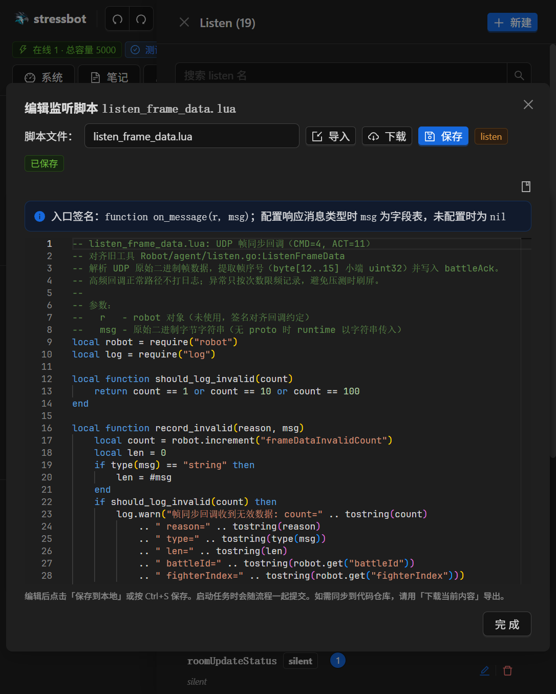

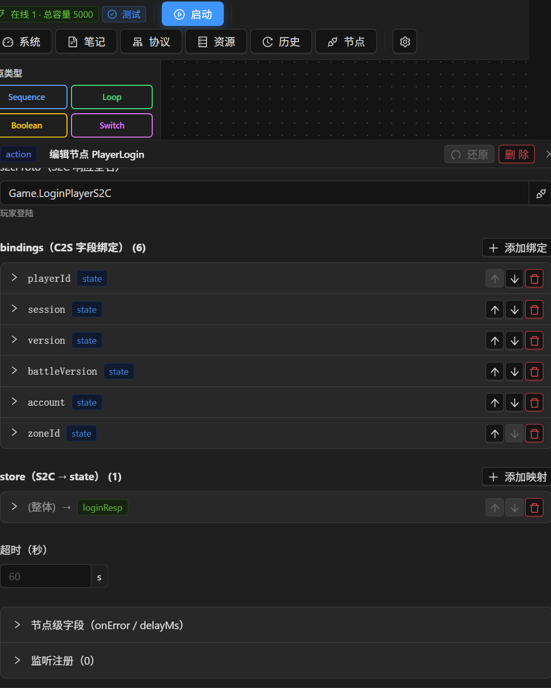

折叠区还有两块：

- `节点级字段（onError / delayMs）`：`strategy` 为 resume / skip / abort，`ignoreCodes`、`handler`、`maxRetries`、`retryDelayMs`，以及节点延迟「使用默认 / 自定义 / 禁用」。
- `监听注册`：给这个动作预挂 listenRefs。可以 `添加` 或 `批量粘贴 JSON`。

顶栏 `监听` 打开右侧 Listen 面板：`新建`、按名搜索、每条显示形态（silent / declarative / lua）和引用数。双击卡片或点编辑进入 Listen 编辑窗，三个页签可以来回切、同一会话内暂存。没被任何 action 引用的卡片带警告「未被任何 action 引用」。

`JSON` 打开只读预览，统计节点 / 动作 / 监听数量，可以复制或下载（这里下载不再做校验拦截；`文件` → `导出流程 JSON` 有错误会拒绝）。`校验` 的三页签见 17.3，每条都有 `跳转`。

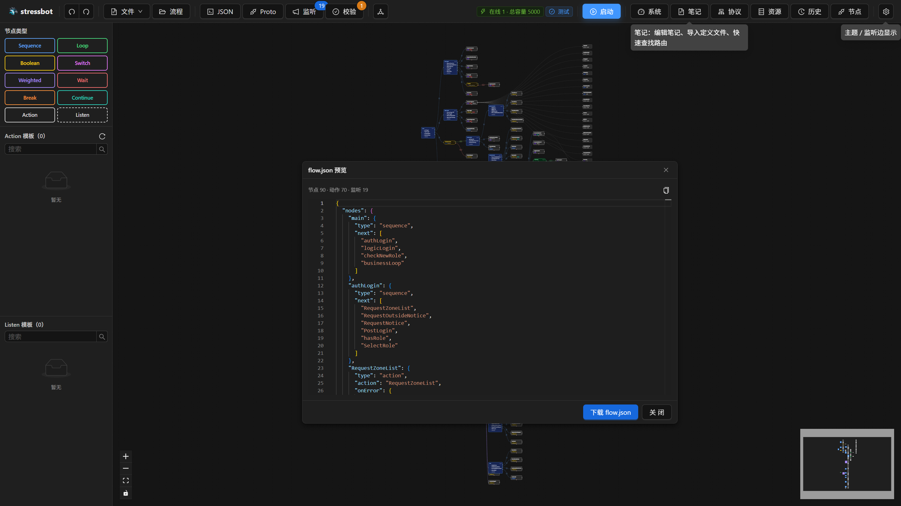

顶栏 `Proto` 打开消息浏览器，左侧按名字搜，右侧看字段。

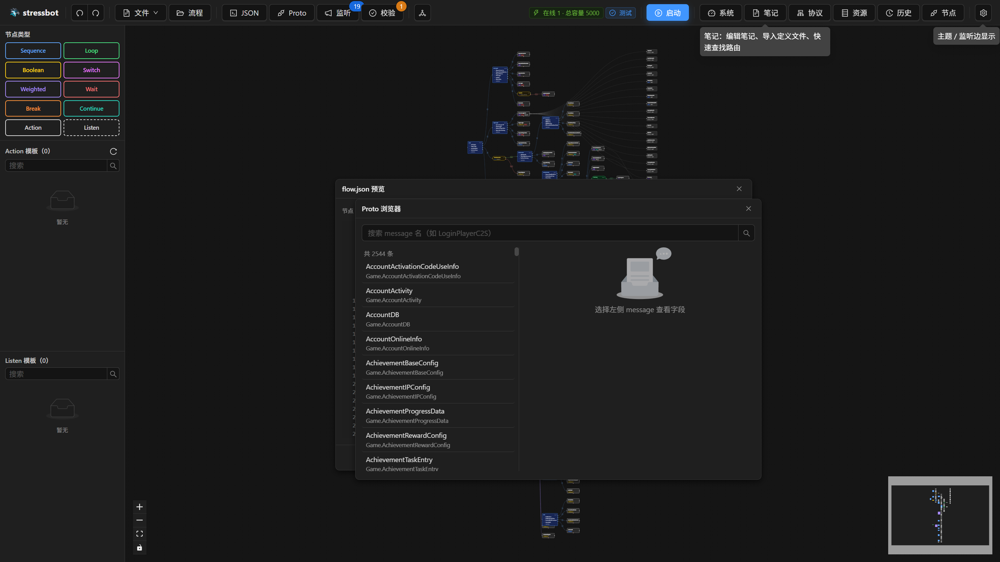

顶栏 `监听` 打开右侧 Listen 面板，基线流程会列出全部 listens。

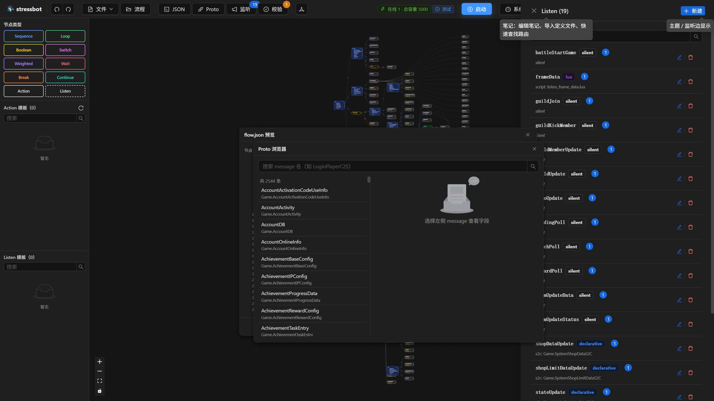

点某条的编辑图标打开 Listen 编辑窗：名称、加入模板库、silent / declarative / lua 三个页签，以及下方「监听注册」反查表。

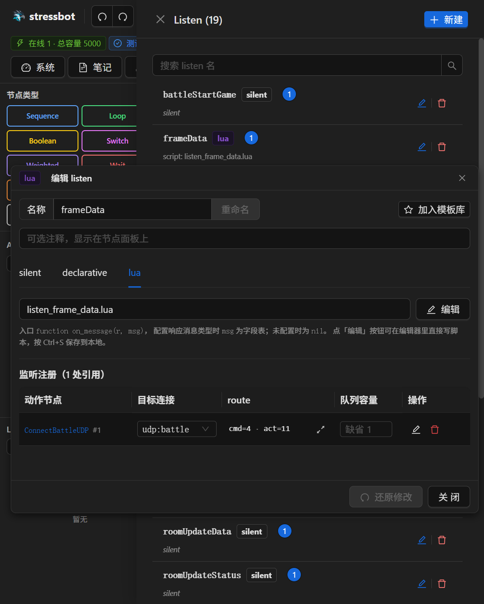

## 17.9 验收（复用第 6 章练习）

- [ ] 在第 6 章的挂机流程（或重新搭）上加一个 boolean 分支，校验通过
- [ ] 故意把 listenRef 名字写错，看校验报告的 错误页签 + 跳转定位
- [ ] 导出 JSON 与手写版对照，确认同一产物
- [ ] 会用流程库 `另存为新流程`，再 `打开` / `覆盖` / 删除各走一遍
- [ ] 把一个 Action 用 `加入模板库` 存上，从左侧拖回画布，右键删除该模板
- [ ] 在空白处用 F1 放下 Sequence，在节点上用 Del 删掉

## 延伸阅读

- 实现文档：[docs/visual-flow-editor.md](../docs/visual-flow-editor.md)；组件：`cmd/web/src/components/FlowEditor/`
- 下一章：[第 18 章 任务管理](ch18-task-management.md)
