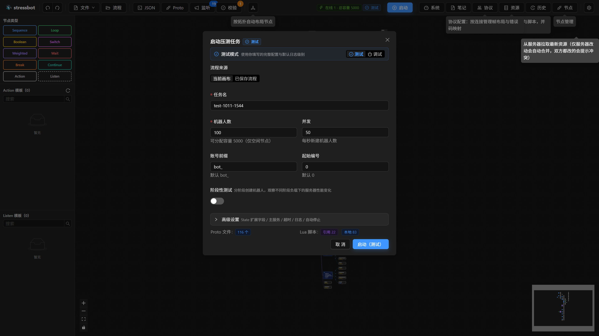
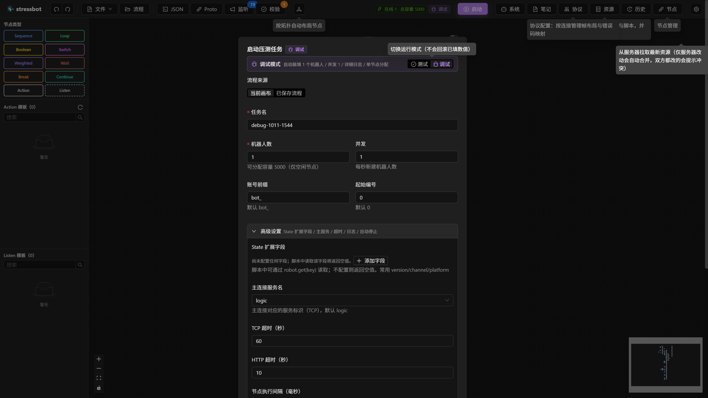
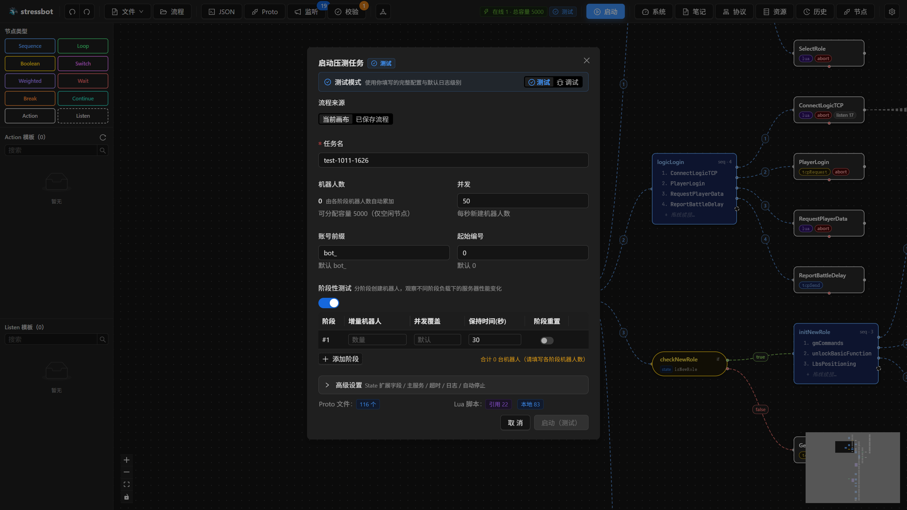
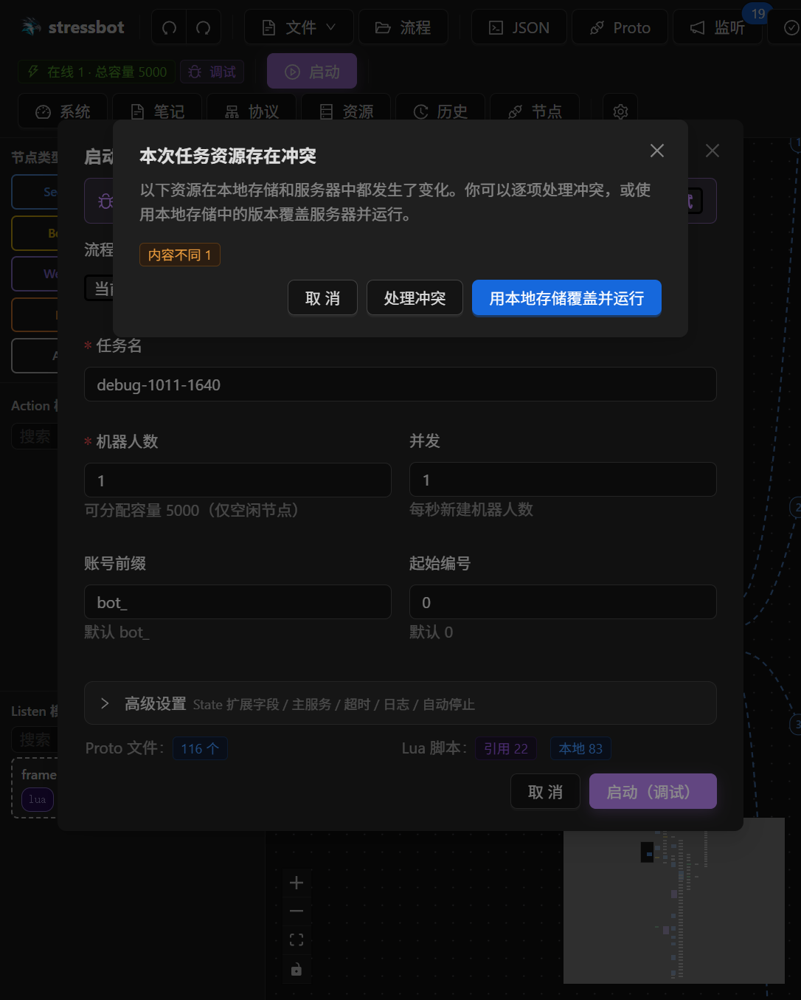

# 第 18 章 任务管理：从创建到停止

> **目标**：只靠界面完成一次完整任务：填表 → 启动 → 观察 → 停止，理解每个字段与界面上呈现的状态机。
>
> **前置**：第 14 章组网就绪、第 16 章资源齐备。入口：顶栏「启动」按钮。

## 18.1 启动弹窗全字段

弹窗「启动压测任务」，确认按钮随模式显示 `启动（调试）` / `启动（测试）`。

**模式区**（顶栏可切，不回滚已填数值）：

- `调试模式`：自动装填 1 个机器人 / 并发 1 / 详细日志 / 单节点分配——快速验证流程用；
- `测试模式`：使用你填写的完整配置与默认日志级别——正式压测用。

**基本区**：

| 字段 | 说明 |
|---|---|
| `流程来源` | `当前画布` / `已保存流程`（选流程库里的存稿） |
| `任务名` | 必填，placeholder `例：200v200 v1.2`；打开时自动生成 `debug-/test-MMDD-HHmm` |
| `机器人数` | 上限=可分配容量（仅空闲节点，输入框下方实时显示 `可分配容量 N`） |
| `并发` | 每秒新建机器人数（第 12 章的创建限速） |
| `账号前缀` / `起始编号` | 默认 `bot_` / 0 |
| `阶段性测试`（仅测试模式） | 渐进加压表格：`阶段 / 增量机器人 / 并发覆盖 / 保持时间(秒) / 阶段重置`；`添加阶段`加行，底部合计 `合计 N 台机器人`。各阶段之和自动约束（对应第 12 章 count 之和 = totalBots） |

**高级设置**（折叠面板：State 扩展字段 / 主服务 / 超时 / 日志 / 自动停止）：

| 字段 | 默认/说明 |
|---|---|
| `State 扩展字段` | 即 stateExtra；说明写着 `脚本中可通过 robot.get(key) 读取；不配置则返回空值。常用 version/channel/platform`。界面**没有**一键推荐标签，要点「添加字段」自己填。不同游戏字段集差别很大，不要把那三个常用名当成内置项 |
| `主连接服务名` | 默认 `logic`；当前值不在已配置 TCP 连接中会黄条提醒 |
| `TCP 超时（秒）` / `HTTP 超时（秒）` | 1~600 / 默认 10 |
| `节点执行间隔（毫秒）` | `留空或 0 = 默认 1000ms；-1 禁用节点间等待`；节点自己配了 delayMs 时以节点为准 |
| `Apdex 满意阈值（毫秒）` | RTT < T 满意、T~4T 容忍、≥4T 不满意；默认 100 |
| `节点日志等级` | 任务期临时切节点进程日志（debug 会打全量收发包，量大），**结束后自动恢复** |
| `自动停止时间（可选）` | 相当于 duration 的绝对时刻版 |

**资源自检区**（还在这个弹窗里，启动前自动跑）：

- Proto、Lua 各有一份清单。缺脚本时红条是 `缺少 N 个 lua 脚本，启动会失败`，并写明请到「资源管理」上传，或在动作里直接编辑。缺 proto 时红条是 `proto 依赖不完整，缺少 N 个文件，启动会失败`，并写明可以点「拉取」从基线补齐。
- 机器人数超过空闲容量时，说明是 `请减少机器人数，或增加空闲压测节点`。
- 没有在线节点时红条是 `没有在线的节点`，说明是 `请确认至少有一台节点程序已经成功注册`。这时确认按钮不可用。
- 流程里的脚本写了 `require("share")`（注释不算），而服务器没配 Redis 时，点启动会被拦：`该流程使用共享状态，但服务器未配置 Redis。请先在服务器配置中启用共享状态后再启动。`

## 18.2 点下启动之后的两层

确认按钮是 `启动（调试）` 或 `启动（测试）`。资源没有冲突就直接进入 18.3。本地和服务器都改过同一份资源时，先不要以为任务已经出去了，会再开一个弹窗。

第一层标题是「本次任务资源存在冲突」。正文：以下资源在本地存储和服务器中都发生了变化。你可以逐项处理冲突，或使用本地存储中的版本覆盖服务器并运行。橙标签 `内容不同 N`，红标签 `服务器未找到 N`。三个按钮：

| 按钮 | 结果 |
|---|---|
| `取消` | 回到启动弹窗，任务不发出 |
| `处理冲突` | 再开一层，标题「处理本次任务资源冲突」。逐项选择和操作与第 16 章 16.4 相同，只是这里的按钮写成 `使用本地存储版本` / `使用服务器版本`。`确认处理` 之后继续启动 |
| `用本地存储覆盖并运行` | 不逐项看，全部用本地版本覆盖服务器并启动 |

## 18.3 启动之后：界面上的状态机

提交后对应第 14 章的状态机，界面上可见的信号：

| 状态 | 界面表现 |
|---|---|
| starting | 顶栏进入监控态；底部监控面板自动展开 |
| running | 状态文案 `运行中`；`运行 {时长}`；渐进任务显示 `阶段 i/n`、`本阶段 x/y`、`累计 x/y`（第 12 章阶梯的界面呈现） |
| stopping | 顶栏「停止」确认弹窗所述：等待所有节点完成后转为已停止 |
| stopped / failed | 终报态：`返回编辑`（画布与最后一份监控数据保留）；清理异常显示 `部分清理`/`清理超时` 等 Tag |

**单例约束的界面呈现**：开屏撞上活跃任务是第 15 章那扇「集群已有任务在执行」。已经点了启动、服务器拒绝时是另一扇「已有任务在执行」——同一时刻全集群只能有一个活跃任务。

他人启动的任务同样可「监测」与「停止」（服务端允许任意客户端操作），按钮 tooltip 会注明任务归属。

点顶栏 `停止` 还会再确认一次，标题 `停止任务？`。说明是：任务将进入停止中状态，等待所有节点完成后转为已停止。这是运行态上的一层，不是启动弹窗里面的下一层。

## 18.4 运行中看什么（操作面，解读见第 19 章）

底部监控面板四张摘要卡（`任务 / 负载`、`吞吐 / 结果`、`耗时 / 连接`、`资源 / 节点`）+ 动作表（`按动作名搜索`、`主指标`/`总耗时` 列组切换、`隐藏推送`）。实时监控**没有**「导出 CSV」——那颗按钮只在第 20 章历史详情的动作表里。面板高度可拖动调整并记忆；`折叠监控` 收起为一条。

## 18.5 验收（【需组网环境】）

- [ ] 调试模式跑一次（1 个机器人）验证流程
- [ ] 故意让本地和服务器各改同一份脚本，点启动后分别走一遍 `处理冲突` 和 `用本地存储覆盖并运行`
- [ ] 测试模式带三阶段渐进跑一次，观察 `阶段 i/n` 推进
- [ ] 停止一次任务，在确认框里读完说明，再读出终报态的清理状态

## 延伸阅读

组件：`cmd/web/src/components/runtime/TaskStartModal.tsx` 等；下一章：[第 19 章 实时监控面板](ch19-monitor-dock.md)
