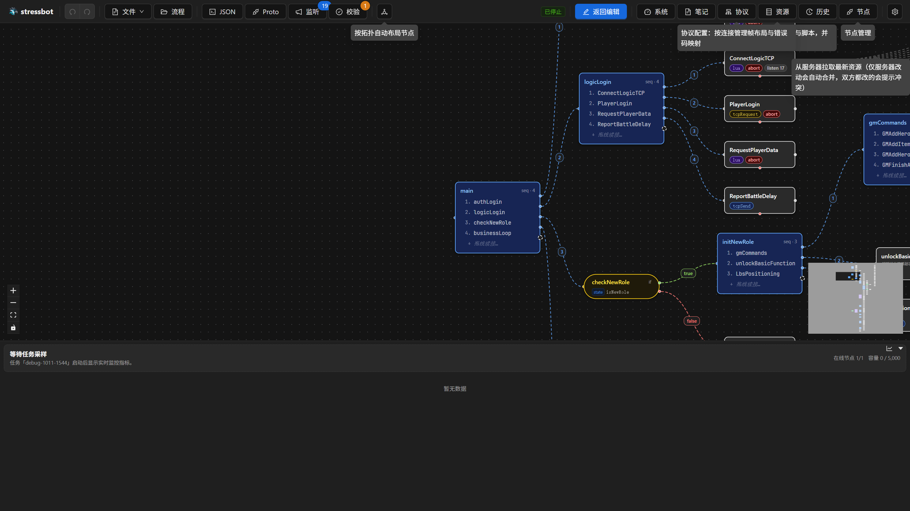
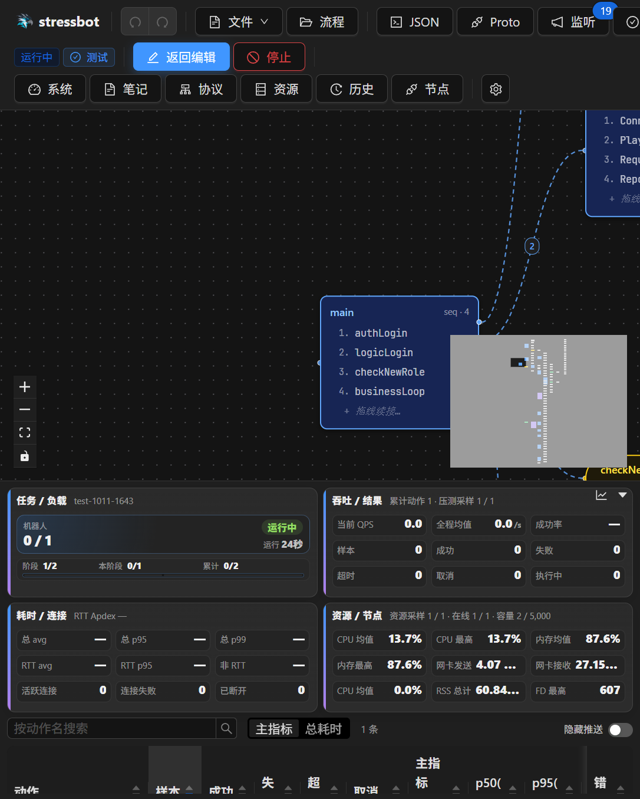
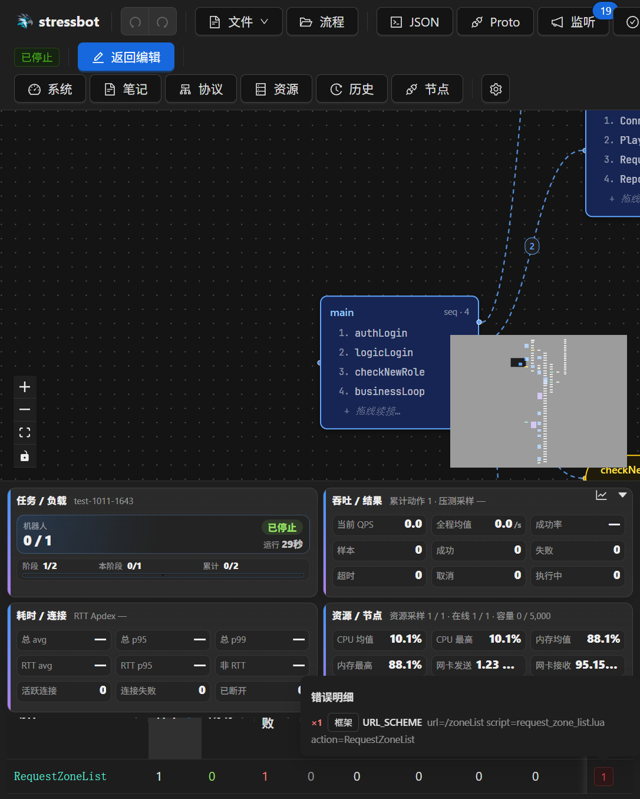

# 第 19 章 实时监控面板

> **目标**：压测进行时看得懂监控面板的每个区域与控件。本章讲**操作面**；指标*解读*与诊断是第 21 章。
>
> **前置**：[第 18 章](ch18-task-management.md)。面板即底部 MonitorDock：编辑模式隐藏，任务启动自动展开，回编辑自动折叠；高度可拖动调整并记忆。

## 19.1 四张摘要卡

| 卡 | 内容 |
|---|---|
| `任务 / 负载` | 机器人 `运行/启动`、任务状态（等待中/启动中/运行中/停止中/已停止/失败）、`运行 {时长}`、负载进度；渐进任务显示 `阶段 i/n`、`本阶段 x/y`、`累计 x/y` |

| `吞吐 / 结果` | 累计动作与采样数、`当前 QPS`、`全程均值`、`成功率`、`样本/成功/失败/超时/取消/执行中` |
| `耗时 / 连接` | RTT Apdex、`总 avg/总 p95/总 p99`、`RTT avg/RTT p95`、`非 RTT`、`活跃连接/连接失败/已断开` |
| `资源 / 节点` | 在线与容量、主机 CPU/内存/网卡、进程 CPU/RSS/FD（"系统"浮窗里有更全的节点级圆表） |

空态显示 `等待任务采样`。30 秒内找两个数：某动作 P99 与错误率 → 动作表；某节点 CPU → 资源卡或"系统"浮窗的 `在线 N · 异常 N · 离线 N` 摘要。

## 19.2 动作表（核心工作区）

工具栏：`按动作名搜索`；`主指标` / `总耗时` 列组切换（主指标=按动作类型选 RTT 或对应指标，总耗时=wallClock 诊断）；`隐藏推送` 开关（收起监听回调行，回调行带橙色 `推送` Tag）。实时监控没有「导出 CSV」；归档后到第 20 章详情的动作表里导出。

列（默认全开）：`动作 / 样本 / 成功 / 失败 / 超时 / 取消 / 主指标 avg / p50 / p95 / p99 / max`。任务把计时细节开得更细时，再追加 `非RTT / encode / decode / build / decode等待 / 分发等待 / parse-store`。流量列是 `↑发送(均)` / `↓接收(均)`，悬停分别是平均每次成功发送、接收的字节数。后面是 `并发 / QPS / Apdex`。Apdex 列表头的悬停写明：只对往返类打分，监听、发送、本地类看各自的主指标。

## 19.3 点开错误数

`错误` 列上的红色数字是这一层里唯一再点进去的地方。悬停或点开，标题是「错误明细」。每一行是次数、`框架` 或 `业务` 标签、错误码名字。码小于 100 标成框架，其余标成业务。有补充说明时跟在码后面。这里不跳转到别的页面，看完移开即可。

## 19.4 面板控制

折叠条 `展开监控` ↔ `折叠监控`；指标区可再单独收起（`展开指标区`/`收起指标区`）；顶缘拖条调高度。

## 19.5 验收

- [ ] 30 秒内找到某动作的 P99，并点开该行的错误数读到码和「框架 / 业务」
- [ ] 会切 `主指标` / `总耗时`、隐藏推送；知道 CSV 只在历史详情里导出
- [ ] 会单独收起指标区，再把整条监控折叠起来
- [ ] 渐进任务时能指出当前 `阶段 i/n` 与本阶段增量

## 延伸阅读

组件 `cmd/web/src/components/monitoring/`；指标口径：[docs/monitoring-system.md](../docs/monitoring-system.md)；下一章：[第 20 章 历史归档与对比](ch20-history.md)
