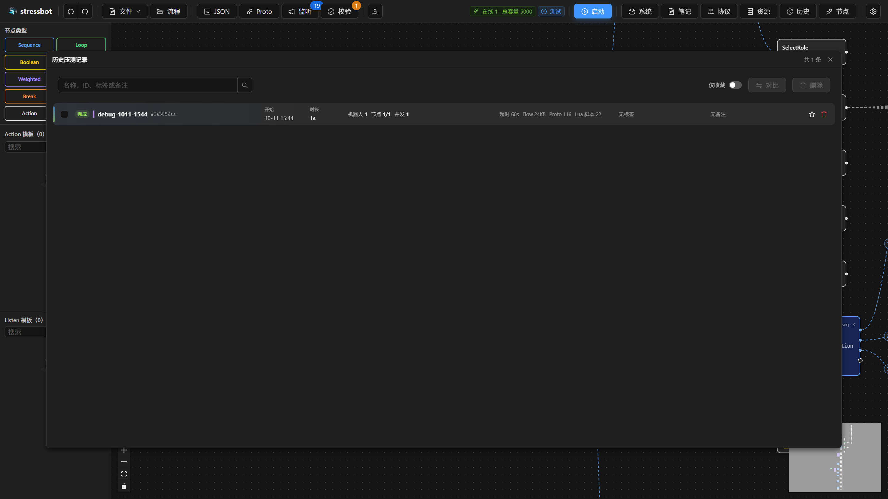
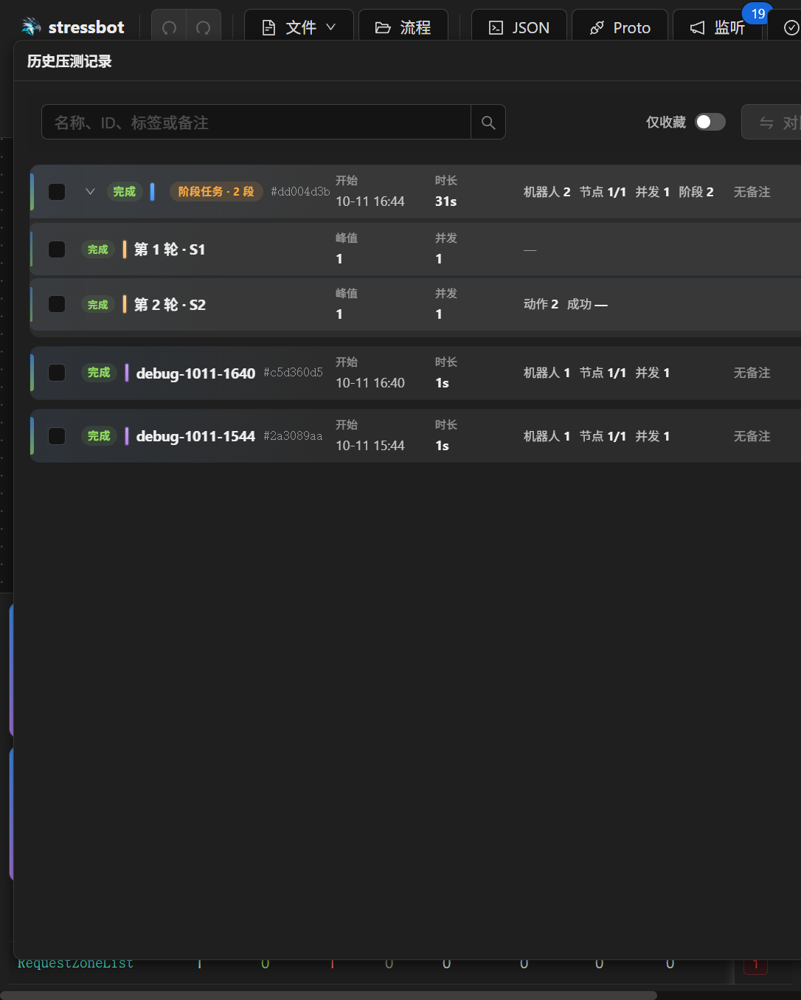
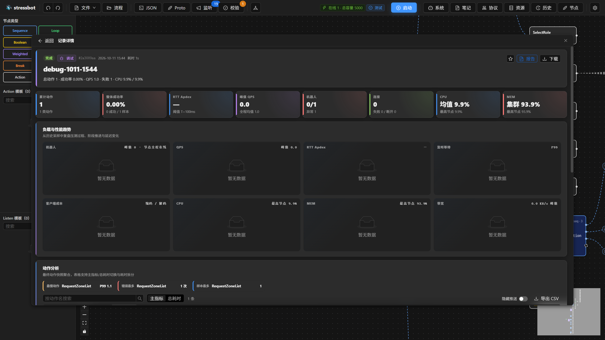
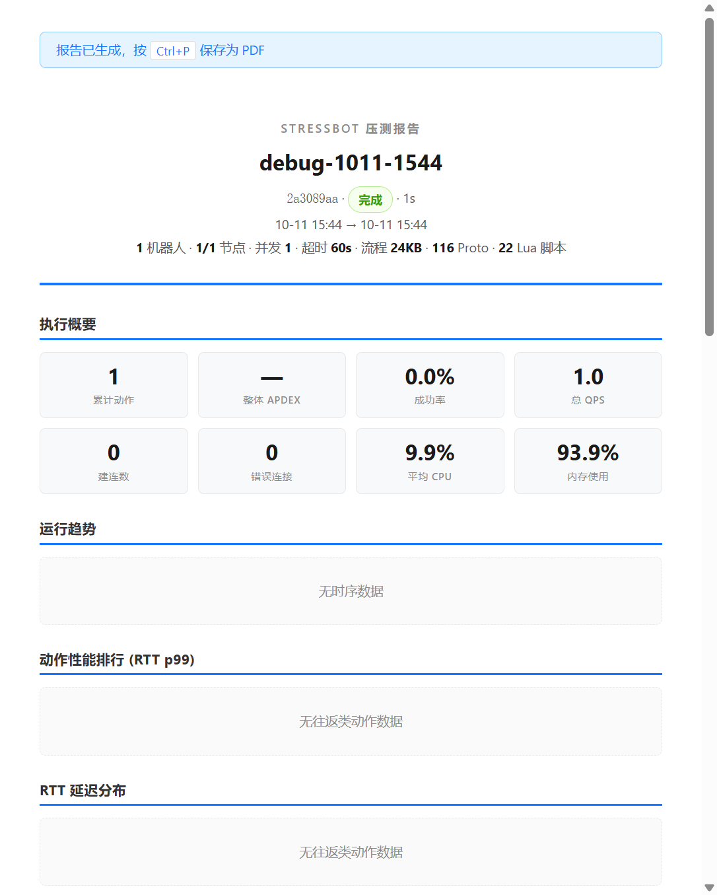
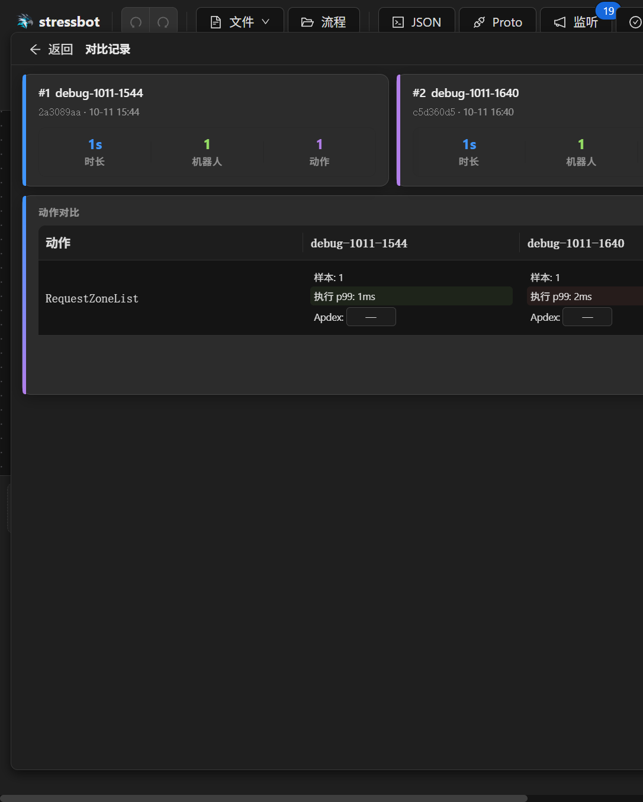

# 第 20 章 历史归档与对比

> **目标**：从顶栏「历史」走进去，把这一扇门里能点到的每一层走完：列表、记录详情、详情里再打开的报告、回到列表后的对比。
>
> **前置**：[第 14 章](ch14-cluster.md)。终态任务自动归档进 MySQL，默认保留 90 天，标星的不清理。顶栏「历史」在服务器没开归档时禁用，并提示检查服务器配置。

本章按点击顺序写。先把列表这一层的控件用完，再点进一条记录；详情里的「报告」是再下一层，看完关掉标签页回到详情；最后退回列表，勾选两条做对比。对比和详情是列表上的两条岔路，都要走到。

## 20.1 第一层：历史压测记录

浮窗标题是「历史压测记录」，有记录时标题栏右侧是 `共 N 条`。超过 20 条出现分页。一张都没有时是 `暂无压测归档，完成任务后将出现在此处`。

工具条从左到右：

| 控件 | 行为 |
|---|---|
| 搜索框，占位 `名称、ID、标签或备注` | 回车或点搜索才提交；清空搜索框会立刻取消筛选 |
| `仅收藏` | 打开后只留星标记录，并回到第 1 页 |
| `对比 (N)` | 勾选少于 2 条或多于 5 条时禁用；在范围内进入 20.4 |
| `删除 (N)` | 一条都没选时禁用。N 按所属任务计，不按阶段条数计 |

列表是卡片，不是表。一张卡片上能点的是：整卡进入详情（20.2）、左侧勾选、星标（`收藏` / `取消收藏`）、`删除`。悬停还能看到调试或测试模式、任务名、`记录 ID`。没有备注时显示 `无备注`。

渐进加压的任务收成一组，组标题带阶段段数。组可以展开。展开后每一段能单独点进该段的详情、单独收藏；删除整组会删掉所属的完整任务和全部阶段。已收藏的记录删除时确认按钮变成 `强制删除`。阶段不能单独删除：对某一段点删除，提示将删除所属完整任务。

点卡片主体进入「记录详情」。点星标、勾选、删除不会进入详情。

## 20.2 第二层：记录详情

标题栏左侧出现 `返回`，回到列表。

这一层自己的操作在页头：

| 按钮 | 悬停或文案 | 结果 |
|---|---|---|
| 星标 | 整条记录是 `收藏` / `取消收藏`；从某一阶段进来时是 `收藏本段` / `取消收藏本段` | 只改收藏，不离开详情 |
| `报告` | `生成压测报告（在新标签页打开，可保存为 PDF）` | 再开一层，见 20.3 |
| `下载` | `下载完整任务配置归档 JSON（含全部阶段）` | 下载该任务的 flow、proto、lua 和机器人配置。多阶段任务的归档含全部阶段 |

往下是只读内容，按出现顺序：

1. 指标：累计动作、整体成功率、RTT Apdex（带阈值 T）、峰值 QPS、机器人、连接、CPU、MEM。
2. `负载与性能趋势`：机器人、QPS、RTT Apdex、监听等待、客户端成本、CPU、MEM、带宽。采样大约 10 秒一次。
3. `动作分析`：和实时监控同一张动作表的归档口径，可在主指标和总耗时之间切换。这里多一颗「导出 CSV」，下载 `action-metrics-*.csv`。实时监控面板没有这颗按钮。
4. `错误与稳定性`。
5. `节点健康`：各节点的结果、完成时间、清理状态，以及事件时间线。
6. `备注与标签`：输入标签后回车添加，拖动标签改变它们在历史列表里的显示顺序。备注框占位是 `备注（任意文本，对比时可见）`。改完要点 `保存`。
7. `配置档案`：机器人、并发、超时、节点间隔、流程和资源计数，以及渐进加压的时间线。对比两条记录的配置差异，就看这里。

## 20.3 第三层：压测报告

在详情里点 `报告`，浏览器新开一个标签页，详情浮窗还在。先显示「正在生成压测报告，请稍候...」，生成失败会 toast。成功后页顶提示「报告已生成，按 Ctrl+P 保存为 PDF」，封面是「stressbot 压测报告」。往下按顺序是：执行概要、运行趋势、动作性能排行（RTT p99）、RTT 延迟分布、成功/失败构成、Apdex 分布、错误分析（有错误时）、集群状态、节点结果、动作详情表。看完关掉标签页，回到仍开着的记录详情，再点 `返回` 回列表。

## 20.4 回到列表之后：对比

在列表勾选 2 到 5 条，点 `对比 (N)`。标题变成「对比记录」，左侧同样有 `返回`。

每条任务一张摘要卡（时长、机器人、动作）。`动作对比` 表按动作名对齐，每个任务一列，列里是样本数、p99、Apdex 三行，同一行里的最好和最差会高亮。

用法：只改一个参数（节点间隔或机器人规模）跑两次，在对比表里看出哪一次更好，再分别打开两条记录的 `配置档案` 核对差在哪一项。对比页本身不编辑备注；备注是在详情里写的，写过才会出现在对比里。

## 20.5 验收

- [ ] 从列表点进一条详情，下载配置归档，再点 `报告` 在新标签页看到排行和延迟分布，然后 `返回` 列表
- [ ] 给一条记录加标签、写备注并 `保存`，再收藏；删除时看到 `强制删除`
- [ ] 勾选两次压测做对比，指出 p99 更好的一次，并在两边的配置档案里找到差异项

## 延伸阅读

组件 `cmd/web/src/components/modules/history/`；下一章：[第 21 章 观测与排障](ch21-observability.md)
